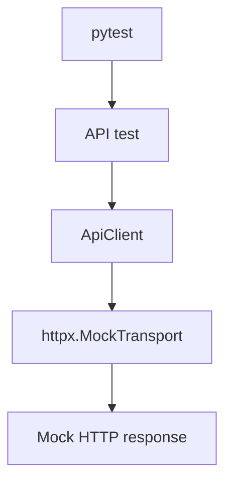
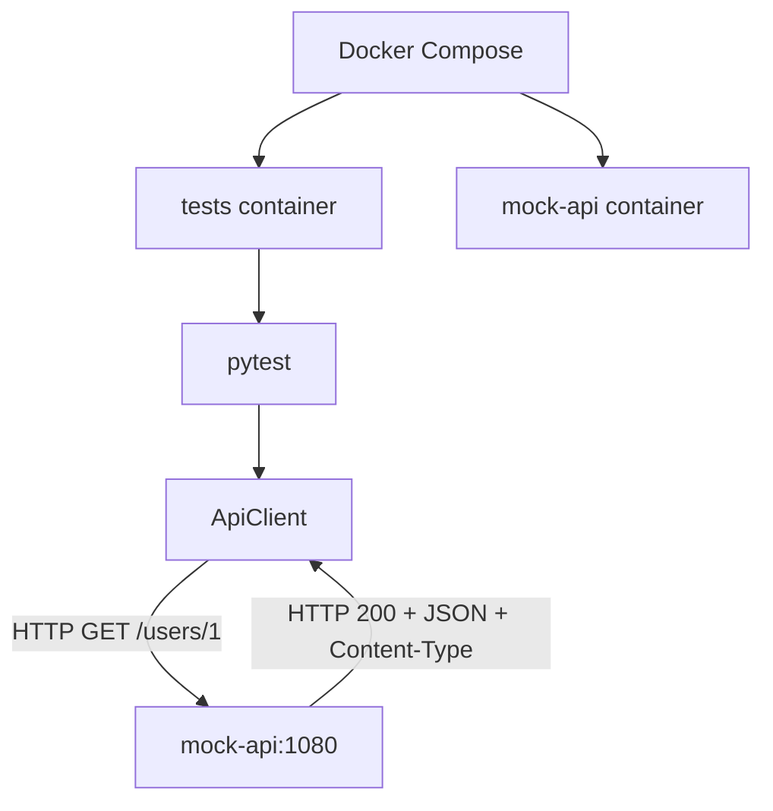

# hp-qa-junior-prep

[RU](README.md) · **EN** · [PL](README.pl.md)

Junior QA Automation training repo (Python): `lab_fw` pytest framework, API (httpx), UI (Playwright / Selenium), mocks, Allure, Docker, Docker Compose, GitHub Actions.

## Quick start (local)

```bash
python -m venv .venv
source .venv/Scripts/activate   # Windows Git Bash
# .venv\Scripts\activate       # Windows cmd/PowerShell

pip install -e ".[dev]"
pytest -m "not ui and not selenium and not compose" -q -n auto
```

UI tests (browser required):

```bash
playwright install chromium
pytest -m ui -q
pytest -m selenium -q
```

## Layout

| Path | Purpose |
|------|---------|
| `src/lab_fw/` | framework (api, ui, config, reporting, pytest plugin) |
| `tests/` | pytest suite |
| `Dockerfile` | multi-stage: `local` (Avast CA) / `ci` / `playwright` |
| `docker-compose.yml` | `mock-api` + `tests`; profiles `selenium`, `playwright` |
| `.github/workflows/tests.yml` | unit/API on the runner (no UI/compose) |
| `.github/workflows/ci.yml` | Compose: API → Selenium Grid → Playwright in Docker |

## Environment variables

| Env | Purpose |
|-----|---------|
| `LAB_FW_BASE_URL` | API base URL (default `https://example.com`) |
| `LAB_FW_UI_BASE_URL` | UI base URL (default the-internet.herokuapp.com) |
| `LAB_FW_API_TOKEN` | optional Bearer token |
| `LAB_FW_TIMEOUT_S` / `LAB_FW_UI_TIMEOUT_S` | timeouts |
| `LAB_FW_LOG_LEVEL` | log level |
| `SELENIUM_REMOTE_URL` | Selenium Grid URL for `webdriver.Remote`; unset → local Chrome |
| `DOCKER_TARGET` | Compose build target: `ci` (default) or `local` (Avast CA) |

CI secret: GitHub → Settings → Secrets → `LAB_FW_API_TOKEN`.

## Pytest markers

| Marker | Meaning |
|--------|---------|
| `smoke` / `api` / … | normal fast tests |
| `ui` | real Playwright |
| `selenium` | real Selenium |
| `compose` | needs Compose `mock-api` service |
| `parallel_lab` | M1 exercises (xdist, files, lock) |
| `distributed_lab` | L2/L3 exercises |
| `serial` | shared state (module-scoped UI/Selenium); do not run under `-n` |

## Docker

### Images (`Dockerfile`)

- **`ci`** — for GitHub / Linux without corporate MITM
- **`local`** — copies `avast-root.crt` (local file, not committed)
- **`playwright`** — Microsoft Playwright base image with Chromium (Compose profile `playwright`)

`Dockerfile.local` and `avast-root.crt` are in `.gitignore`.

```bash
docker build --target ci -t hp-qa-junior-prep:ci .
docker run --rm -e LAB_FW_API_TOKEN=ci-demo-token hp-qa-junior-prep:ci

docker build --target local -t hp-qa-junior-prep:local .
docker run --rm -e LAB_FW_API_TOKEN=ci-demo-token hp-qa-junior-prep:local
```

Image CMD: `pytest -m "not ui and not selenium"` — **includes** `compose` tests when `mock-api` is available.

### Docker Compose

**Default run (API, compose, parallel_lab — no UI):**

```bash
docker compose up --build --abort-on-container-exit tests
docker compose down

DOCKER_TARGET=local docker compose up --build --abort-on-container-exit tests
```

**Profile `selenium`** — Grid + tests in the `ci` image:

```bash
docker compose --profile selenium run --build --rm selenium-tests
docker compose --profile selenium run --build --rm selenium-tests-serial
docker compose --profile selenium down
```

- `selenium` — `selenium/standalone-chrome`, ports `4444` (WebDriver), `7900` (noVNC)
- `selenium-tests*` sets `SELENIUM_REMOTE_URL=http://selenium:4444`

**Profile `playwright`** — Playwright UI in the `playwright` image:

```bash
docker compose --profile playwright run --build --rm playwright-tests
docker compose --profile playwright run --build --rm playwright-tests-serial
```

Default services (no profile): `mock-api` (`:1080`) + `tests` (`${DOCKER_TARGET:-ci}`, Dockerfile CMD).

`LAB_FW_BASE_URL` is **not** set globally in compose (older tests expect `example.com` / MockTransport). Compose tests call `http://mock-api:1080` explicitly.

## GitHub Actions

| Workflow | What it does |
|----------|----------------|
| **tests** | `pip install` + `pytest -m "not ui and not selenium and not compose"` + Allure artifact |
| **CI** | steps: `tests` → `down` → Selenium (parallel + serial) → `down` → Playwright (parallel + serial); `DOCKER_TARGET=ci` |

| Where | mock-api? | Compose tests |
|-------|-----------|---------------|
| **CI** / local compose | yes | run |
| **tests** workflow | no | excluded (`not compose`) |

## API interaction diagram (lab I1)

The project has two API test modes: in-process `httpx.MockTransport`, and integration with a MockServer service via Docker Compose. Real cloud/API is **not** called in these runs — the mock stands in for its HTTP contract (status, JSON, headers).

### Mode 1. Regular tests



`httpx.MockTransport` runs inside the Python process: exercise the HTTP client without a separate server or a real network call to an API.

The **tests** workflow excludes the `compose` marker — those services are not started there.

### Mode 2. Docker Compose / CI



Tests run in the `tests` container; MockServer runs in `mock-api`. They talk on the Compose network at `http://mock-api:1080`.

The **CI** workflow starts Compose with `DOCKER_TARGET=ci` so integration tests can reach MockServer.

### Why both levels

- **MockTransport** — fast isolation: responses, errors, client-side contract checks; easier to pin bugs in `ApiClient` logic.
- **MockServer** — real HTTP between containers and integration-environment wiring.

Both reduce dependence on a live external API.

### Mocking strategy (lab I2)

| | `httpx.MockTransport` | MockServer |
|--|------------------------|------------|
| Where | inside the Python process | separate service (`mock-api`) |
| Network | not required | real HTTP on the Docker network |
| Goal | unit/API client tests | container-to-container integration |
| Examples | `tests/mocks_lab/` | `tests/test_compose_api.py` |

Compose contract in `test_mock_api_users`:

1. fixture `reset_mockserver` — `PUT /mockserver/reset` before and after the test (state isolation);
2. `PUT /mockserver/expectation` → **201** (rule accepted);
3. `ApiClient.get` → **200**, JSON body, `Content-Type` contains `application/json`;
4. `PUT /mockserver/verify` → **202** (request actually matched the expectation).

The `compose` marker does not start infrastructure — check the run command:

- **tests** workflow: `pytest -m "not ui and not selenium and not compose"` (no MockServer);
- **Dockerfile CMD**: `not ui and not selenium` (no `not compose`) — under Compose, `mock-api` is present so integration tests run;
- targeted: `pytest -m compose` inside the `tests` service.

`LAB_FW_BASE_URL` is not set globally in Compose: compose tests pass `base_url="http://mock-api:1080"` explicitly via `Settings`.

### Negative integration scenarios (lab I3)

In `tests/test_compose_api.py` (`compose` marker, same `reset_mockserver`):

| Test | MockServer | What we assert |
|------|------------|----------------|
| `test_mock_api_auth_fail` | `GET /protected` → **401** + JSON `error` | client sees status/body/Content-Type without a real IdP |
| `test_mock_api_timeout` | `GET /slow` with 1000 ms `delay`, `timeout_s=0.2` | `ApiError`; `__cause__` is `ReadTimeout` ⊂ `TimeoutException` ⊂ `HTTPError`; then `/mockserver/verify` → **202** |

Client policy: on 4xx/5xx, `get`/`post` **return** `Response` (optional `ensure_success` → `HttpStatusError`). Transport failures (timeout, etc.) always surface as `ApiError`.

### Test failure troubleshooting (lab I4)

| Symptom | Where to look | What to check |
|---|---|---|
| A local test failed | `pytest` terminal output | Test name, traceback, assertion and actual result |
| Framework logs are needed | `lab_fw` logs; `LAB_FW_LOG_LEVEL` setting | Log level and API client messages |
| HTTP request/response details are needed | Allure report / attachments | `response` and `status_error` attachments, if generated |
| A Compose test failed | `docker compose logs tests` | Pytest output, traceback, configuration and container environment |
| MockServer interaction failed | `docker compose logs mock-api` | Whether the request arrived, whether the expectation was registered and which response was returned |
| GitHub Actions failed | Actions → workflow → job → failed step | For `tests`, inspect the pytest step and `allure-results` artifact; for `CI`, inspect `Run Docker Compose` |
| MockServer expectation registration failed | Registration output and `mock-api` logs | Registration HTTP status (usually `201`) and response body |
| MockServer verification failed | `/mockserver/verify` output and `mock-api` logs | Verification HTTP status (expected `202`) and response body |

**Common symptoms**

- **HTTP 4xx/5xx:** `get()` / `post()` return a `Response`. Check the status, response body and authentication. `ensure_success()` raises `HttpStatusError` for an unsuccessful status.
- **Timeout / `ApiError`:** Check the timeout, endpoint availability and exception chain (`__cause__`). The client wraps transport errors in `ApiError`.
- **Expectation not registered:** Check the MockServer registration response and logs.
- **`/mockserver/verify` did not return `202`:** Check whether the actual request matches the registered expectation and whether it was sent.

**Environment variables and markers**

- `LAB_FW_API_TOKEN` — verify that the token is present and correct.
- `http://mock-api:1080` — MockServer address from the `tests` container; use the Compose service name `mock-api`.
- `LAB_FW_BASE_URL` — avoid setting it globally for Compose unless necessary; regular tests use their own configuration.
- `@pytest.mark.compose` — marker for integration tests that require MockServer.
- On the Avast-protected laptop, use `DOCKER_TARGET=local` when the corresponding certificate is required.

**Quick workflow:** test fails → read the traceback → determine whether it is an HTTP response or a transport error → for Compose failures, inspect `tests`, then `mock-api` → in CI, open the failed step and download the available artifact.

## Distributed systems: theory and terms (lab L1)

Mid-level glossary. Where useful — links to `lab_fw` (retry, timeout, `ApiError`, Compose/CI).

### 1. Async communication

The sender does not have to wait for the whole operation to finish before continuing; the result may arrive later. Async is **not** the same as a queue — a queue is only one mechanism.

**QA:** delays, no immediate response, duplicate events, background processing failures.

**Example:** API returns `202 Accepted` (job accepted); the order appears later — assert both `202` and the later state.

### 2. Queue / event / message broker

| Term | Meaning | QA |
|------|---------|-----|
| **Queue** | messages waiting to be processed | no loss, correct handling, no bad side effects on retry |
| **Event** | something that happened (e.g. `OrderCreated`) | fires under the right conditions with correct data |
| **Message broker** | routes messages between services (RabbitMQ, Kafka) | delivery, routing, errors, redelivery |

### 3. Retry vs timeout

- **Retry** — do we try again after a transient failure (attempt limit; do not blindly retry e.g. a typical `404`).
- **Timeout** — how long we are willing to wait (connect / read / overall deadline).

Timeout may trigger retry, but they are different mechanisms. After a client timeout you **do not know** whether the server completed the work — blind retry is unsafe without idempotency.

In `lab_fw`: retry policy; after attempts are exhausted — expected `ApiError`.

### 4. Timeout

Max wait for connection, response data, or the whole operation (including delays between retries). Three 5s attempts with pauses is not “only 5s total”.

**QA:** hung calls do not block forever; wait failures are predictable (`ApiError` + `__cause__` such as `TimeoutException`).

### 5. Idempotency

Repeating an operation does not create an **extra effect** beyond doing it once. Responses need not be identical JSON (metadata may differ).

An **Idempotency-Key** helps the server recognise the same logical operation. GET/PUT/DELETE are typically idempotent by HTTP semantics; POST usually is not (depends on the API).

**Example:** retrying payment creation with the same key must not create a second payment.

### 6. Eventual consistency

Components may briefly diverge; with no new writes they converge. **QA:** do not fail every short lag; catch cases that never converge in time. Prefer **polling with a deadline**, not a blind `sleep`.

### 7. Logs vs metrics vs traces

| | Question | Example |
|--|----------|---------|
| **Logs** | what happened? | `ApiError: HTTP 500` + method/URL/time |
| **Metrics** | how often / how well? | error rate, latency p95, retry count |
| **Traces** | where in the service chain? | gateway 20 ms → orders 50 ms → payments 2 s |

### 8. Correlation / Request / Trace ID

IDs that tie records for one request or business flow. Request ID often maps to one HTTP call; Correlation ID spans related steps; Trace ID spans distributed tracing. On retry, policy may mint a new Request ID while keeping Correlation/Trace ID.

### 9. Env vs build (“locally green ≠ CI”)

- **Env** — URLs, tokens, timeouts, run mode.
- **Build** — code, dependencies, Docker image.

Local green does not prove CI green. Control: Python/dependency versions, secrets/env, image contents, mocks/external services, the pytest command in the workflow. In this repo Compose aligns services; CI checks reproducibility.

## Lab L2: queue, retry, timeout, deadline, idempotency

Hands-on follow-up to the [L1](#distributed-systems-theory-and-terms-lab-l1) glossary: in-memory queue → worker → HTTP via `lab_fw`’s `ApiClient`, with retry policy and time limits.

**Code:** `src/distributed_lab/queue_worker.py`  
**Tests:** `tests/distributed_lab/` (marker `@pytest.mark.distributed_lab`)

### Components

| Component | Role |
|-----------|------|
| `Job` | Task: `method`, `path`, optional `timeout`, `deadline_s`, `payload`, `headers`, `idempotency_key` |
| `parse_job` | Validate dict → `Job`; schema failures → `SchemaError` |
| `InMemoryQueue` | FIFO on `deque`; `put` accepts only `Job` |
| `Worker` | `run_once()` — one job; `execute()` — one HTTP call |

The worker builds client kwargs: `json` from `payload`, a copy of `headers`, and when `idempotency_key` is set it adds the `Idempotency-Key` header without mutating the job model.

### Retry and HTTP method

`run_once` uses `retry_call` (up to 3 attempts) and `lab_fw.api.retry_policy.should_retry`:

- **GET:** retry on `429` / `503` and transport errors (`ConnectError`, `ReadTimeout`, …);
- **POST:** **no** retry (even on `429`/`503` or timeout) — avoids double side effects without server-side idempotency.

After retries are exhausted or on non-retryable status — `ApiError` / `HttpStatusError` (via `ensure_success`).

### Timeout vs deadline

| Mechanism | Where | Meaning |
|-----------|--------|---------|
| **Timeout** | `Settings.timeout_s`, `Job.timeout` | Max wait for a single HTTP call (connect/read) |
| **Job deadline** | `Job.deadline_s` | Overall budget for the job (including retries); expiry → `JobDeadlineExceeded` |
| **Worker deadline** | `Worker(..., deadline_w=...)` | Budget for the worker session; expiry → `WorkerDeadlineExceeded` |

Per-request timeout is the **minimum** of job timeout, remaining job deadline, and remaining worker deadline. After `ApiError`, the worker re-checks deadlines — the final error may be a deadline, not the last HTTP failure.

### Idempotency (teaching HTTP server)

In `tests/distributed_lab/test_timeout.py`, `WorkerTestHandler`: a repeated POST with the same `Idempotency-Key` does **not** append a second entry to `received_requests` but returns the first request’s data. Tests cover:

- JSON and headers (including `X-Request-ID`) on real HTTP;
- no `Idempotency-Key` when the field is unset;
- POST on timeout — single attempt, key on the wire;
- two jobs, same key — `server.calls == 2`, `len(received_requests) == 1`;
- GET retry (503→200) — the same `Idempotency-Key` on every attempt.

### How to run

```bash
# all L2 lab tests
pytest -m distributed_lab -q

# queue/worker only (no slow HTTP server)
pytest tests/distributed_lab/test_queue_worker.py -q

# timeout, deadline, idempotency with local HTTP server
pytest tests/distributed_lab/test_timeout.py -q
```

Docker / MockServer are **not** required for L2 — venv and `pip install -e .` are enough.

### When a test fails

1. Traceback: `JobDeadlineExceeded` / `WorkerDeadlineExceeded` vs `ApiError` and `__cause__` (`ReadTimeout`, `ConnectError`, …).
2. Attempt counters in MockTransport or `server.request_counts` / `received_requests` in slow-server tests.
3. Job method: POST must not produce three attempts under the default retry policy.

## Lab L3: failure investigation checklist

Systematic diagnosis across five areas: **Env → Build → Logs → Metrics → Trace**. Hands-on: **retry** behaviour, logs via `caplog`, and manual **investigation counters**.

**Tests:** `tests/distributed_lab/test_l3_investigation.py` (marker `@pytest.mark.distributed_lab`)

**Related labs:** [I4 — where to look when pytest fails](#test-failure-troubleshooting-lab-i4) (map of places); [L2](#lab-l2-queue-retry-timeout-deadline-idempotency) (queue, worker, retry, deadline); L3 is the **investigation route** plus retry/log practice.

### 1. Env — environment variables

Local check (example):

```bash
python -c "import os; print('LAB_FW_API_TOKEN:', 'SET' if os.getenv('LAB_FW_API_TOKEN') else 'MISSING'); print('LAB_FW_BASE_URL:', os.getenv('LAB_FW_BASE_URL', '<unset>')); print('LAB_FW_LOG_LEVEL:', os.getenv('LAB_FW_LOG_LEVEL', '<unset>'))"
```

If variables are unset, `get_settings()` applies defaults: `base_url=https://example.com`, `timeout_s=5.0`, `log_level=INFO`, `api_token=None`.

**Local vs CI:** the GitHub Actions **tests** workflow sets `LAB_FW_API_TOKEN` from Secrets and asserts it is non-empty. Missing token locally during L3 is fine with MockTransport; CI uses a different env — a typical **local ≠ CI** case.

### 2. Build — project state

| Check | Why |
|-------|-----|
| `git rev-parse --short HEAD` | same commit as CI for reproducibility |
| `python -m pip show lab-fw` | package version, editable install |
| `git status` | uncommitted changes vs clean build |

### 3. Logs — retry lab

`httpx.MockTransport` + `Worker` + `ApiClient`. Two scenarios:

| Scenario | Behaviour | Assertions |
|----------|-----------|------------|
| Successful retry | 503, 503, 200 | 3 attempts; 2× `WARNING` from `lab_fw.core.retry`; body `{"ok": true}` |
| Exhausted | 503 × 3 | 3 attempts; 2× `WARNING`; `HttpStatusError`; status/method/path |

Logs: `INFO` from `lab_fw.api`; `WARNING` from `lab_fw.core.retry` before the next attempt. The final failure does not require a third WARNING.

### 4. Metrics — investigation counters

No built-in Prometheus-style metrics in this repo. For “all 503” scenarios, record **manual counters from the test**:

- `http_requests = 3`
- `503_count = 3`
- `retries_after_first = 2`

These are not production metrics (no live error rate / p95). Code search: `grep -RniE "prometheus|metrics|histogram|counter|p95" src tests pyproject.toml`.

### 5. Trace — correlation

Search IDs: `grep -RniE "X-Request-ID|Correlation-ID|request_id" src tests`. L2 tests assert `X-Request-ID: req-123`. That is **wire-level** correlation, not full distributed tracing (no auto Trace ID / cross-service spans).

### I4 vs L3 vs L2 (oral anchor)

| Stage | Question |
|-------|----------|
| **I4** | Where to look? (pytest, Compose, mock-api, CI) |
| **L3** | In what order? (Env → Build → Logs → Metrics → Trace) |
| **L2** | Queue, worker, deadline, idempotency (separate lab) |
| **L3 retry lab** | Practice: retry + `caplog` + investigation counters |

*I4 — map of places; L3 — investigation route; L2/L3 tests — retry and logs in practice.*

### How to run

```bash
pytest tests/distributed_lab/test_l3_investigation.py -v
```

### L3 limitations

`MockTransport` — no real network or Docker/MockServer. Automatic metrics and end-to-end tracing platforms are out of scope for L3.

## Lab M1 — Parallel execution and resource isolation

### Goal

Understand how parallel pytest runs via `pytest-xdist` affect shared resources and learn how to prevent conflicts between tests.

### Isolation strategies

| Shared resource | Strategy | Setup |
|---|---|---|
| MockServer in Docker Compose | Run conflicting tests on one worker | `@pytest.mark.xdist_group(name="mockserver")` is applied in `tests/conftest.py` to tests marked `compose`; run with `--dist loadgroup` |
| One local browser without Grid | Serialize conflicting tests | Same group + `--dist loadgroup` |
| Shared report file | Separate file per worker | `worker_id` in the filename or `tmp_path` |
| Resource created per test | Create and tear down per test | Pytest fixture with proper teardown |

A plain `threading.Lock` is not enough to synchronize a shared file across processes: xdist workers are separate processes. If a shared file is truly required, use an inter-process lock. For test artifacts, separate files are usually simpler.

### Compose and MockServer

Compose tests share one MockServer instance. If several tests change expectations or reset state at the same time, they can interfere with each other.

In `tests/conftest.py`, the `pytest_collection_modifyitems` hook assigns `@pytest.mark.xdist_group(name="mockserver")` to every test marked `compose`.

#### Why `tryfirst=True` matters

With `--dist loadgroup`, xdist groups tests by the `xdist_group` marker.

During collection, the `pytest_collection_modifyitems` hook in `tests/conftest.py` adds `xdist_group(name="mockserver")` to tests marked `compose`. For grouping to work, that marker must be present before xdist’s collection logic builds the schedule.

On the worker, xdist uses `xdist_group` to append a suffix to `nodeid`, e.g. `@mockserver`. If the marker is missing in time, the controller may receive nodeids without that suffix. Then `LoadGroupScheduling` will not merge conflicting tests into one group, and they may run on different workers in parallel.

The project uses `@pytest.hookimpl(tryfirst=True)` — see `tests/conftest.py`. It raises the hook’s priority so the group marker is applied before xdist processes grouping.

`tryfirst=True` alone does not lock a shared resource; isolation comes from correct grouping and run configuration.

#### `loadgroup` vs `loadscope`

- `--dist load` assigns individual tests to workers; good for independent tests.
- `--dist loadscope` keeps tests from one module or class on one worker. If all conflicting Compose tests live in one module, that may be enough.
- `--dist loadgroup` merges tests with the same `xdist_group`, including across modules. More flexible for a shared resource group.

The project `Dockerfile` already uses `-n auto` and `--dist loadgroup`.

#### Role of `reset_mockserver`

The `reset_mockserver` fixture in `tests/test_compose_api.py` resets MockServer before and after each test.

That keeps state clean between sequential tests. It does not replace grouping: if two tests hit MockServer in parallel, one test’s reset can break the other.

### Verification

#### 1. Run Compose

```bash
docker compose up --build --abort-on-container-exit tests
```

This starts `mock-api` and the `tests` container (API / compose / parallel_lab, no UI).

#### 2. Check Compose test grouping

Inside the `tests` container you can run:

```bash
docker compose run --rm tests pytest tests/test_compose_api.py -vv -n auto --dist loadgroup
```

This runs `tests/test_compose_api.py` with verbose output and `loadgroup` scheduling.

Look for three signals:

- At session start: `scheduling tests via LoadGroupScheduling`.
- In test lines: group suffix, e.g. `tests/test_compose_api.py::test_mock_api_users@mockserver`.
- All four Compose tests on the same worker, e.g. `[gw0]`. The index may differ; what matters is one worker for the whole group.

When running via Compose, `mock-api` must be reachable from the tests container at `http://mock-api:1080`.

#### 3. CI split

Regular tests and Compose tests run separately:

- `.github/workflows/tests.yml` runs with `-n auto`, excluding markers `ui`, `selenium`, and `compose`.
- `.github/workflows/ci.yml` runs service `tests` first, then profiles `selenium` and `playwright` (see Lab M2).
- `Dockerfile` sets `-n auto --dist loadgroup` for pytest in the container.

CI thus separates the default suite from tests that depend on shared MockServer.

### Practice: `parallel_lab`

Code: `tests/parallel_lab/test_parallel_resources.py`, marker `@pytest.mark.parallel_lab` (see `pyproject.toml`). Lock tests need `filelock` in `[project.optional-dependencies]` (`dev` / `dev_slim`).

| Topic | Tests (idea) |
|---|---|
| Per-worker file (`PYTEST_XDIST_WORKER`) | `test_shared_file_write_read`, `test_worker_specific_files_are_isolated` |
| Isolation via `tmp_path` | `test_tmp_path_creates_isolated_temp_file`, `test_tmp_path_is_unique_for_each_test` |
| Shared file + `FileLock` under xdist | `test_shared_file_access_with_file_lock`, `test_shared_file_access_is_serialized` |
| Race without lock (multiprocessing, deterministic) | `test_shared_file_race_condition_is_reproducible` |
| Inter-process lock | `test_file_lock_prevents_shared_file_race` |

Run:

```bash
pytest tests/parallel_lab -m parallel_lab -v
pytest tests/parallel_lab -m parallel_lab -n 2 -v
```

`shared_report*.txt` in the lab folder are local run artifacts; do not commit them (see `.gitignore`). The full Docker suite (`Dockerfile` CMD) includes `parallel_lab` with other tests except `ui` / `selenium`.

### Related labs

- **C6** — test isolation and shared resources.
- **G3** — parallel runs in CI: `pytest-xdist`, Docker, and run settings.
- **I4** — where to look for config and results: pytest, Compose, MockServer, CI.
- **L2** — queue, worker, timeout, retry, idempotency.
- **L3** — failure investigation via logs and other signals.

**M1 takeaway:** parallelism speeds up independent tests, but shared resources need an explicit isolation strategy. Grouping, per-worker resources, and cleanup solve different problems and do not replace each other.

## Lab M2 — Remote browser (Selenium Grid) and UI in Docker

### Goal

Run the browser in a separate container (Grid), parallelize independent UI/Selenium tests, and isolate **shared-state** chains (module-scoped fixtures) via the `serial` marker.

### Code changes

| Piece | Role |
|-------|------|
| `Settings.selenium_remote_url` | from `SELENIUM_REMOTE_URL`; whitespace-only → unset → local Chrome |
| `SeleniumClient.start()` | `Chrome()` or `Remote()`; on startup failure, `quit()` then re-raise |
| `@pytest.mark.serial` | chains with `ui_client_module` / `selenium_client_module` in `test_login_page.py`, `test_secure_page.py`, `test_login_page_selenium.py`, `test_secure_page_selenium.py`; run without `-n` |
| `tests/test_selenium_client.py` | mocked Remote/Chrome + optional live Grid |
| `docker-compose.yml` | Grid, `selenium-tests` / `selenium-tests-serial`, `playwright-tests` / `playwright-tests-serial` |
| `Dockerfile` target `playwright` | official Playwright Python image (browsers included) |

Grid `SE_NODE_MAX_SESSIONS=2` matches `-n 2` in `selenium-tests`.

### Compose selectors

| Service | pytest `-m` |
|---------|-------------|
| `selenium-tests` | `selenium and not serial` |
| `selenium-tests-serial` | `selenium and serial` |
| `playwright-tests` | `ui and not selenium and not serial` |
| `playwright-tests-serial` | `ui and not selenium and serial` |

### Local runs

```bash
docker compose --profile selenium up -d selenium
export SELENIUM_REMOTE_URL=http://localhost:4444
pytest -m "selenium and not serial" -n 2 -vv
pytest -m "selenium and serial" -vv
docker compose --profile selenium down

pytest -m "ui and not selenium and not serial" -n 2 -vv
pytest -m "ui and not selenium and serial" -vv
```

noVNC with `selenium` up: [http://localhost:7900](http://localhost:7900).

### CI (`.github/workflows/ci.yml`)

1. `docker compose up … tests`  
2. `docker compose down`  
3. Selenium parallel → serial → `docker compose --profile selenium down`  
4. Playwright parallel → serial  

There is no `playwright down` step; ephemeral runners usually do not need it. Add `docker compose --profile playwright down` if you want explicit cleanup.

### M1 ↔ M2

| Issue | M1 | M2 |
|-------|----|----|
| Shared MockServer | `xdist_group` + `loadgroup` | unchanged |
| Single local browser | loadgroup / sequential | Grid sessions + `serial` for module fixtures |
| Playwright in CI without host install | — | Docker target `playwright` |

### Review checklist

- Mocks: `pytest tests/test_selenium_client.py -k "not connects_to_real" -q`
- Live Grid (Grid listening on `:4444`): `test_selenium_client_connects_to_real_grid` defaults to `http://localhost:4444` when env is unset; `test_selenium_client_connects_to_real_grid_2` needs `SELENIUM_REMOTE_URL` via the `selenium_client` fixture. Compose/CI uses `http://selenium:4444`.
- Playwright in Docker: pin `playwright` 1.63.x to match image `mcr.microsoft.com/playwright/python:v1.63.0-noble`; parallel UI runs use `-p no:anyio` (sync Playwright + xdist).
- `*fixture_module` pairs — only in `serial` runs, not under `-n 2`.

**M2 takeaway:** separate runner and browser; UI parallelism uses multiple Grid sessions or Playwright workers, not one unmarked shared driver.

## Allure

```bash
pytest -q --alluredir=allure-results
allure serve allure-results
```

Artifact upload uses `if: always()`.

## Module docs

- [API](src/lab_fw/api/README.en.md)
- [UI](src/lab_fw/ui/README.en.md)
- [Reporting / Allure](src/lab_fw/reporting/README.en.md)
- [Pytest plugin](src/lab_fw/pytest_plugin/README.en.md)
- [Pytest notes](tests/README_PYTEST.en.md)
- [Mocks lab](tests/mocks_lab/README.en.md)

## Learning plan

See [PLAN_MID_HP.md](PLAN_MID_HP.md).
