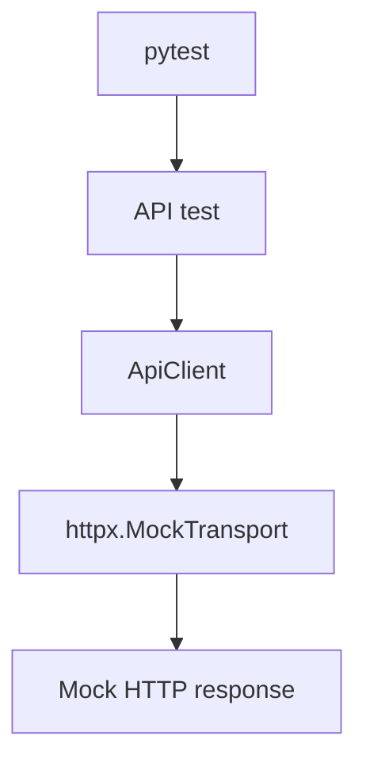
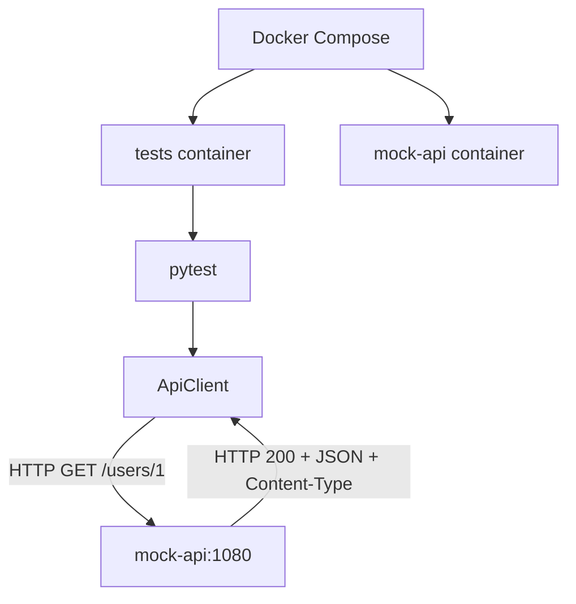

# hp-qa-junior-prep

[RU](README.md) · **EN** · [PL](README.pl.md)

Junior QA Automation training repo (Python): `lab_fw` pytest framework, API (httpx), UI (Playwright / Selenium), mocks, Allure, Docker, Docker Compose, GitHub Actions.

## Quick start (local)

```bash
python -m venv .venv
source .venv/Scripts/activate   # Windows Git Bash
# .venv\Scripts\activate       # Windows cmd/PowerShell

pip install -e ".[dev]"
pytest -m "not ui and not selenium and not compose" -q -n auto
```

UI tests (browser required):

```bash
playwright install chromium
pytest -m ui -q
pytest -m selenium -q
```

## Layout

| Path | Purpose |
|------|---------|
| `src/lab_fw/` | framework (api, ui, config, reporting, pytest plugin) |
| `tests/` | pytest suite |
| `Dockerfile` | multi-stage: `local` (Avast CA) / `ci` |
| `docker-compose.yml` | `mock-api` + `tests` |
| `.github/workflows/tests.yml` | unit/API on the runner (no UI/compose) |
| `.github/workflows/ci.yml` | Docker Compose on GitHub Actions |

## Environment variables

| Env | Purpose |
|-----|---------|
| `LAB_FW_BASE_URL` | API base URL (default `https://example.com`) |
| `LAB_FW_UI_BASE_URL` | UI base URL (default the-internet.herokuapp.com) |
| `LAB_FW_API_TOKEN` | optional Bearer token |
| `LAB_FW_TIMEOUT_S` / `LAB_FW_UI_TIMEOUT_S` | timeouts |
| `LAB_FW_LOG_LEVEL` | log level |

CI secret: GitHub → Settings → Secrets → `LAB_FW_API_TOKEN`.

## Pytest markers

| Marker | Meaning |
|--------|---------|
| `smoke` / `api` / … | normal fast tests |
| `ui` | real Playwright |
| `selenium` | real Selenium |
| `compose` | needs Compose `mock-api` service |

## Docker

### Images (`Dockerfile`)

- **`ci`** — for GitHub / Linux without corporate MITM
- **`local`** — copies `avast-root.crt` (local file, not committed)

`Dockerfile.local` and `avast-root.crt` are in `.gitignore`.

```bash
docker build --target ci -t hp-qa-junior-prep:ci .
docker run --rm -e LAB_FW_API_TOKEN=ci-demo-token hp-qa-junior-prep:ci

docker build --target local -t hp-qa-junior-prep:local .
docker run --rm -e LAB_FW_API_TOKEN=ci-demo-token hp-qa-junior-prep:local
```

Image CMD: `pytest -m "not ui and not selenium"` — **includes** `compose` tests when `mock-api` is available.

### Docker Compose

```bash
docker compose up --build --abort-on-container-exit

DOCKER_TARGET=local docker compose up --build --abort-on-container-exit
```

Services: `mock-api` (MockServer `:1080`) + `tests` (build + pytest).

`LAB_FW_BASE_URL` is **not** set globally in compose (older tests expect `example.com` / MockTransport). Compose tests call `http://mock-api:1080` explicitly.

## GitHub Actions

| Workflow | What it does |
|----------|----------------|
| **tests** | `pip install` + `pytest -m "not ui and not selenium and not compose"` + Allure artifact |
| **CI** | `docker compose` with `DOCKER_TARGET=ci` — also runs `@pytest.mark.compose` |

| Where | mock-api? | Compose tests |
|-------|-----------|---------------|
| **CI** / local compose | yes | run |
| **tests** workflow | no | excluded (`not compose`) |

## API interaction diagram (lab I1)

The project has two API test modes: in-process `httpx.MockTransport`, and integration with a MockServer service via Docker Compose. Real cloud/API is **not** called in these runs — the mock stands in for its HTTP contract (status, JSON, headers).

### Mode 1. Regular tests



`httpx.MockTransport` runs inside the Python process: exercise the HTTP client without a separate server or a real network call to an API.

The **tests** workflow excludes the `compose` marker — those services are not started there.

### Mode 2. Docker Compose / CI



Tests run in the `tests` container; MockServer runs in `mock-api`. They talk on the Compose network at `http://mock-api:1080`.

The **CI** workflow starts Compose with `DOCKER_TARGET=ci` so integration tests can reach MockServer.

### Why both levels

- **MockTransport** — fast isolation: responses, errors, client-side contract checks; easier to pin bugs in `ApiClient` logic.
- **MockServer** — real HTTP between containers and integration-environment wiring.

Both reduce dependence on a live external API.

## Allure

```bash
pytest -q --alluredir=allure-results
allure serve allure-results
```

Artifact upload uses `if: always()`.

## Module docs

- [API](src/lab_fw/api/README.en.md)
- [UI](src/lab_fw/ui/README.en.md)
- [Reporting / Allure](src/lab_fw/reporting/README.en.md)
- [Pytest plugin](src/lab_fw/pytest_plugin/README.en.md)
- [Pytest notes](tests/README_PYTEST.en.md)
- [Mocks lab](tests/mocks_lab/README.en.md)

## Learning plan

See [PLAN_MID_HP.md](PLAN_MID_HP.md).
