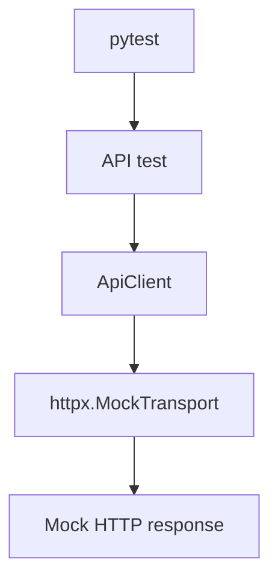
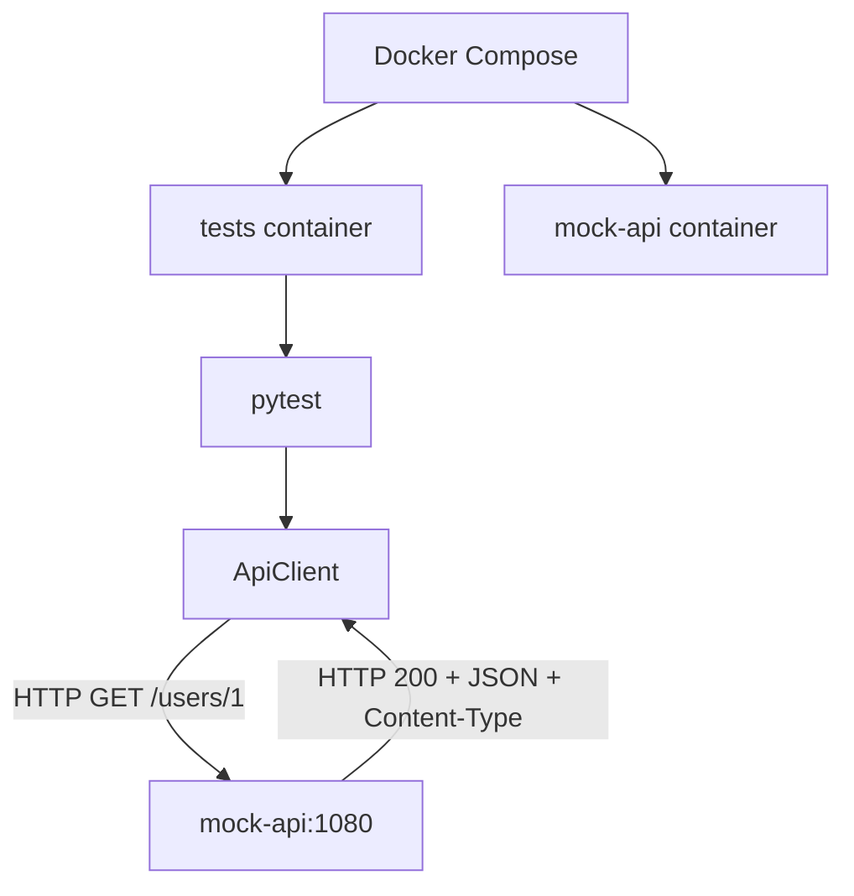

# hp-qa-junior-prep

[RU](README.md) · **EN** · [PL](README.pl.md)

<!-- readme-preamble -->

The **hp-qa-junior-prep** repository is a hands-on Python QA automation project. It bundles a reusable package **`lab_fw`** (HTTP client, UI layer, configuration, reporting, pytest plugin), a **pytest** suite, **Docker / Compose**, **GitHub Actions**, and **Allure** reporting. Typical runs **do not** call a production API: contracts are simulated with **MockTransport** and **MockServer** so you can practice isolation, integration, and troubleshooting without external dependencies.

This document is both a **runbook** (commands, env vars, CI) and a **textbook** (concepts, code mapping, common failures). Languages: [RU](README.md) · **EN** (this file) · [PL](README.pl.md).

### Audience

- QA / SDET engineers running the framework locally and in CI.
- Developers who need a clear picture of mocks, parallel pytest, and traceability (TestRail / Jira).

### Outcomes

- Choose the right test level: in-process mock vs container MockServer vs UI on Grid/Docker.
- Understand retry, timeout, deadline, and idempotency via `ApiClient` and `Worker`.
- Investigate failures using env → build → logs → metrics → trace.
- Use Allure and optionally link runs to TestRail and Jira.

### Requirements

| Component | Version / notes |
|-----------|-----------------|
| Python | **≥ 3.11** (`pyproject.toml`) |
| Git | clone and match CI commits |
| Docker Desktop (optional) | Compose tests, Grid, Playwright CI image |
| Allure CLI (optional) | local `allure serve` |
| TestRail CLI (optional) | channel B in section N2 |

### Section map

| Block | Topic | Code |
|-------|--------|------|
| **I1–I4** | API, mocks, negatives, troubleshooting | `tests/mocks_lab/`, `tests/test_compose_api.py`, `src/lab_fw/api/` |
| **L1–L3** | Distributed concepts, queue/worker, investigation | `src/distributed_lab/`, `tests/distributed_lab/` |
| **M1–M2** | xdist, isolation, Selenium Grid, UI in Docker | `tests/parallel_lab/`, `tests/conftest.py`, Compose profiles |
| **N1–N3** | Allure, TestRail, Jira, risk-based suites | `src/lab_fw/reporting/`, `tests/test_api_client.py`, `pyproject.toml` (markers) |

Suggested reading order: **Quick start → Layout → I1–I4 → L1 → L2 → L3 → M1 → M2 → N1 → N2 → N3**. Keep **Docker** and **GitHub Actions** nearby for every run.

### Table of contents

1. [Quick start](#quick-start-local)
2. [Layout](#layout)
3. [Environment variables](#environment-variables)
4. [Pytest markers](#pytest-markers)
5. [Docker](#docker)
6. [GitHub Actions](#github-actions)
7. [I1 — API diagram](#api-interaction-diagram-i1) (includes I2–I4)
8. [L1 — glossary](#distributed-systems-theory-and-terms-l1)
9. [L2 — queue and worker](#l2--queue-retry-timeout-deadline-idempotency)
10. [L3 — failure investigation](#l3--failure-investigation-checklist)
11. [M1 — parallelism](#m1--parallel-execution-and-resource-isolation)
12. [M2 — Grid and UI](#m2--remote-browser-selenium-grid-and-ui-in-docker)
13. [N1 — Allure](#n1--allure-reporting)
14. [N2 — TestRail and Jira](#n2--jira--testrail)
15. [N3 — risk-based (smoke / full)](#n3--risk-based-testing-smoke-and-full-regression)
16. [Allure quick reference](#allure-quick-reference)
17. [Module documentation](#module-documentation)

### How chapters are structured

Each major section starts with **About this section**: purpose, files to open, and self-check steps. Tables and commands follow. If a test fails, start with [I4](#test-failure-troubleshooting-i4); for infrastructure issues use [L3](#l3--failure-investigation-checklist).

## Quick start (local)

<!-- readme-chapter:quickstart -->
### About this section

The shortest path from a clean machine to a green unit/API run without a browser or MockServer — the same slice as the GitHub **tests** workflow (no `compose` marker).

### Step by step

1. Clone the repo and `cd` into the root.
2. Create a **Python 3.11+** venv and activate it.
3. `pip install -e ".[dev]"` — editable `lab-fw` plus pytest, xdist, allure, playwright, selenium, filelock.
4. Run the fast suite (command below). Expect hundreds of passes; runtime is a few minutes on a laptop.

### Marker filter

`-m "not ui and not selenium and not compose"` skips tests that need a real browser or the `mock-api` container. You do not need Docker or `playwright install` for the first green run.

### UI (separate step)

Playwright and Selenium need a browser. For Playwright run `playwright install chromium`. Selenium 4 on Windows often resolves Chrome via Selenium Manager.

### Self-check

| Question | Where to look |
|----------|----------------|
| Editable install? | `python -m pip show lab-fw` → Location under your `.venv` |
| xdist active? | pytest output shows `[gw0]` with `-n auto` |
| Why no compose tests? | No MockServer — see Docker |

### Common issues

- **Wrong Python** — recreate the venv with 3.11+.
- **Import errors** — venv activated? `pip install -e ".[dev]"` done?
- **Playwright** — do not run `-m ui` before `playwright install`.


```bash
python -m venv .venv
source .venv/Scripts/activate   # Windows Git Bash
# .venv\Scripts\activate       # Windows cmd/PowerShell

pip install -e ".[dev]"
pytest -m "not ui and not selenium and not compose" -q -n auto
```

UI tests (browser required):

```bash
playwright install chromium
pytest -m ui -q
pytest -m selenium -q
```

## Layout

<!-- readme-chapter:structure -->
### About this section

A map of the repo: reusable framework code, pytest scenarios, and how Docker/CI tie in.

### Tree (main paths)

| Path | Contents |
|------|----------|
| `src/lab_fw/api/` | `ApiClient`, retry, auth, errors |
| `src/lab_fw/ui/` | Playwright / Selenium clients, pages |
| `src/lab_fw/config/` | `Settings`, env, pydantic |
| `src/lab_fw/reporting/` | Allure decorators, steps, attachments |
| `src/lab_fw/pytest_plugin/` | hooks, markers |
| `src/distributed_lab/` | `Job`, `Worker`, `InMemoryQueue` (L2) |
| `tests/` | all pytest modules |
| `tests/mocks_lab/` | pure mocks and MockTransport (I2) |
| `tests/distributed_lab/` | L2/L3 |
| `tests/parallel_lab/` | M1, xdist and files |
| `scripts/` | helpers (TestRail upload) |
| `categories.json` | Allure Categories rules |
| `.github/workflows/` | **tests** and **CI** |

### Two layers

- **`lab_fw`** — library imported by tests; editable install for reuse.
- **`tests/`** — pattern catalog; failures often signal framework or contract regressions.

### Self-check

In `pyproject.toml`, packages live under `src/`. After install, `import lab_fw` must work from the repo root.


| Path | Purpose |
|------|---------|
| `src/lab_fw/` | framework (api, ui, config, reporting, pytest plugin) |
| `tests/` | pytest suite |
| `Dockerfile` | multi-stage: `local` (Avast CA) / `ci` / `playwright` |
| `docker-compose.yml` | `mock-api` + `tests`; profiles `selenium`, `playwright` |
| `.github/workflows/tests.yml` | unit/API on the runner (no UI/compose) |
| `.github/workflows/ci.yml` | Compose: API → Selenium Grid → Playwright in Docker |

## Environment variables

<!-- readme-chapter:env -->
### About this section

Configuration via environment variables and `Settings`. Most MockTransport API tests **do not** need a real token.

### Precedence

1. Explicit test/fixture values.
2. Env (`LAB_FW_*`).
3. Code defaults (`example.com`, 5s timeout).

### Practice

- Locally `LAB_FW_API_TOKEN` may be unset.
- CI **tests** workflow requires the Secret token — typical env drift.
- Compose API tests should pass `http://mock-api:1080` in `Settings`, not a global `LAB_FW_BASE_URL`.

### Self-check

```bash
python -c "from lab_fw.config import get_settings; s=get_settings(); print(s.base_url, s.timeout_s)"
```


| Env | Purpose |
|-----|---------|
| `LAB_FW_BASE_URL` | API base URL (default `https://example.com`) |
| `LAB_FW_UI_BASE_URL` | UI base URL (default the-internet.herokuapp.com) |
| `LAB_FW_API_TOKEN` | optional Bearer token |
| `LAB_FW_TIMEOUT_S` / `LAB_FW_UI_TIMEOUT_S` | timeouts |
| `LAB_FW_LOG_LEVEL` | log level |
| `SELENIUM_REMOTE_URL` | Selenium Grid URL for `webdriver.Remote`; unset → local Chrome |
| `DOCKER_TARGET` | Compose build target: `ci` (default) or `local` (Avast CA) |

CI secret: GitHub → Settings → Secrets → `LAB_FW_API_TOKEN`.

## Pytest markers

<!-- readme-chapter:markers -->
### About this section

Markers select test subsets and drive CI. They **do not** start infrastructure.

### CI usage

| Workflow | Filter | Effect |
|----------|--------|--------|
| **tests** | `not ui`, `not selenium`, `not compose` | fast runner, no Docker |
| **CI** / Docker CMD | often includes compose | needs `mock-api` |
| Compose services | see M2 | `serial` vs parallel UI |

### Learning tracks

- `distributed_lab` — L2/L3.
- `parallel_lab` — M1.
- `reporting` — Allure decorators.

### Self-check

Run `pytest --markers` and confirm `compose`, `serial`, `distributed_lab` descriptions.


| Marker | Meaning |
|--------|---------|
| `smoke` / `api` / … | normal fast tests |
| `ui` | real Playwright |
| `selenium` | real Selenium |
| `compose` | needs Compose `mock-api` service |
| `parallel_lab` | M1 exercises (xdist, files, lock) |
| `distributed_lab` | L2/L3 exercises |
| `serial` | shared state (module-scoped UI/Selenium); do not run under `-n` |
| `reporting` | Allure / `lab_fw.reporting` layer tests |

## Docker

<!-- readme-chapter:docker -->
### About this section

Docker reproduces CI locally: a `tests` image, MockServer, optional Grid/Playwright.

### Mental model

1. **`ci` image** — pytest on Linux.
2. **Compose network** — `tests` resolves `mock-api`.
3. **Profiles** — UI is opt-in.

### `DOCKER_TARGET=local`

Corporate MITM: **local** target adds your CA; `avast-root.crt` stays untracked.

### Self-check

```bash
docker compose up --build --abort-on-container-exit tests
```

### Common mistakes

- Running `compose` tests without `mock-api`.
- Confusing image CMD (runs compose) with **tests** workflow (excludes compose).


### Images (`Dockerfile`)

- **`ci`** — for GitHub / Linux without corporate MITM
- **`local`** — copies `avast-root.crt` (local file, not committed)
- **`playwright`** — Microsoft Playwright base image with Chromium (Compose profile `playwright`)

`Dockerfile.local` and `avast-root.crt` are in `.gitignore`.

```bash
docker build --target ci -t hp-qa-junior-prep:ci .
docker run --rm -e LAB_FW_API_TOKEN=ci-demo-token hp-qa-junior-prep:ci

docker build --target local -t hp-qa-junior-prep:local .
docker run --rm -e LAB_FW_API_TOKEN=ci-demo-token hp-qa-junior-prep:local
```

Image CMD: `pytest -m "not ui and not selenium"` — **includes** `compose` tests when `mock-api` is available.

### Docker Compose

**Default run (API, compose, parallel_lab — no UI):**

```bash
docker compose up --build --abort-on-container-exit tests
docker compose down

DOCKER_TARGET=local docker compose up --build --abort-on-container-exit tests
```

**Profile `selenium`** — Grid + tests in the `ci` image:

```bash
docker compose --profile selenium run --build --rm selenium-tests
docker compose --profile selenium run --build --rm selenium-tests-serial
docker compose --profile selenium down
```

- `selenium` — `selenium/standalone-chrome`, ports `4444` (WebDriver), `7900` (noVNC)
- `selenium-tests*` sets `SELENIUM_REMOTE_URL=http://selenium:4444`

**Profile `playwright`** — Playwright UI in the `playwright` image:

```bash
docker compose --profile playwright run --build --rm playwright-tests
docker compose --profile playwright run --build --rm playwright-tests-serial
```

Default services (no profile): `mock-api` (`:1080`) + `tests` (`${DOCKER_TARGET:-ci}`, Dockerfile CMD).

`LAB_FW_BASE_URL` is **not** set globally in compose (older tests expect `example.com` / MockTransport). Compose tests call `http://mock-api:1080` explicitly.

## GitHub Actions

<!-- readme-chapter:gha -->
### About this section

Two pipelines: fast feedback on the runner and full integration in Docker.

### tests.yml

- ubuntu runner, xdist pytest, **no** ui/selenium/compose.
- Partial `allure-results` artifact.

### ci.yml

- Full Compose chain including Selenium and Playwright stages.
- Combined `allure-results`.

### Learning from Actions

1. Failed job → step log.
2. Download Allure artifact.
3. Compare pytest command with local README.

### Self-check

Green **tests** on each push; **CI** is slower but complete.


| Workflow | What it does |
|----------|----------------|
| **tests** | `pip install` + `pytest -m "not ui and not selenium and not compose"` + Allure artifact |
| **CI** | steps: `tests` → `down` → Selenium → Playwright; `DOCKER_TARGET=ci`; artifact **`allure-results`** (full Docker run) |

| Where | mock-api? | Compose tests |
|-------|-----------|---------------|
| **CI** / local compose | yes | run |
| **tests** workflow | no | excluded (`not compose`) |

## API interaction diagram (I1)

<!-- readme-chapter:i1 -->
### About this section (I1–I4)

**Integration / API**: testing the HTTP client without production and when to use a container mock.

| Part | Topic |
|------|--------|
| **I1** | MockTransport vs MockServer |
| **I2** | Mock strategy, `tests/mocks_lab/` |
| **I3** | 401, timeout, `ApiError` |
| **I4** | Logs and CI map |

### Key files

- `src/lab_fw/api/client.py`
- `tests/test_api_client.py`
- `tests/test_compose_api.py`

### Exercise

1. `pytest tests/mocks_lab -q`
2. `docker compose up … tests`
3. Compare debug experience.

### Review questions

- Why doesn't `compose` start MockServer?
- HTTP 401 vs `ReadTimeout` in tests?


The project has two API test modes: in-process `httpx.MockTransport`, and integration with a MockServer service via Docker Compose. Real cloud/API is **not** called in these runs — the mock stands in for its HTTP contract (status, JSON, headers).

### Mode 1. Regular tests



`httpx.MockTransport` runs inside the Python process: exercise the HTTP client without a separate server or a real network call to an API.

The **tests** workflow excludes the `compose` marker — those services are not started there.

### Mode 2. Docker Compose / CI



Tests run in the `tests` container; MockServer runs in `mock-api`. They talk on the Compose network at `http://mock-api:1080`.

The **CI** workflow starts Compose with `DOCKER_TARGET=ci` so integration tests can reach MockServer.

### Why both levels

- **MockTransport** — fast isolation: responses, errors, client-side contract checks; easier to pin bugs in `ApiClient` logic.
- **MockServer** — real HTTP between containers and integration-environment wiring.

Both reduce dependence on a live external API.

### Mocking strategy (I2)

#### About I2

Compare two HTTP substitution seams: in-process **MockTransport** vs container **MockServer**. Choosing the seam is core API test design: fast unit-like vs Compose integration.

**Study:** [tests/mocks_lab/](tests/mocks_lab/README.en.md) and [tests/test_compose_api.py](tests/test_compose_api.py).

**Self-check:** why is `transport=` DI preferable to endless `patch('httpx.Client')` for `ApiClient`?

| | `httpx.MockTransport` | MockServer |
|--|------------------------|------------|
| Where | inside the Python process | separate service (`mock-api`) |
| Network | not required | real HTTP on the Docker network |
| Goal | unit/API client tests | container-to-container integration |
| Examples | `tests/mocks_lab/` | `tests/test_compose_api.py` |

Compose contract in `test_mock_api_users`:

1. fixture `reset_mockserver` — `PUT /mockserver/reset` before and after the test (state isolation);
2. `PUT /mockserver/expectation` → **201** (rule accepted);
3. `ApiClient.get` → **200**, JSON body, `Content-Type` contains `application/json`;
4. `PUT /mockserver/verify` → **202** (request actually matched the expectation).

The `compose` marker does not start infrastructure — check the run command:

- **tests** workflow: `pytest -m "not ui and not selenium and not compose"` (no MockServer);
- **Dockerfile CMD**: `not ui and not selenium` (no `not compose`) — under Compose, `mock-api` is present so integration tests run;
- targeted: `pytest -m compose` inside the `tests` service.

`LAB_FW_BASE_URL` is not set globally in Compose: compose tests pass `base_url="http://mock-api:1080"` explicitly via `Settings`.

### Negative integration scenarios (I3)

#### About I3

Negative tests assert the **error contract**: 401 vs transport timeout. Distinguish HTTP status/body from `ApiError` and `__cause__`.

**Practice:** read `ApiClient.get` / `ensure_success` in `src/lab_fw/api/` against the table below.

In `tests/test_compose_api.py` (`compose` marker, same `reset_mockserver`):

| Test | MockServer | What we assert |
|------|------------|----------------|
| `test_mock_api_auth_fail` | `GET /protected` → **401** + JSON `error` | client sees status/body/Content-Type without a real IdP |
| `test_mock_api_timeout` | `GET /slow` with 1000 ms `delay`, `timeout_s=0.2` | `ApiError`; `__cause__` is `ReadTimeout` ⊂ `TimeoutException` ⊂ `HTTPError`; then `/mockserver/verify` → **202** |

Client policy: on 4xx/5xx, `get`/`post` **return** `Response` (optional `ensure_success` → `HttpStatusError`). Transport failures (timeout, etc.) always surface as `ApiError`.

### Test failure troubleshooting (I4)

#### About I4

A **map of places** when pytest fails locally or in Actions. Pair with [L3](#l3--failure-investigation-checklist).

**Exercise:** break a compose expectation and walk the table until `/mockserver/verify` shows 202 vs non-202.

| Symptom | Where to look | What to check |
|---|---|---|
| A local test failed | `pytest` terminal output | Test name, traceback, assertion and actual result |
| Framework logs are needed | `lab_fw` logs; `LAB_FW_LOG_LEVEL` setting | Log level and API client messages |
| HTTP request/response details are needed | Allure report / attachments | `response` and `status_error` attachments, if generated |
| A Compose test failed | `docker compose logs tests` | Pytest output, traceback, configuration and container environment |
| MockServer interaction failed | `docker compose logs mock-api` | Whether the request arrived, whether the expectation was registered and which response was returned |
| GitHub Actions failed | Actions → workflow → job → failed step | For `tests`, inspect the pytest step and `allure-results` artifact; for `CI`, inspect `Run Docker Compose` |
| MockServer expectation registration failed | Registration output and `mock-api` logs | Registration HTTP status (usually `201`) and response body |
| MockServer verification failed | `/mockserver/verify` output and `mock-api` logs | Verification HTTP status (expected `202`) and response body |

**Common symptoms**

- **HTTP 4xx/5xx:** `get()` / `post()` return a `Response`. Check the status, response body and authentication. `ensure_success()` raises `HttpStatusError` for an unsuccessful status.
- **Timeout / `ApiError`:** Check the timeout, endpoint availability and exception chain (`__cause__`). The client wraps transport errors in `ApiError`.
- **Expectation not registered:** Check the MockServer registration response and logs.
- **`/mockserver/verify` did not return `202`:** Check whether the actual request matches the registered expectation and whether it was sent.

**Environment variables and markers**

- `LAB_FW_API_TOKEN` — verify that the token is present and correct.
- `http://mock-api:1080` — MockServer address from the `tests` container; use the Compose service name `mock-api`.
- `LAB_FW_BASE_URL` — avoid setting it globally for Compose unless necessary; regular tests use their own configuration.
- `@pytest.mark.compose` — marker for integration tests that require MockServer.
- On the Avast-protected laptop, use `DOCKER_TARGET=local` when the corresponding certificate is required.

**Quick workflow:** test fails → read the traceback → determine whether it is an HTTP response or a transport error → for Compose failures, inspect `tests`, then `mock-api` → in CI, open the failed step and download the available artifact.

## Distributed systems: theory and terms (L1)

<!-- readme-chapter:l1 -->
### About this section

**L1** — conceptual base for L2/L3: terms you will see in interviews and production logs.

### Study path

1. Read sections 1–9 in order.
2. Map each term to `lab_fw` (retry, timeout, `ApiError`).
3. Continue to L2 for executable models.

### Self-check

Explain: retry ≠ timeout; idempotency ≠ identical JSON; eventual consistency ≠ blind sleep.


### 1. Async communication

<!-- l1-deep:1 -->
#### About item 1 — Async communication

**Meaning:** the caller does not block until processing finishes; another component handles the outcome later.

**In this repo:** `InMemoryQueue` + `Worker.run_once()` — you `put` a `Job`, HTTP runs on the next `run_once`, not inside `put`.

```python
# src/distributed_lab/queue_worker.py (idea)
queue.put(job)
worker.run_once()  # one job → HTTP via ApiClient
```

**QA:** assert “accepted for processing” and final state separately; do not treat as unchecked fire-and-forget.

**Check:** `pytest tests/distributed_lab/test_queue_worker.py -q`

### 2. Queue / event / message broker

<!-- l1-deep:2 -->
#### About item 2 — Queue / event / broker

**In this repo:** a simplified **Queue** — FIFO on `deque`, typed `Job` (`parse_job` → `SchemaError` on invalid payload).

```python
# src/distributed_lab/queue_worker.py
class InMemoryQueue:
    def put(self, job: Job) -> None: ...
    def get(self) -> Job | None: ...
```

In production, an **event** is a domain fact (`OrderCreated`); here the analogue is a job dict validated into a model.

**QA:** after `put`, the job must not be lost; for redelivery effects see item 5 (idempotency).

**Check:** `pytest tests/distributed_lab/test_queue_worker.py -k queue -q`

### 3. Retry vs timeout

<!-- l1-deep:3 -->
#### About item 3 — Retry vs timeout

**Retry** answers “try again?”; **timeout** answers “how long to wait per attempt”. After a timeout the server outcome is **unknown** — blind POST retry is unsafe without idempotency.

**Policy in code** (`src/lab_fw/api/retry_policy.py`):

```python
def should_retry(exc: ApiError) -> bool:
    # GET + 429/503 or GET transport error → True
    # POST → False
```

**Orchestration:** `lab_fw.core.retry.retry_call` consults `should_retry` between attempts.

**Check:** `pytest tests/test_api_retry_policy.py tests/distributed_lab/test_l3_investigation.py -q`

### 4. Timeout

<!-- l1-deep:4 -->
#### About item 4 — Timeout

**Timeout layers in this repo:**

| Layer | Where |
|-------|--------|
| HTTP client | `Settings.timeout_s` → `ApiClient` |
| Compose negative | `timeout_s=0.2` vs 1000 ms MockServer delay (`tests/test_compose_api.py`) |
| Job / worker | `Job.timeout`, `Job.deadline_s`, `Worker.deadline_w` → `JobDeadlineExceeded` |

```python
# Worker.execute — min of job timeout and remaining deadlines
timeout = min(job.timeout, remaining, remaining_worker)
```

**QA:** assert error type: `ApiError` with `__cause__` `ReadTimeout`, not only “failed”.

**Check:** `pytest tests/test_compose_api.py::test_mock_api_timeout tests/distributed_lab/test_timeout.py -q`

### 5. Idempotency

<!-- l1-deep:5 -->
#### About item 5 — Idempotency

**Header on the wire** (job model not mutated):

```python
# src/distributed_lab/queue_worker.py
if job.idempotency_key is not None:
    kwargs["headers"]["Idempotency-Key"] = job.idempotency_key
```

**Test server** in `tests/distributed_lab/test_timeout.py`: repeated POST with the same key does not grow `received_requests`.

**Retry policy:** POST is **not** retried in `should_retry` / worker — avoids double side effects.

**Check:** `pytest tests/distributed_lab/test_timeout.py -q -k idempotency`

### 6. Eventual consistency

<!-- l1-deep:6 -->
#### About item 6 — Eventual consistency

**Idea:** replicas may lag briefly; tests should **poll with a deadline**, not a fixed `sleep`.

**In this repo:** worker uses `_remaining_time` around HTTP; UI layer uses explicit waits (`PlaywrightWait` / `SeleniumWait`).

**QA pattern:**

```python
# anti-pattern: time.sleep(5)
# better: wait helper with timeout from settings or job deadline
```

**Check:** `pytest tests/test_playwright_wait.py tests/test_selenium_wait.py -q`

### 7. Logs vs metrics vs traces

<!-- l1-deep:7 -->
#### About item 7 — Logs / metrics / traces

| Signal | Example in repo |
|--------|------------------|
| **Logs** | `INFO lab_fw.api`, `WARNING lab_fw.core.retry` on retry |
| **Metrics** | manual L3 counters: `http_requests`, `503_count` |
| **Traces** | no full OTel; wire ID `X-Request-ID` (item 8) |

**L3 practice:** `caplog` captures two WARNING lines before a successful 503→200 retry.

**Check:** `pytest tests/distributed_lab/test_l3_investigation.py -q`

### 8. Correlation / Request / Trace ID

<!-- l1-deep:8 -->
#### About item 8 — Correlation / Request / Trace ID

**In this repo:** jobs forward headers unchanged — tests set `X-Request-ID`:

```python
# tests/distributed_lab/test_timeout.py
headers={"X-Request-ID": "req-123"}
```

**Retry:** GET retries may reuse the same `Idempotency-Key`; Request ID policy depends on what you put on the job.

**QA:** `grep -Rni "X-Request-ID" src tests`

**Check:** `pytest tests/distributed_lab/test_timeout.py -q -k request`

### 9. Env vs build (“locally green ≠ CI”)

<!-- l1-deep:9 -->
#### About item 9 — Env vs build

**Env (L3 example):** locally `LAB_FW_API_TOKEN` may be unset; CI **tests** workflow requires the secret.

**Build:** `git rev-parse HEAD`, editable `lab-fw`, Docker target `ci` vs `local` (Avast CA).

```bash
python -c "import os; print(os.getenv('LAB_FW_API_TOKEN', 'MISSING'))"
docker compose config | head
```

**QA:** fails only in CI → diff env and pytest commands in `.github/workflows/` before changing the test.

**Check:** read env/build sections in `tests/distributed_lab/test_l3_investigation.py`.

## L2 — queue, retry, timeout, deadline, idempotency

<!-- readme-chapter:l2 -->
### About this section

**L2** — queue → worker → HTTP with retry policy and time budgets.

### Architecture

```text
Job → InMemoryQueue → Worker → retry_call → ApiClient
```

### Learning goals

- GET vs POST retry rules.
- Timeout vs job/worker deadlines.
- `Idempotency-Key` on the wire.

### Self-check

POST timeout → one attempt; GET 503→200 → three attempts.


Implementation and tests for the [L1](#distributed-systems-theory-and-terms-l1) glossary: in-memory queue → worker → HTTP via `lab_fw`’s `ApiClient`, with retry policy and time limits.

**Code:** `src/distributed_lab/queue_worker.py`  
**Tests:** `tests/distributed_lab/` (marker `@pytest.mark.distributed_lab`)

### Components

| Component | Role |
|-----------|------|
| `Job` | Task: `method`, `path`, optional `timeout`, `deadline_s`, `payload`, `headers`, `idempotency_key` |
| `parse_job` | Validate dict → `Job`; schema failures → `SchemaError` |
| `InMemoryQueue` | FIFO on `deque`; `put` accepts only `Job` |
| `Worker` | `run_once()` — one job; `execute()` — one HTTP call |

The worker builds client kwargs: `json` from `payload`, a copy of `headers`, and when `idempotency_key` is set it adds the `Idempotency-Key` header without mutating the job model.

### Retry and HTTP method

`run_once` uses `retry_call` (up to 3 attempts) and `lab_fw.api.retry_policy.should_retry`:

- **GET:** retry on `429` / `503` and transport errors (`ConnectError`, `ReadTimeout`, …);
- **POST:** **no** retry (even on `429`/`503` or timeout) — avoids double side effects without server-side idempotency.

After retries are exhausted or on non-retryable status — `ApiError` / `HttpStatusError` (via `ensure_success`).

### Timeout vs deadline

| Mechanism | Where | Meaning |
|-----------|--------|---------|
| **Timeout** | `Settings.timeout_s`, `Job.timeout` | Max wait for a single HTTP call (connect/read) |
| **Job deadline** | `Job.deadline_s` | Overall budget for the job (including retries); expiry → `JobDeadlineExceeded` |
| **Worker deadline** | `Worker(..., deadline_w=...)` | Budget for the worker session; expiry → `WorkerDeadlineExceeded` |

Per-request timeout is the **minimum** of job timeout, remaining job deadline, and remaining worker deadline. After `ApiError`, the worker re-checks deadlines — the final error may be a deadline, not the last HTTP failure.

### Idempotency (local HTTP server in tests)

In `tests/distributed_lab/test_timeout.py`, `WorkerTestHandler`: a repeated POST with the same `Idempotency-Key` does **not** append a second entry to `received_requests` but returns the first request’s data. Tests cover:

- JSON and headers (including `X-Request-ID`) on real HTTP;
- no `Idempotency-Key` when the field is unset;
- POST on timeout — single attempt, key on the wire;
- two jobs, same key — `server.calls == 2`, `len(received_requests) == 1`;
- GET retry (503→200) — the same `Idempotency-Key` on every attempt.

### How to run

```bash
# distributed_lab (L2)
pytest -m distributed_lab -q

# queue/worker only (no slow HTTP server)
pytest tests/distributed_lab/test_queue_worker.py -q

# timeout, deadline, idempotency with local HTTP server
pytest tests/distributed_lab/test_timeout.py -q
```

Docker / MockServer are **not** required for L2 — venv and `pip install -e .` are enough.

### When a test fails

1. Traceback: `JobDeadlineExceeded` / `WorkerDeadlineExceeded` vs `ApiError` and `__cause__` (`ReadTimeout`, `ConnectError`, …).
2. Attempt counters in MockTransport or `server.request_counts` / `received_requests` in slow-server tests.
3. Job method: POST must not produce three attempts under the default retry policy.

## L3 — failure investigation checklist

<!-- readme-chapter:l3 -->
### About this section

**L3** — investigation checklist: **Env → Build → Logs → Metrics → Trace**.

### I4 vs L3

- **I4** — where artifacts live.
- **L3** — order of analysis and caplog/counters practice.

### Practice

`tests/distributed_lab/test_l3_investigation.py`.

### Self-check

Replay triple-503 retry and record manual counters from the test.


Systematic diagnosis across five areas: **Env → Build → Logs → Metrics → Trace**. Hands-on: **retry** behaviour, logs via `caplog`, and manual **investigation counters**.

**Tests:** `tests/distributed_lab/test_l3_investigation.py` (marker `@pytest.mark.distributed_lab`)

**See also:** [I4 — test failure troubleshooting](#test-failure-troubleshooting-i4); [L2](#l2--queue-retry-timeout-deadline-idempotency) (queue, worker, retry, deadline). L3 covers Env → Build → Logs order and retry scenarios with `caplog`.

### 1. Env — environment variables

Local check (example):

```bash
python -c "import os; print('LAB_FW_API_TOKEN:', 'SET' if os.getenv('LAB_FW_API_TOKEN') else 'MISSING'); print('LAB_FW_BASE_URL:', os.getenv('LAB_FW_BASE_URL', '<unset>')); print('LAB_FW_LOG_LEVEL:', os.getenv('LAB_FW_LOG_LEVEL', '<unset>'))"
```

If variables are unset, `get_settings()` applies defaults: `base_url=https://example.com`, `timeout_s=5.0`, `log_level=INFO`, `api_token=None`.

**Local vs CI:** the GitHub Actions **tests** workflow sets `LAB_FW_API_TOKEN` from Secrets and asserts it is non-empty. Missing token locally during L3 is fine with MockTransport; CI uses a different env — a typical **local ≠ CI** case.

### 2. Build — project state

| Check | Why |
|-------|-----|
| `git rev-parse --short HEAD` | same commit as CI for reproducibility |
| `python -m pip show lab-fw` | package version, editable install |
| `git status` | uncommitted changes vs clean build |

### 3. Logs — retry lab

`httpx.MockTransport` + `Worker` + `ApiClient`. Two scenarios:

| Scenario | Behaviour | Assertions |
|----------|-----------|------------|
| Successful retry | 503, 503, 200 | 3 attempts; 2× `WARNING` from `lab_fw.core.retry`; body `{"ok": true}` |
| Exhausted | 503 × 3 | 3 attempts; 2× `WARNING`; `HttpStatusError`; status/method/path |

Logs: `INFO` from `lab_fw.api`; `WARNING` from `lab_fw.core.retry` before the next attempt. The final failure does not require a third WARNING.

### 4. Metrics — investigation counters

No built-in Prometheus-style metrics in this repo. For “all 503” scenarios, record **manual counters from the test**:

- `http_requests = 3`
- `503_count = 3`
- `retries_after_first = 2`

These are not production metrics (no live error rate / p95). Code search: `grep -RniE "prometheus|metrics|histogram|counter|p95" src tests pyproject.toml`.

### 5. Trace — correlation

Search IDs: `grep -RniE "X-Request-ID|Correlation-ID|request_id" src tests`. L2 tests assert `X-Request-ID: req-123`. That is **wire-level** correlation, not full distributed tracing (no auto Trace ID / cross-service spans).

### How I4, L3, and L2 fit together

| Stage | Question |
|-------|----------|
| **I4** | Where to look? (pytest, Compose, mock-api, CI) |
| **L3** | In what order? (Env → Build → Logs → Metrics → Trace) |
| **L2** | Queue, worker, deadline, idempotency |
| **L3 (retry)** | retry + `caplog` + investigation counters |


### How to run

```bash
pytest tests/distributed_lab/test_l3_investigation.py -v
```

### L3 limitations

`MockTransport` — no real network or Docker/MockServer. Automatic metrics and end-to-end tracing platforms are out of scope for L3.

## M1 — parallel execution and resource isolation

<!-- readme-chapter:m1 -->
### About this section

**M1** — parallel pytest and shared resource risks.

### Core idea

Parallelism is safe for **independent** tests only. Shared MockServer/files/browser need `xdist_group`, `loadgroup`, separate files, `FileLock`, or `@serial`.

### Code

- `tests/conftest.py`
- `tests/parallel_lab/`

### Self-check

Compose run shows `@mockserver` suffix and one worker for the group.


How this repo uses `pytest-xdist`: shared resources (MockServer, files, browser), `xdist_group`, `loadgroup`, and per-worker artifacts.

### Isolation strategies

| Shared resource | Strategy | Setup |
|---|---|---|
| MockServer in Docker Compose | Run conflicting tests on one worker | `@pytest.mark.xdist_group(name="mockserver")` is applied in `tests/conftest.py` to tests marked `compose`; run with `--dist loadgroup` |
| One local browser without Grid | Serialize conflicting tests | Same group + `--dist loadgroup` |
| Shared report file | Separate file per worker | `worker_id` in the filename or `tmp_path` |
| Resource created per test | Create and tear down per test | Pytest fixture with proper teardown |

A plain `threading.Lock` is not enough to synchronize a shared file across processes: xdist workers are separate processes. If a shared file is truly required, use an inter-process lock. For test artifacts, separate files are usually simpler.

### Compose and MockServer

Compose tests share one MockServer instance. If several tests change expectations or reset state at the same time, they can interfere with each other.

In `tests/conftest.py`, the `pytest_collection_modifyitems` hook assigns `@pytest.mark.xdist_group(name="mockserver")` to every test marked `compose`.

#### Why `tryfirst=True` matters

With `--dist loadgroup`, xdist groups tests by the `xdist_group` marker.

During collection, the `pytest_collection_modifyitems` hook in `tests/conftest.py` adds `xdist_group(name="mockserver")` to tests marked `compose`. For grouping to work, that marker must be present before xdist’s collection logic builds the schedule.

On the worker, xdist uses `xdist_group` to append a suffix to `nodeid`, e.g. `@mockserver`. If the marker is missing in time, the controller may receive nodeids without that suffix. Then `LoadGroupScheduling` will not merge conflicting tests into one group, and they may run on different workers in parallel.

The project uses `@pytest.hookimpl(tryfirst=True)` — see `tests/conftest.py`. It raises the hook’s priority so the group marker is applied before xdist processes grouping.

`tryfirst=True` alone does not lock a shared resource; isolation comes from correct grouping and run configuration.

#### `loadgroup` vs `loadscope`

- `--dist load` assigns individual tests to workers; good for independent tests.
- `--dist loadscope` keeps tests from one module or class on one worker. If all conflicting Compose tests live in one module, that may be enough.
- `--dist loadgroup` merges tests with the same `xdist_group`, including across modules. More flexible for a shared resource group.

The project `Dockerfile` already uses `-n auto` and `--dist loadgroup`.

#### Role of `reset_mockserver`

The `reset_mockserver` fixture in `tests/test_compose_api.py` resets MockServer before and after each test.

That keeps state clean between sequential tests. It does not replace grouping: if two tests hit MockServer in parallel, one test’s reset can break the other.

### Verification

#### 1. Run Compose

```bash
docker compose up --build --abort-on-container-exit tests
```

This starts `mock-api` and the `tests` container (API / compose / parallel_lab, no UI).

#### 2. Check Compose test grouping

Inside the `tests` container you can run:

```bash
docker compose run --rm tests pytest tests/test_compose_api.py -vv -n auto --dist loadgroup
```

This runs `tests/test_compose_api.py` with verbose output and `loadgroup` scheduling.

Look for three signals:

- At session start: `scheduling tests via LoadGroupScheduling`.
- In test lines: group suffix, e.g. `tests/test_compose_api.py::test_mock_api_users@mockserver`.
- All four Compose tests on the same worker, e.g. `[gw0]`. The index may differ; what matters is one worker for the whole group.

When running via Compose, `mock-api` must be reachable from the tests container at `http://mock-api:1080`.

#### 3. CI split

Regular tests and Compose tests run separately:

- `.github/workflows/tests.yml` runs with `-n auto`, excluding markers `ui`, `selenium`, and `compose`.
- `.github/workflows/ci.yml` runs service `tests` first, then profiles `selenium` and `playwright` (see [M2](#m2--remote-browser-selenium-grid-and-ui-in-docker)).
- `Dockerfile` sets `-n auto --dist loadgroup` for pytest in the container.

CI thus separates the default suite from tests that depend on shared MockServer.

### Practice: `parallel_lab`

Code: `tests/parallel_lab/test_parallel_resources.py`, marker `@pytest.mark.parallel_lab` (see `pyproject.toml`). Lock tests need `filelock` in `[project.optional-dependencies]` (`dev` / `dev_slim`).

| Topic | Tests (idea) |
|---|---|
| Per-worker file (`PYTEST_XDIST_WORKER`) | `test_shared_file_write_read`, `test_worker_specific_files_are_isolated` |
| Isolation via `tmp_path` | `test_tmp_path_creates_isolated_temp_file`, `test_tmp_path_is_unique_for_each_test` |
| Shared file + `FileLock` under xdist | `test_shared_file_access_with_file_lock`, `test_shared_file_access_is_serialized` |
| Race without lock (multiprocessing, deterministic) | `test_shared_file_race_condition_is_reproducible` |
| Inter-process lock | `test_file_lock_prevents_shared_file_race` |

Run:

```bash
pytest tests/parallel_lab -m parallel_lab -v
pytest tests/parallel_lab -m parallel_lab -n 2 -v
```

`shared_report*.txt` in the lab folder are local run artifacts; do not commit them (see `.gitignore`). The full Docker suite (`Dockerfile` CMD) includes `parallel_lab` with other tests except `ui` / `selenium`.

Parallel runs speed up independent tests; shared resources need grouping (`loadgroup`), separate files or `FileLock`, and proper teardown. See [I4](#test-failure-troubleshooting-i4), [L2](#l2--queue-retry-timeout-deadline-idempotency), [L3](#l3--failure-investigation-checklist).

## M2 — remote browser (Selenium Grid) and UI in Docker

<!-- readme-chapter:m2 -->
### About this section

**M2** — UI infrastructure: Grid browser, separate pytest runner, parallel vs **serial** module state.

### Stacks

Playwright Docker target vs Selenium Grid + `SELENIUM_REMOTE_URL`.

### Self-check

Module login chains under `serial` only; parallel UI needs enough Grid sessions.


Browser in a Grid container; parallel UI/Selenium tests use multiple sessions. Flows with module-scoped shared state use `@pytest.mark.serial` and run without `-n`.

### Code changes

| Piece | Role |
|-------|------|
| `Settings.selenium_remote_url` | from `SELENIUM_REMOTE_URL`; whitespace-only → unset → local Chrome |
| `SeleniumClient.start()` | `Chrome()` or `Remote()`; on startup failure, `quit()` then re-raise |
| `@pytest.mark.serial` | chains with `ui_client_module` / `selenium_client_module` in `test_login_page.py`, `test_secure_page.py`, `test_login_page_selenium.py`, `test_secure_page_selenium.py`; run without `-n` |
| `tests/test_selenium_client.py` | mocked Remote/Chrome + optional live Grid |
| `docker-compose.yml` | Grid, `selenium-tests` / `selenium-tests-serial`, `playwright-tests` / `playwright-tests-serial` |
| `Dockerfile` target `playwright` | official Playwright Python image (browsers included) |

Grid `SE_NODE_MAX_SESSIONS=2` matches `-n 2` in `selenium-tests`.

### Compose selectors

| Service | pytest `-m` |
|---------|-------------|
| `selenium-tests` | `selenium and not serial` |
| `selenium-tests-serial` | `selenium and serial` |
| `playwright-tests` | `ui and not selenium and not serial` |
| `playwright-tests-serial` | `ui and not selenium and serial` |

### Local runs

```bash
docker compose --profile selenium up -d selenium
export SELENIUM_REMOTE_URL=http://localhost:4444
pytest -m "selenium and not serial" -n 2 -vv
pytest -m "selenium and serial" -vv
docker compose --profile selenium down

pytest -m "ui and not selenium and not serial" -n 2 -vv
pytest -m "ui and not selenium and serial" -vv
```

noVNC with `selenium` up: [http://localhost:7900](http://localhost:7900).

### CI (`.github/workflows/ci.yml`)

1. `docker compose up … tests`  
2. `docker compose down`  
3. Selenium parallel → serial → `docker compose --profile selenium down`  
4. Playwright parallel → serial  

There is no `playwright down` step; ephemeral runners usually do not need it. Add `docker compose --profile playwright down` if you want explicit cleanup.

### M1 ↔ M2

| Issue | M1 | M2 |
|-------|----|----|
| Shared MockServer | `xdist_group` + `loadgroup` | unchanged |
| Single local browser | loadgroup / sequential | Grid sessions + `serial` for module fixtures |
| Playwright in CI without host install | — | Docker target `playwright` |

### Local verification

- Mocks: `pytest tests/test_selenium_client.py -k "not connects_to_real" -q`
- Live Grid (Grid listening on `:4444`): `test_selenium_client_connects_to_real_grid` defaults to `http://localhost:4444` when env is unset; `test_selenium_client_connects_to_real_grid_2` needs `SELENIUM_REMOTE_URL` via the `selenium_client` fixture. Compose/CI uses `http://selenium:4444`.
- Playwright in Docker: pin `playwright` 1.63.x to match image `mcr.microsoft.com/playwright/python:v1.63.0-noble`; parallel UI runs use `-p no:anyio` (sync Playwright + xdist).
- `*fixture_module` pairs — only in `serial` runs, not under `-n 2`.

The pytest runner and browser are separate: UI parallelism uses multiple Grid sessions or Playwright workers, not one shared driver without `@serial`.

## N1 — Allure reporting

<!-- readme-chapter:n1 -->
### About this section

**N1** — Allure for analysis: metadata, failure categories, environment, framework steps.

### Data flow

pytest → conftest → `allure-results/` → CI artifact.

### Notes

Master process writes environment; workers do not.

### Self-check

Inspect Behaviors, Categories, Environment in Allure UI.


Allure is wired through `lab_fw.reporting`: labels (epic/feature/severity), steps/attachments, `categories.json`, dynamic `environment.properties` in `tests/conftest.py`. The **CI** workflow uploads the full Docker run as `allure-results`; **tests** is a narrower slice without UI/compose.

### What was added

| Piece | Role |
|-------|------|
| `lab_fw.reporting` | `step`, `attach_*`, decorators `epic`, `feature`, `title`, `description`, `severity(SeverityLevel)`; no-op without allure |
| `tests/test_reporting.py` | marker `@pytest.mark.reporting` |
| `tests/test_api_client.py` | example `@feature("API Client")`, `@severity(SeverityLevel.CRITICAL)` |
| `categories.json` | **static** repo file — Allure **Categories** rules |
| `tests/conftest.py` | with `--alluredir`: copies `categories.json` into results; writes **dynamic** `environment.properties`; main process only (not xdist workers) |
| `docker-compose.yml` | `--alluredir=/app/allure-results`, shared `./allure-results` volume |
| `.github/workflows/ci.yml` | prepare folder, upload artifact; commented `# cp environment.properties` — example of static env (this repo generates env in conftest) |
| `Dockerfile` | `COPY categories.json` for conftest inside containers |

### Downloading reports on GitHub

| Workflow | `allure-results` contents |
|----------|---------------------------|
| **tests** | unit/API without UI/compose/selenium |
| **CI** | API + compose + parallel_lab + **Selenium + Playwright** (one folder on the runner) |

Download ZIP → `allure serve allure-results` locally ([Allure CLI](https://allurereport.org/docs/install/)).

### Local run

```bash
pytest -m reporting -q --alluredir=allure-results
pytest tests/test_api_client.py -q --alluredir=allure-results
allure serve allure-results
```

With `--alluredir`, conftest writes `categories.json` and `environment.properties` into `allure-results/`.

### What to check in Allure UI

- **Behaviors** — epic/feature (decorated tests).
- **Categories** — rules from `categories.json`.
- **Environment** — `environment.properties`.
- **Steps / Attachments** — `ApiClient` and `lab_fw.reporting.step`.

### TestRail and Jira

Feature/epic labels are extended with testcase/issue links — see [N2](#n2--jira--testrail).

## N2 — Jira and TestRail

<!-- readme-chapter:n2 -->
### About this section

**N2** — traceability across pytest, TestRail, Jira, Allure. Two **independent** channels (links vs run upload).

### Trial setup

Cases, References, decorators, JUnit + trcli.

### Security

TestRail keys in local `.env` only.

### Self-check

Allure Links; TestRail `test_id` is `C1`; clear Assigned To filter.


Link a pytest run to TestRail cases and Jira issues: Allure links (`@testcase`, `@issue`), TestRail **References**, optional trcli upload. Grouping by `feature` and `severity` is covered in [N1](#n1--allure-reporting).

### Why four systems

| System | Role |
|--------|------|
| **pytest** | Runs code; pass/fail is the source of truth for execution. |
| **Allure** | Human-readable report: steps, attachments, **Links** to external tools. |
| **TestRail** | **Test cases**, suites, milestones, and **test runs**. |
| **Jira** | **Team work** (stories, tasks, bugs) and discussion history. |

An autotest in Git is not the whole story: TestRail holds “what we verify”, Jira holds “why we did it”, Allure shows “what the last run did”.

### Two separate linking channels

People often mix these up — they are **different**:

```text
  (A) Allure links     pytest --alluredir  →  @testcase / @issue  →  Links in the report
  (B) TestRail run     pytest --junitxml   →  trcli parse_junit   →  Run + statuses in TR
```

- **(A)** does not write results into TestRail; it only adds TMS / Issue links in Allure.
- **(B)** does not add Allure links; it uploads pass/fail into a **Test Run** (e.g. “N2 pytest API client results”).
- **References** on a TestRail case is the manual back-link “this case = this pytest node id”.

You can use both; one is enough if you know the limits.

### Code: `lab_fw.reporting` decorators

Besides `@feature` / `@severity` (N1), the reporting layer provides:

| Decorator | Allure | Typical URL |
|-----------|--------|-------------|
| `@testcase(url, name=…)` | Link → TestRail | `https://<instance>.testrail.io/index.php?/cases/view/<id>` |
| `@issue(url, name=…)` | Link → Jira | `https://<site>.atlassian.net/browse/<KEY>-<n>` |

Without `allure-pytest`, decorators are **no-ops**. Example from `tests/test_api_client.py`:

```python
from lab_fw.reporting import feature, severity, SeverityLevel, testcase, issue

@issue("https://andrzejszamborski08.atlassian.net/browse/KAN-4")
@testcase("https://andrzejszamborski.testrail.io/index.php?/cases/view/1", name="C1")
@feature("API Client")
def test_get_ok_with_mock_transport(record_property):
    record_property("test_id", "C1")
    ...
```

Prefer **`/browse/KAN-4`** in `@issue`, not a board URL with query parameters.

Decorator unit tests: `pytest -m reporting -q` (`tests/test_reporting.py`).

### Example mapping (HP QA Junior Prep)

| TestRail case | pytest node id | Allure decorators |
|---------------|----------------|-------------------|
| **C1** — GET /users returns 200 | `tests.test_api_client#test_get_ok_with_mock_transport` | `@testcase(…/view/1)`, `@feature("API Client")` |
| **C2** — Connection error → ApiError | `tests.test_api_client#test_request_http_error_becomes_api_error` | `@testcase(…/view/2)`, `@severity(CRITICAL)` |
| Jira **KAN-4** (link pytest ↔ TestRail) | both tests | `@issue(…/browse/KAN-4)` |

### TestRail: case fields

In the suite (**API Client** section), for each case:

- **Type:** Automated · **Is Automated:** Yes  
- **References:** pytest node id and optional Jira key, e.g.  
  `tests.test_api_client#test_get_ok_with_mock_transport, Jira KAN-4`  
- **Steps / Expected:** mock API scenario (as in your C1/C2)

The id in the URL (`view/1`) is the **global case id**, not the row index in the suite tree.

### Allure: viewing links

```bash
pytest tests/test_api_client.py -q --alluredir=allure-results
allure serve allure-results
```

- **Behaviors → API Client** — `@feature` grouping.  
- Test card → **Links** — open TestRail and Jira.

Reporting layer details: [Reporting / Allure](src/lab_fw/reporting/README.en.md).

### TestRail CLI (channel B)

1. Generate JUnit (`test_id` property must be **`C1`**, **`C2`** — with the **C** prefix as in TestRail):

```bash
pytest tests/test_api_client.py --junitxml=testrail-results.xml
```

2. Secrets in repo-root `.env` (gitignored):  
   `TESTRAIL_URL`, `TESTRAIL_EMAIL`, `TESTRAIL_API_KEY`.

3. Install [TestRail CLI](https://github.com/gurock/trcli), then:

```bash
bash scripts/upload_testrail.sh
```

The script runs `trcli parse_junit` with `--case-matcher property` and `--suite-id 1` (adjust for your project).

### TestRail UI: common confusion

| Symptom | Likely cause |
|---------|----------------|
| Summary **2 Passed**, list **No tests found** | **Assigned To** filter active — clear it or choose **All**. |
| trcli does not match cases | JUnit `test_id` should be `C1`, not `1`. |
| Jira “Select organization” does nothing | Pop-up blocker; workaround: [GitHub App Jira](https://github.com/apps/jira/installations/new) and select repo `hp-qa-junior-prep`. |

### Jira + GitHub (separate from pytest)

**GitHub for Atlassian** links **commits and PRs** when the issue key appears (`KAN-4` in message/title/branch) — **Development** panel on the issue. That does **not** replace `@issue` in Allure; the decorator only adds a link in the report.

### Repository files (N2)

| Path | Meaning |
|------|---------|
| `src/lab_fw/reporting/allure_tools.py` | `testcase`, `issue`, shared `decor_allure` |
| `tests/test_api_client.py` | live API Client example with links |
| `tests/test_reporting.py` | decorator tests |
| `scripts/upload_testrail.sh` | trcli wrapper |
| `pyproject.toml` | `python_functions = ["test_*"]` so pytest does not collect imported `testcase` as a test |

`testrail-results.xml` and local allure folders are gitignored.

## N3 — risk-based testing (smoke and full regression)

<!-- readme-chapter:n3 -->
### About this chapter

**N3** explains how to **split the pytest collection into meaningful suites** and choose run scope by **risk**, **change area**, and **cost** (time, infrastructure, flakiness). Markers in `pyproject.toml` are the main lever; GitHub Actions workflows and the Docker CMD define the **default CI policy**.

Related chapters: [Pytest markers](#pytest-markers), [GitHub Actions](#github-actions), [M1](#m1--parallel-execution-and-resource-isolation), [M2](#m2--remote-browser-selenium-grid-and-ui-in-docker), [N1](#n1--allure-reporting), [N2](#n2--jira-and-testrail).

### Why risk-based testing

**Risk-based testing** is not “fewer tests to save time”; it is an **explicit choice** of what must fail first if the build, config, API contract, UI, or MockServer integration breaks. In this repository:

- **Smoke** — minimal signal that the framework skeleton is alive (settings, core abstractions, some UI smoke).
- **Targeted regression** — markers such as `api`, `mocks`, `distributed_lab`, `config`, … aligned with the code you changed.
- **CI default** — fast run without browser and without Compose on a runner that has no `mock-api`.
- **Full collection** — every discovered test (local, nightly, pre-release, Docker CMD).

A single test may carry **multiple markers**; `--collect-only` counts membership per marker, so column totals **do not** sum to unique tests.

### Inventory: `--collect-only`

Commands below **collect** test node ids and **do not execute** tests. Counts in the table match the current repository tree (**400** tests under `tests/`). Re-run after adding tests:

```bash
python -m pytest --collect-only -q
python -m pytest --collect-only -q -m smoke
```

### Marker-based suites

| Suite | Collected | Scope | Collect command |
|-------|-----------|--------|-----------------|
| **Smoke** | 17 | Core checks: settings, users, abstractions, timeouts, selected UI smoke | `python -m pytest --collect-only -q -m smoke` |
| **Regression** | 4 | User roles and tests marked `regression` | `python -m pytest --collect-only -q -m regression` |
| **User** | 5 | Default user creation, overrides, role combinations | `python -m pytest --collect-only -q -m user` |
| **Config** | 11 | Settings defaults, env, timeouts, Selenium Grid URL | `python -m pytest --collect-only -q -m config` |
| **Mocks** | 50 | unittest.mock, patch, spy, HTTP mocks, retry, reporting in mocks_lab | `python -m pytest --collect-only -q -m mocks` |
| **Pure mocks** | 10 | Patch/mock/retry without the httpx transport suite | `python -m pytest --collect-only -q -m mocks_pure` |
| **HTTPX mocks** | 36 | MockTransport: GET/POST, JSON, transport errors, retry, attachments | `python -m pytest --collect-only -q -m mocks_httpx` |
| **API** | 97 | Auth, tokens, ApiError, retry policy, schemas, ApiClient | `python -m pytest --collect-only -q -m api` |
| **UI** | 34 | Playwright: login, fields, waits, URL, timeouts | `python -m pytest --collect-only -q -m ui` |
| **Selenium** | 47 | Selenium: login, waits, flash, local/remote Grid | `python -m pytest --collect-only -q -m selenium` |
| **Compose** | 4 | Mock API in Docker: health, users, 401, timeout | `python -m pytest --collect-only -q -m compose` |
| **Distributed lab** | 85 | Queue/worker, retry, timeout, deadline, idempotency, L3 | `python -m pytest --collect-only -q -m distributed_lab` |
| **Parallel lab** | 10 | xdist, shared files, FileLock, races (M1) | `python -m pytest --collect-only -q -m parallel_lab` |
| **Serial** | 12 | Sequential scenarios, fixture scope, browser | `python -m pytest --collect-only -q -m serial` |
| **Reporting** | 51 | Allure steps, severity, testcase/issue links | `python -m pytest --collect-only -q -m reporting` |

### Browser subsets (UI × serial)

| Subset | Collected | Meaning | Collect command |
|--------|-----------|---------|-----------------|
| Playwright non-serial | 26 | UI without `serial`, parallel under `-n` | `python -m pytest --collect-only -q -m "ui and not selenium and not serial"` |
| Playwright serial | 8 | UI with shared module/session state | `python -m pytest --collect-only -q -m "ui and not selenium and serial"` |
| Selenium non-serial | 43 | Selenium without `serial` | `python -m pytest --collect-only -q -m "selenium and not serial"` |
| Selenium serial | 4 | Selenium `@serial` | `python -m pytest --collect-only -q -m "selenium and serial"` |

The **`serial`** marker tells the scheduler not to mix tests with `-n auto` unless grouping is intentional (see M1/M2).

### CI suite (GitHub Actions **tests**)

| Metric | Value |
|--------|--------|
| Collected | **315** |
| Expression | `-m "not ui and not selenium and not compose"` |
| Excluded | Browser, live Compose MockServer |
| Included | API, mocks, config, reporting, distributed_lab, parallel_lab, … |

```bash
python -m pytest --collect-only -q -m "not ui and not selenium and not compose"
```

The **tests** workflow runs this filter with `-n auto` and `--alluredir`. The **CI** workflow / Compose `tests` service adds **compose** and **selenium** / **playwright** profiles ([Docker](#docker), [M2](#m2--remote-browser-selenium-grid-and-ui-in-docker)).

### Full collection

| Metric | Value |
|--------|--------|
| Total collected | **400** |
| Command | `python -m pytest --collect-only -q` |

A full run is the **broadest** check; for every push it is usually too slow and infrastructure-heavy.

### Smoke vs regression vs full suite

| Approach | Role | In this project |
|----------|------|-----------------|
| **Smoke** | Fast post-change signal | `-m smoke` (17 tests) |
| **Narrow regression** | Area touched by the diff | `-m api`, `-m mocks_httpx`, `-m distributed_lab`, … |
| **Wide CI regression** | Stable gate without UI/Docker | 315 tests, **tests** filter |
| **Full suite** | Entire collection | all **400**, plus UI/selenium/compose when needed |

Allure **severity** / **feature** (N1) and TestRail case priority (N2) complement markers: a critical autotest may appear in both smoke and `-m api`.

### Recommended run policy

| Event | Suite | Example command | Risk addressed |
|-------|--------|-----------------|----------------|
| Local check after a change | By area | `pytest tests/mocks_lab -m mocks_httpx -q` | Broken HTTP mock / ApiClient |
| Fast gate | Smoke | `pytest -m smoke -q` | “Is the framework alive?” |
| Push / PR (CI-like) | CI-315 | `pytest -m "not ui and not selenium and not compose" -q -n auto` | API/L2/L3/mocks without Grid |
| After UI changes | Playwright subset | `pytest -m "ui and not serial" -q` | Browser flows |
| Pre-release / nightly | Full + infra | `pytest -q` locally; `docker compose up … tests`; M2 profiles | Compose, Grid, full collection |

Teams may tighten policy (e.g. mandatory `-m smoke` on every commit); **CI boundaries** here are already defined in `.github/workflows/tests.yml`.

### Execution (not only collect)

```bash
pytest -m smoke -q
pytest -m "not ui and not selenium and not compose" -q -n auto
pytest -m compose -q
pytest tests/distributed_lab -m distributed_lab -q
pytest tests/parallel_lab -m parallel_lab -n 2 -q
```

### Self-check

1. `--collect-only` reports **17** for smoke, **315** for the CI expression, **400** total.
2. You can explain why **distributed_lab** is in CI-315 but **compose** is not (in-process vs live MockServer).
3. You know when **`serial`** UI tests are required and why they must not run under `-n auto` without grouping.


## Allure (short)

<!-- readme-chapter:allure_short -->
### About this section

Quick Allure commands. Full chapter: [N1](#n1--allure-reporting).


```bash
pytest -q --alluredir=allure-results
allure serve allure-results
```

See [N1](#n1--allure-reporting), [N2](#n2--jira--testrail), and [Reporting](src/lab_fw/reporting/README.en.md).

Artifact upload uses `if: always()` (**tests** and **CI** workflows).

## Module docs

<!-- readme-chapter:modules -->
### About this section

Deep dives per subsystem. Start with API → mocks → reporting → UI → pytest plugin → README_PYTEST.


- [API](src/lab_fw/api/README.en.md)
- [UI](src/lab_fw/ui/README.en.md)
- [Reporting / Allure](src/lab_fw/reporting/README.en.md)
- [Pytest plugin](src/lab_fw/pytest_plugin/README.en.md)
- [Pytest notes](tests/README_PYTEST.en.md)
- [Mocks lab](tests/mocks_lab/README.en.md)

## Further reading

<!-- readme-chapter:extra -->
### About this section

External skill roadmap file — not required to run tests.

See [PLAN_MID_HP.md](PLAN_MID_HP.md) for extended topics beyond this README.


Skill roadmap: [PLAN_MID_HP.md](PLAN_MID_HP.md).
