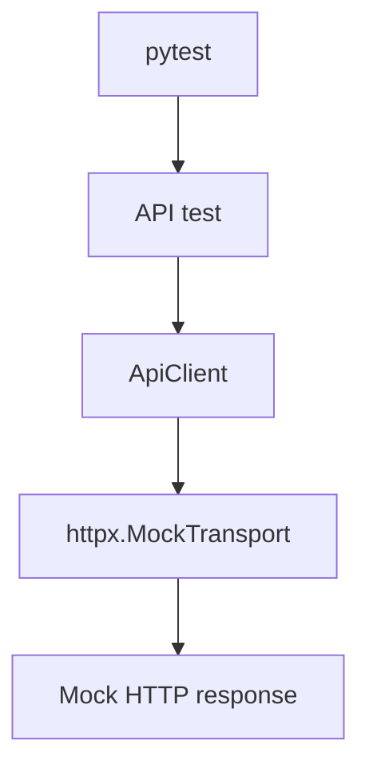
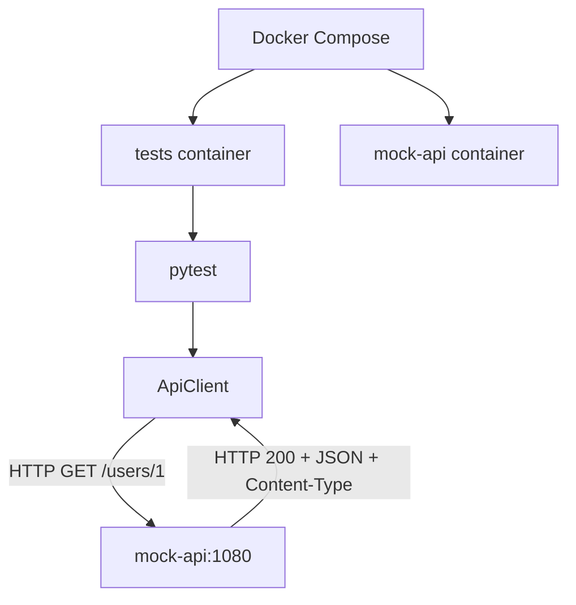

# hp-qa-junior-prep

**RU** · [EN](README.en.md) · [PL](README.pl.md)

Учебный репозиторий Junior QA Automation (Python): pytest-фреймворк `lab_fw`, API (httpx), UI (Playwright / Selenium), mocks, Allure, Docker, Docker Compose, GitHub Actions.

## Быстрый старт (локально)

```bash
python -m venv .venv
source .venv/Scripts/activate   # Windows Git Bash
# .venv\Scripts\activate       # Windows cmd/PowerShell

pip install -e ".[dev]"
pytest -m "not ui and not selenium and not compose" -q -n auto
```

UI-тесты (нужен браузер):

```bash
playwright install chromium
pytest -m ui -q
pytest -m selenium -q
```

## Структура

| Путь | Назначение |
|------|------------|
| `src/lab_fw/` | фреймворк (api, ui, config, reporting, pytest plugin) |
| `tests/` | pytest suite |
| `Dockerfile` | multi-stage: `local` (Avast CA) / `ci` |
| `docker-compose.yml` | `mock-api` + `tests` |
| `.github/workflows/tests.yml` | unit/API на runner (без UI/compose) |
| `.github/workflows/ci.yml` | Docker Compose на GitHub Actions |

## Переменные окружения

| Env | Назначение |
|-----|------------|
| `LAB_FW_BASE_URL` | API base URL (default `https://example.com`) |
| `LAB_FW_UI_BASE_URL` | UI base URL (default the-internet.herokuapp.com) |
| `LAB_FW_API_TOKEN` | optional Bearer token |
| `LAB_FW_TIMEOUT_S` / `LAB_FW_UI_TIMEOUT_S` | timeouts |
| `LAB_FW_LOG_LEVEL` | уровень логов |

Секрет CI: GitHub → Settings → Secrets → `LAB_FW_API_TOKEN`.

## Маркеры pytest

| Маркер | Смысл |
|--------|--------|
| `smoke` / `api` / … | обычные быстрые тесты |
| `ui` | реальный Playwright |
| `selenium` | реальный Selenium |
| `compose` | нужен сервис `mock-api` из Compose |

## Docker

### Образы (`Dockerfile`)

- **`ci`** — для GitHub / Linux без корпоративного MITM  
- **`local`** — копирует `avast-root.crt` (файл локальный, в git не коммитится)

`Dockerfile.local` и `avast-root.crt` в `.gitignore`.

Сборка и прогон без Compose:

```bash
# CI-подобный образ
docker build --target ci -t hp-qa-junior-prep:ci .
docker run --rm -e LAB_FW_API_TOKEN=ci-demo-token hp-qa-junior-prep:ci

# Локально с Avast (нужен avast-root.crt в корне)
docker build --target local -t hp-qa-junior-prep:local .
docker run --rm -e LAB_FW_API_TOKEN=ci-demo-token hp-qa-junior-prep:local
```

CMD образа: `pytest -m "not ui and not selenium"` — **включая** `compose`-тесты, если доступен `mock-api`.

### Docker Compose

```bash
# default target=ci (удобно без Avast)
docker compose up --build --abort-on-container-exit

# ноутбук с Avast
DOCKER_TARGET=local docker compose up --build --abort-on-container-exit
```

Сервисы:

- `mock-api` — MockServer на порту `1080`
- `tests` — собирает Dockerfile и гоняет pytest

`LAB_FW_BASE_URL` в compose **не** задаём глобально: старые тесты ждут `example.com` / MockTransport. Compose-тесты ходят на `http://mock-api:1080` явно.

## GitHub Actions

| Workflow | Что делает |
|----------|------------|
| **tests** | `pip install` + `pytest -m "not ui and not selenium and not compose"` + Allure artifact |
| **CI** | `docker compose up --build --abort-on-container-exit` (`DOCKER_TARGET=ci`) — здесь бегут и `@pytest.mark.compose` |

Логика маркера `compose`:

| Где | Есть mock-api? | Compose-тесты |
|-----|----------------|---------------|
| workflow **CI** / локальный compose | да | бегут |
| workflow **tests** (голый runner) | нет | исключены (`not compose`) |

## Схема взаимодействия API (лаба I1)

В проекте два режима тестирования API: изолированный с `httpx.MockTransport` и интеграционный с отдельным сервисом MockServer через Docker Compose. Реальный cloud/API в этих прогонах **не** вызывается — мок имитирует его HTTP-контракт (статус, JSON, заголовки).

### Режим 1. Обычные тесты



`httpx.MockTransport` работает внутри Python-процесса: проверяем поведение HTTP-клиента без отдельного сервера и без реального сетевого обращения к API.

Workflow **tests** исключает маркеры `compose` — нужные сервисы этим workflow не поднимаются.

### Режим 2. Docker Compose / CI



Тесты идут в контейнере `tests`, MockServer — в `mock-api`. Связь по внутренней сети Compose: `http://mock-api:1080`.

Workflow **CI** поднимает Compose с `DOCKER_TARGET=ci`, чтобы интеграционные тесты могли ходить в MockServer.

### Зачем оба уровня

- **MockTransport** — быстро и изолированно: ответы, ошибки, контракт клиентского кода; легче локализовать баг в логике `ApiClient`.
- **MockServer** — сетевое взаимодействие между контейнерами и настройки интеграционного окружения.

Оба подхода снижают зависимость от доступности реального внешнего API.

### Стратегия моков (лаба I2)

| | `httpx.MockTransport` | MockServer |
|--|------------------------|------------|
| Где работает | внутри процесса Python | отдельный сервис (`mock-api`) |
| Сеть | не нужна | реальный HTTP в Docker-сети |
| Цель | unit/API-тесты клиента | интеграция контейнеров |
| Примеры | `tests/mocks_lab/` | `tests/test_compose_api.py` |

Compose-контракт в `test_mock_api_users`:

1. fixture `reset_mockserver` — `PUT /mockserver/reset` до и после теста (изоляция состояния);
2. `PUT /mockserver/expectation` → **201** (правило принято);
3. `ApiClient.get` → **200**, JSON-тело, `Content-Type` содержит `application/json`;
4. `PUT /mockserver/verify` → **202** (запрос реально сматчился с expectation).

Маркер `compose` сам инфраструктуру не поднимает — смотри команду запуска:

- workflow **tests**: `pytest -m "not ui and not selenium and not compose"` (без MockServer);
- **Dockerfile CMD**: `not ui and not selenium` (без `not compose`) — в Compose рядом есть `mock-api`, интеграционные тесты бегут;
- точечно: `pytest -m compose` внутри сервиса `tests`.

`LAB_FW_BASE_URL` в Compose глобально не задаём: compose-тесты передают `base_url="http://mock-api:1080"` явно в `Settings`.

### Негативные интеграционные сценарии (лаба I3)

В `tests/test_compose_api.py` (маркер `compose`, тот же `reset_mockserver`):

| Тест | MockServer | Что проверяем |
|------|------------|----------------|
| `test_mock_api_auth_fail` | `GET /protected` → **401** + JSON `error` | клиент получает статус/тело/Content-Type без вызова реального IdP |
| `test_mock_api_timeout` | `GET /slow` с `delay` 1000 ms, `timeout_s=0.2` | `ApiError`; `__cause__` — `ReadTimeout` ⊂ `TimeoutException` ⊂ `HTTPError`; затем `/mockserver/verify` → **202** |

Политика клиента: при 4xx/5xx `get`/`post` **возвращают** `Response` (опционально `ensure_success` → `HttpStatusError`). Транспортные сбои (timeout и т.п.) всегда через `ApiError`.

### Диагностика падения тестов (лаба I4)

| Ситуация | Где смотреть | Что проверить |
|---|---|---|
| Локальный тест упал | Вывод `pytest` в терминале | Имя теста, traceback, assertion и фактический результат |
| Нужны подробные логи фреймворка | Логи `lab_fw`; настройка `LAB_FW_LOG_LEVEL` | Уровень логирования и сообщения API-клиента |
| Нужны детали HTTP-запроса и ответа | Allure report / attachments | Вложения `response` и `status_error`, если они созданы тестом или плагином |
| Ошибка в Compose-тесте | `docker compose logs tests` | Вывод pytest, traceback, конфигурацию и переменные окружения контейнера |
| Ошибка взаимодействия с MockServer | `docker compose logs mock-api` | Получил ли MockServer запрос, зарегистрировано ли ожидание и какой ответ он вернул |
| Ошибка в GitHub Actions | Actions → нужный workflow → job → упавший step | Для `tests` — шаг запуска pytest и артефакт `allure-results`; для `CI` — шаг `Run Docker Compose` |
| Ожидание MockServer не зарегистрировано | Вывод регистрации ожидания и логи `mock-api` | HTTP-статус регистрации — обычно `201`, а также тело ответа |
| Проверка MockServer не прошла | Вывод `/mockserver/verify` и логи `mock-api` | HTTP-статус проверки — ожидается `202`, а также тело ответа |

**Типичные симптомы**

- **HTTP 4xx/5xx:** `get()` / `post()` возвращают `Response`. Проверь статус, тело ответа и авторизацию. `ensure_success()` при ошибочном статусе вызывает `HttpStatusError`.
- **Timeout / `ApiError`:** проверь timeout, доступность адреса и цепочку исключений (`__cause__`). Клиент оборачивает транспортные ошибки в `ApiError`.
- **Ожидание не зарегистрировано:** проверь ответ регистрации MockServer и его логи.
- **`/mockserver/verify` вернул не `202`:** проверь, соответствует ли фактический запрос зарегистрированному ожиданию и отправлялся ли он вообще.

**Переменные окружения и маркеры**

- `LAB_FW_API_TOKEN` — проверь наличие и корректность токена.
- `http://mock-api:1080` — адрес MockServer из контейнера `tests`; внутри Compose используй имя сервиса `mock-api`.
- `LAB_FW_BASE_URL` — не задавай глобально для Compose без необходимости: обычные тесты используют собственную конфигурацию.
- `@pytest.mark.compose` — маркер интеграционных тестов, которым нужен MockServer.
- Локально на ноутбуке с Avast используй `DOCKER_TARGET=local`, если требуется соответствующий сертификат.

**Быстрый алгоритм:** тест упал → прочитай traceback → определи, это HTTP-ответ или транспортная ошибка → если проблема в Compose, проверь `tests`, затем `mock-api` → в CI открой упавший step и скачай доступный артефакт.

## Распределённые системы: теория и термины (лаба L1)

Краткий глоссарий mid-уровня. Где уместно — связь с `lab_fw` (retry, timeout, `ApiError`, Compose/CI).

### 1. Async communication

Отправитель не обязан ждать завершения всей обработки, прежде чем продолжить; результат может прийти позже. Асинхронность **не равна** очереди — очередь лишь один из механизмов.

**QA:** задержки, отсутствие немедленного ответа, повторные события, ошибки фоновой обработки.

**Пример:** API отвечает `202 Accepted` (заказ принят), заказ появляется позже — проверяем и `202`, и позднее состояние.

### 2. Queue / event / message broker

| Термин | Смысл | QA |
|--------|--------|-----|
| **Queue** | сообщения ждут обработки | не теряются, корректная обработка, нет нежелательных эффектов при повторе |
| **Event** | факт в системе (напр. `OrderCreated`) | возникает при нужных условиях, корректные данные |
| **Message broker** | маршрутизация между сервисами (RabbitMQ, Kafka) | доставка, маршрутизация, ошибки, повторная доставка |

### 3. Retry vs timeout

- **Retry** — будем ли пытаться снова после временной ошибки (лимит попыток; не повторять бессмысленно, напр. типичный `404`).
- **Timeout** — как долго готовы ждать (connect / read / overall deadline).

Timeout может привести к retry, но это разные механизмы. После timeout клиент **не знает**, выполнил ли сервер операцию — слепой повтор опасен без идемпотентности.

В `lab_fw`: политика retry; после исчерпания попыток — ожидаемый `ApiError`.

### 4. Timeout

Максимальное время ожидания соединения, данных или всей операции (включая паузы между retry). Три попытки по 5 с с паузами ≠ «всего 5 с».

**QA:** зависшие запросы не блокируют систему; ошибки ожидания предсказуемы (`ApiError` + `__cause__` как `TimeoutException`).

### 5. Idempotency

Повтор операции не даёт **дополнительного эффекта** по сравнению с одним выполнением. Не требует идентичного JSON в каждом ответе (могут отличаться метаданные).

**Idempotency-Key** помогает серверу распознать повтор той же операции. GET/PUT/DELETE по семантике HTTP обычно идемпотентны; POST — обычно нет (зависит от реализации).

**Пример:** повтор создания платежа с тем же ключом не создаёт второй платёж.

### 6. Eventual consistency

Компоненты могут кратко расходиться; при отсутствии новых изменений приходят к согласованному состоянию.

**QA:** не считать дефектом каждую краткую задержку; ловить случаи, когда согласование не наступает за допустимое время. В тестах — **polling с deadline**, не слепой `sleep`.

### 7. Logs vs metrics vs traces

| | Вопрос | Пример |
|--|--------|--------|
| **Logs** | что произошло? | `ApiError: HTTP 500` + метод/URL/время |
| **Metrics** | как часто / насколько хорошо? | error rate, latency p95, retry count |
| **Traces** | где в цепочке сервисов задержка? | gateway 20 ms → orders 50 ms → payments 2 s |

### 8. Correlation / Request / Trace ID

Идентификаторы связывают записи одного запроса или бизнес-процесса. Request ID — часто один HTTP-запрос; Correlation ID — несколько связанных шагов; Trace ID — распределённая трассировка. При retry политика может выдать новый Request ID, сохранив Correlation/Trace ID.

### 9. Env vs build («locally green ≠ CI»)

- **Env** — URL, токены, таймауты, режим запуска.
- **Build** — код, зависимости, образ Docker.

Успех локально не доказывает CI. Контролировать: версию Python/зависимостей, секреты/env, состав образа, доступность mock/внешних сервисов, команду pytest в workflow. В этом репо Compose даёт согласованный набор сервисов; CI проверяет воспроизводимость.

## Allure

```bash
pytest -q --alluredir=allure-results
allure serve allure-results
```

В Actions артефакт `allure-results` загружается даже при падении (`if: always()`).

## Документация модулей

- [API](src/lab_fw/api/README.md)
- [UI](src/lab_fw/ui/README.md)
- [Reporting / Allure](src/lab_fw/reporting/README.md)
- [Pytest plugin](src/lab_fw/pytest_plugin/README.md)
- [Pytest notes](tests/README_PYTEST.md)
- [Mocks lab](tests/mocks_lab/README.md)

## План обучения

См. [PLAN_MID_HP.md](PLAN_MID_HP.md).
