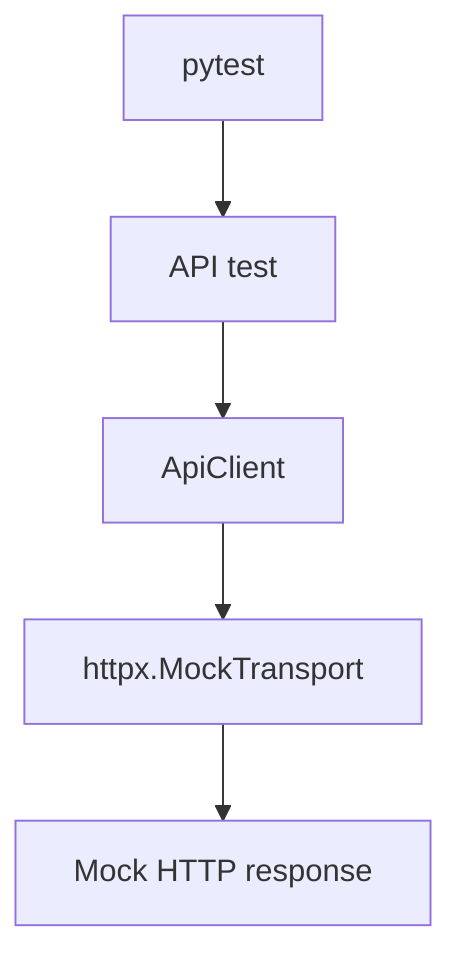
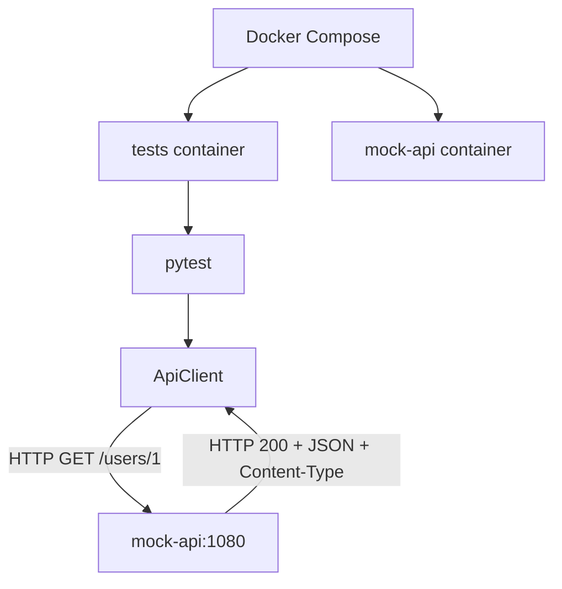

# hp-qa-junior-prep

**RU** · [EN](README.en.md) · [PL](README.pl.md)

Учебный репозиторий Junior QA Automation (Python): pytest-фреймворк `lab_fw`, API (httpx), UI (Playwright / Selenium), mocks, Allure, Docker, Docker Compose, GitHub Actions.

## Быстрый старт (локально)

```bash
python -m venv .venv
source .venv/Scripts/activate   # Windows Git Bash
# .venv\Scripts\activate       # Windows cmd/PowerShell

pip install -e ".[dev]"
pytest -m "not ui and not selenium and not compose" -q -n auto
```

UI-тесты (нужен браузер):

```bash
playwright install chromium
pytest -m ui -q
pytest -m selenium -q
```

## Структура

| Путь | Назначение |
|------|------------|
| `src/lab_fw/` | фреймворк (api, ui, config, reporting, pytest plugin) |
| `tests/` | pytest suite |
| `Dockerfile` | multi-stage: `local` (Avast CA) / `ci` / `playwright` |
| `docker-compose.yml` | `mock-api` + `tests`; profiles `selenium`, `playwright` |
| `.github/workflows/tests.yml` | unit/API на runner (без UI/compose) |
| `.github/workflows/ci.yml` | Compose: API → Selenium Grid → Playwright в Docker |

## Переменные окружения

| Env | Назначение |
|-----|------------|
| `LAB_FW_BASE_URL` | API base URL (default `https://example.com`) |
| `LAB_FW_UI_BASE_URL` | UI base URL (default the-internet.herokuapp.com) |
| `LAB_FW_API_TOKEN` | optional Bearer token |
| `LAB_FW_TIMEOUT_S` / `LAB_FW_UI_TIMEOUT_S` | timeouts |
| `LAB_FW_LOG_LEVEL` | уровень логов |
| `SELENIUM_REMOTE_URL` | URL Selenium Grid (`webdriver.Remote`); если не задан — локальный Chrome |
| `DOCKER_TARGET` | target сборки Compose: `ci` (default) или `local` (Avast CA) |

Секрет CI: GitHub → Settings → Secrets → `LAB_FW_API_TOKEN`.

## Маркеры pytest

| Маркер | Смысл |
|--------|--------|
| `smoke` / `api` / … | обычные быстрые тесты |
| `ui` | реальный Playwright |
| `selenium` | реальный Selenium |
| `compose` | нужен сервис `mock-api` из Compose |
| `parallel_lab` | упражнения M1 (xdist, файлы, lock) |
| `distributed_lab` | упражнения L2/L3 |
| `serial` | общее состояние (module-scoped UI/Selenium); не параллелить (`-n`) |

## Docker

### Образы (`Dockerfile`)

- **`ci`** — для GitHub / Linux без корпоративного MITM  
- **`local`** — копирует `avast-root.crt` (файл локальный, в git не коммитится)  
- **`playwright`** — базовый образ Microsoft Playwright с Chromium (profile `playwright` в Compose)

`Dockerfile.local` и `avast-root.crt` в `.gitignore`.

Сборка и прогон без Compose:

```bash
# CI-подобный образ
docker build --target ci -t hp-qa-junior-prep:ci .
docker run --rm -e LAB_FW_API_TOKEN=ci-demo-token hp-qa-junior-prep:ci

# Локально с Avast (нужен avast-root.crt в корне)
docker build --target local -t hp-qa-junior-prep:local .
docker run --rm -e LAB_FW_API_TOKEN=ci-demo-token hp-qa-junior-prep:local
```

CMD образа: `pytest -m "not ui and not selenium"` — **включая** `compose`-тесты, если доступен `mock-api`.

### Docker Compose

**Базовый прогон (API, compose, parallel_lab — без UI):**

```bash
docker compose up --build --abort-on-container-exit tests
docker compose down

# ноутбук с Avast MITM
DOCKER_TARGET=local docker compose up --build --abort-on-container-exit tests
```

**Profile `selenium`** — Selenium Grid + тесты в контейнере `ci`:

```bash
docker compose --profile selenium run --build --rm selenium-tests          # -m "selenium and not serial" -n 2
docker compose --profile selenium run --build --rm selenium-tests-serial   # -m "selenium and serial"
docker compose --profile selenium down
```

- `selenium` — `selenium/standalone-chrome`, порты `4444` (WebDriver), `7900` (noVNC)
- в `selenium-tests*` задаётся `SELENIUM_REMOTE_URL=http://selenium:4444`

**Profile `playwright`** — UI Playwright в образе `playwright`:

```bash
docker compose --profile playwright run --build --rm playwright-tests
docker compose --profile playwright run --build --rm playwright-tests-serial
```

Сервисы по умолчанию (без profile):

- `mock-api` — MockServer `:1080`
- `tests` — target `${DOCKER_TARGET:-ci}`, CMD из Dockerfile

`LAB_FW_BASE_URL` в compose **не** задаём глобально: старые тесты ждут `example.com` / MockTransport. Compose-тесты ходят на `http://mock-api:1080` явно.

## GitHub Actions

| Workflow | Что делает |
|----------|------------|
| **tests** | `pip install` + `pytest -m "not ui and not selenium and not compose"` + Allure artifact |
| **CI** | по шагам: `tests` → `down` → Selenium (parallel + serial) → `down` → Playwright (parallel + serial); `DOCKER_TARGET=ci` |

Логика маркера `compose`:

| Где | Есть mock-api? | Compose-тесты |
|-----|----------------|---------------|
| workflow **CI** / локальный compose | да | бегут |
| workflow **tests** (голый runner) | нет | исключены (`not compose`) |

## Схема взаимодействия API (лаба I1)

В проекте два режима тестирования API: изолированный с `httpx.MockTransport` и интеграционный с отдельным сервисом MockServer через Docker Compose. Реальный cloud/API в этих прогонах **не** вызывается — мок имитирует его HTTP-контракт (статус, JSON, заголовки).

### Режим 1. Обычные тесты



`httpx.MockTransport` работает внутри Python-процесса: проверяем поведение HTTP-клиента без отдельного сервера и без реального сетевого обращения к API.

Workflow **tests** исключает маркеры `compose` — нужные сервисы этим workflow не поднимаются.

### Режим 2. Docker Compose / CI



Тесты идут в контейнере `tests`, MockServer — в `mock-api`. Связь по внутренней сети Compose: `http://mock-api:1080`.

Workflow **CI** поднимает Compose с `DOCKER_TARGET=ci`, чтобы интеграционные тесты могли ходить в MockServer.

### Зачем оба уровня

- **MockTransport** — быстро и изолированно: ответы, ошибки, контракт клиентского кода; легче локализовать баг в логике `ApiClient`.
- **MockServer** — сетевое взаимодействие между контейнерами и настройки интеграционного окружения.

Оба подхода снижают зависимость от доступности реального внешнего API.

### Стратегия моков (лаба I2)

| | `httpx.MockTransport` | MockServer |
|--|------------------------|------------|
| Где работает | внутри процесса Python | отдельный сервис (`mock-api`) |
| Сеть | не нужна | реальный HTTP в Docker-сети |
| Цель | unit/API-тесты клиента | интеграция контейнеров |
| Примеры | `tests/mocks_lab/` | `tests/test_compose_api.py` |

Compose-контракт в `test_mock_api_users`:

1. fixture `reset_mockserver` — `PUT /mockserver/reset` до и после теста (изоляция состояния);
2. `PUT /mockserver/expectation` → **201** (правило принято);
3. `ApiClient.get` → **200**, JSON-тело, `Content-Type` содержит `application/json`;
4. `PUT /mockserver/verify` → **202** (запрос реально сматчился с expectation).

Маркер `compose` сам инфраструктуру не поднимает — смотри команду запуска:

- workflow **tests**: `pytest -m "not ui and not selenium and not compose"` (без MockServer);
- **Dockerfile CMD**: `not ui and not selenium` (без `not compose`) — в Compose рядом есть `mock-api`, интеграционные тесты бегут;
- точечно: `pytest -m compose` внутри сервиса `tests`.

`LAB_FW_BASE_URL` в Compose глобально не задаём: compose-тесты передают `base_url="http://mock-api:1080"` явно в `Settings`.

### Негативные интеграционные сценарии (лаба I3)

В `tests/test_compose_api.py` (маркер `compose`, тот же `reset_mockserver`):

| Тест | MockServer | Что проверяем |
|------|------------|----------------|
| `test_mock_api_auth_fail` | `GET /protected` → **401** + JSON `error` | клиент получает статус/тело/Content-Type без вызова реального IdP |
| `test_mock_api_timeout` | `GET /slow` с `delay` 1000 ms, `timeout_s=0.2` | `ApiError`; `__cause__` — `ReadTimeout` ⊂ `TimeoutException` ⊂ `HTTPError`; затем `/mockserver/verify` → **202** |

Политика клиента: при 4xx/5xx `get`/`post` **возвращают** `Response` (опционально `ensure_success` → `HttpStatusError`). Транспортные сбои (timeout и т.п.) всегда через `ApiError`.

### Диагностика падения тестов (лаба I4)

| Ситуация | Где смотреть | Что проверить |
|---|---|---|
| Локальный тест упал | Вывод `pytest` в терминале | Имя теста, traceback, assertion и фактический результат |
| Нужны подробные логи фреймворка | Логи `lab_fw`; настройка `LAB_FW_LOG_LEVEL` | Уровень логирования и сообщения API-клиента |
| Нужны детали HTTP-запроса и ответа | Allure report / attachments | Вложения `response` и `status_error`, если они созданы тестом или плагином |
| Ошибка в Compose-тесте | `docker compose logs tests` | Вывод pytest, traceback, конфигурацию и переменные окружения контейнера |
| Ошибка взаимодействия с MockServer | `docker compose logs mock-api` | Получил ли MockServer запрос, зарегистрировано ли ожидание и какой ответ он вернул |
| Ошибка в GitHub Actions | Actions → нужный workflow → job → упавший step | Для `tests` — шаг запуска pytest и артефакт `allure-results`; для `CI` — шаг `Run Docker Compose` |
| Ожидание MockServer не зарегистрировано | Вывод регистрации ожидания и логи `mock-api` | HTTP-статус регистрации — обычно `201`, а также тело ответа |
| Проверка MockServer не прошла | Вывод `/mockserver/verify` и логи `mock-api` | HTTP-статус проверки — ожидается `202`, а также тело ответа |

**Типичные симптомы**

- **HTTP 4xx/5xx:** `get()` / `post()` возвращают `Response`. Проверь статус, тело ответа и авторизацию. `ensure_success()` при ошибочном статусе вызывает `HttpStatusError`.
- **Timeout / `ApiError`:** проверь timeout, доступность адреса и цепочку исключений (`__cause__`). Клиент оборачивает транспортные ошибки в `ApiError`.
- **Ожидание не зарегистрировано:** проверь ответ регистрации MockServer и его логи.
- **`/mockserver/verify` вернул не `202`:** проверь, соответствует ли фактический запрос зарегистрированному ожиданию и отправлялся ли он вообще.

**Переменные окружения и маркеры**

- `LAB_FW_API_TOKEN` — проверь наличие и корректность токена.
- `http://mock-api:1080` — адрес MockServer из контейнера `tests`; внутри Compose используй имя сервиса `mock-api`.
- `LAB_FW_BASE_URL` — не задавай глобально для Compose без необходимости: обычные тесты используют собственную конфигурацию.
- `@pytest.mark.compose` — маркер интеграционных тестов, которым нужен MockServer.
- Локально на ноутбуке с Avast используй `DOCKER_TARGET=local`, если требуется соответствующий сертификат.

**Быстрый алгоритм:** тест упал → прочитай traceback → определи, это HTTP-ответ или транспортная ошибка → если проблема в Compose, проверь `tests`, затем `mock-api` → в CI открой упавший step и скачай доступный артефакт.

## Распределённые системы: теория и термины (лаба L1)

Краткий глоссарий mid-уровня. Где уместно — связь с `lab_fw` (retry, timeout, `ApiError`, Compose/CI).

### 1. Async communication

Отправитель не обязан ждать завершения всей обработки, прежде чем продолжить; результат может прийти позже. Асинхронность **не равна** очереди — очередь лишь один из механизмов.

**QA:** задержки, отсутствие немедленного ответа, повторные события, ошибки фоновой обработки.

**Пример:** API отвечает `202 Accepted` (заказ принят), заказ появляется позже — проверяем и `202`, и позднее состояние.

### 2. Queue / event / message broker

| Термин | Смысл | QA |
|--------|--------|-----|
| **Queue** | сообщения ждут обработки | не теряются, корректная обработка, нет нежелательных эффектов при повторе |
| **Event** | факт в системе (напр. `OrderCreated`) | возникает при нужных условиях, корректные данные |
| **Message broker** | маршрутизация между сервисами (RabbitMQ, Kafka) | доставка, маршрутизация, ошибки, повторная доставка |

### 3. Retry vs timeout

- **Retry** — будем ли пытаться снова после временной ошибки (лимит попыток; не повторять бессмысленно, напр. типичный `404`).
- **Timeout** — как долго готовы ждать (connect / read / overall deadline).

Timeout может привести к retry, но это разные механизмы. После timeout клиент **не знает**, выполнил ли сервер операцию — слепой повтор опасен без идемпотентности.

В `lab_fw`: политика retry; после исчерпания попыток — ожидаемый `ApiError`.

### 4. Timeout

Максимальное время ожидания соединения, данных или всей операции (включая паузы между retry). Три попытки по 5 с с паузами ≠ «всего 5 с».

**QA:** зависшие запросы не блокируют систему; ошибки ожидания предсказуемы (`ApiError` + `__cause__` как `TimeoutException`).

### 5. Idempotency

Повтор операции не даёт **дополнительного эффекта** по сравнению с одним выполнением. Не требует идентичного JSON в каждом ответе (могут отличаться метаданные).

**Idempotency-Key** помогает серверу распознать повтор той же операции. GET/PUT/DELETE по семантике HTTP обычно идемпотентны; POST — обычно нет (зависит от реализации).

**Пример:** повтор создания платежа с тем же ключом не создаёт второй платёж.

### 6. Eventual consistency

Компоненты могут кратко расходиться; при отсутствии новых изменений приходят к согласованному состоянию.

**QA:** не считать дефектом каждую краткую задержку; ловить случаи, когда согласование не наступает за допустимое время. В тестах — **polling с deadline**, не слепой `sleep`.

### 7. Logs vs metrics vs traces

| | Вопрос | Пример |
|--|--------|--------|
| **Logs** | что произошло? | `ApiError: HTTP 500` + метод/URL/время |
| **Metrics** | как часто / насколько хорошо? | error rate, latency p95, retry count |
| **Traces** | где в цепочке сервисов задержка? | gateway 20 ms → orders 50 ms → payments 2 s |

### 8. Correlation / Request / Trace ID

Идентификаторы связывают записи одного запроса или бизнес-процесса. Request ID — часто один HTTP-запрос; Correlation ID — несколько связанных шагов; Trace ID — распределённая трассировка. При retry политика может выдать новый Request ID, сохранив Correlation/Trace ID.

### 9. Env vs build («locally green ≠ CI»)

- **Env** — URL, токены, таймауты, режим запуска.
- **Build** — код, зависимости, образ Docker.

Успех локально не доказывает CI. Контролировать: версию Python/зависимостей, секреты/env, состав образа, доступность mock/внешних сервисов, команду pytest в workflow. В этом репо Compose даёт согласованный набор сервисов; CI проверяет воспроизводимость.

## Лаба L2: очередь, retry, timeout, deadline, idempotency

Практика к глоссарию [L1](#распределённые-системы-теория-и-термины-лаба-l1): in-memory очередь → worker → HTTP через `ApiClient` из `lab_fw`, с политикой retry и ограничениями по времени.

**Код:** `src/distributed_lab/queue_worker.py`  
**Тесты:** `tests/distributed_lab/` (маркер `@pytest.mark.distributed_lab`)

### Компоненты

| Компонент | Назначение |
|-----------|------------|
| `Job` | Задача: `method`, `path`, опционально `timeout`, `deadline_s`, `payload`, `headers`, `idempotency_key` |
| `parse_job` | Валидация dict → `Job`; ошибки схемы → `SchemaError` |
| `InMemoryQueue` | FIFO на `deque`; `put` принимает только `Job` |
| `Worker` | `run_once()` — один job из очереди; `execute()` — один HTTP-вызов |

Worker строит kwargs для клиента: `json` из `payload`, копия `headers`, при наличии `idempotency_key` добавляется заголовок `Idempotency-Key` (поле job не мутируется).

### Retry и метод HTTP

В `run_once` используется `retry_call` (до 3 попыток) и политика `lab_fw.api.retry_policy.should_retry`:

- **GET:** retry на `429` / `503` и на транспортные ошибки (`ConnectError`, `ReadTimeout`, …);
- **POST:** retry **не** выполняется (даже при `429`/`503` или timeout) — снижаем риск двойного эффекта без явной идемпотентности на сервере.

После исчерпания попыток или при не-retryable статусе — `ApiError` / `HttpStatusError` (через `ensure_success`).

### Timeout vs deadline

| Механизм | Где задаётся | Смысл |
|----------|--------------|--------|
| **Timeout** | `Settings.timeout_s`, `Job.timeout` | Сколько ждать один HTTP-запрос (connect/read) |
| **Job deadline** | `Job.deadline_s` | Общий бюджет времени на обработку job (включая retry); истечение → `JobDeadlineExceeded` |
| **Worker deadline** | аргумент `Worker(..., deadline_w=...)` | Бюджет на «сессию» worker; истечение → `WorkerDeadlineExceeded` |

При расчёте timeout для запроса worker берёт **минимум** из job timeout, оставшегося job deadline и оставшегося worker deadline. После `ApiError` worker снова проверяет deadline — финальная ошибка может быть deadline, а не последний HTTP-сбой.

### Idempotency (учебный HTTP-сервер)

В `tests/distributed_lab/test_timeout.py` — `WorkerTestHandler`: при повторном POST с тем же `Idempotency-Key` сервер **не создаёт вторую запись** в `received_requests`, но отвечает данными первого запроса. Тесты проверяют:

- передачу JSON и заголовков (в т.ч. `X-Request-ID`) на реальный HTTP;
- отсутствие `Idempotency-Key`, если ключ не задан;
- POST при timeout — одна попытка, ключ на wire;
- два job с одним ключом — `server.calls == 2`, `len(received_requests) == 1`;
- GET retry (503→200) — один и тот же `Idempotency-Key` на каждой попытке.

### Запуск

```bash
# все тесты лабы L2
pytest -m distributed_lab -q

# только модуль очереди/worker (без slow HTTP server)
pytest tests/distributed_lab/test_queue_worker.py -q

# timeout, deadline, idempotency на локальном HTTP server
pytest tests/distributed_lab/test_timeout.py -q
```

Docker / MockServer для L2 **не нужны** — достаточно venv и `pip install -e .`.

### Что смотреть при падении

1. Traceback: `JobDeadlineExceeded` / `WorkerDeadlineExceeded` vs `ApiError` и `__cause__` (`ReadTimeout`, `ConnectError`, …).
2. Счётчики попыток в MockTransport или `server.request_counts` / `received_requests` в slow-server тестах.
3. Метод job: POST не должен давать 3 попытки при типичной политике retry.

## Лаба L3: чек-лист расследования неисправностей

Систематическая диагностика по пяти направлениям: **Env → Build → Logs → Metrics → Trace**. Практика: исследование **retry**, логов (`caplog`) и **ручных счётчиков расследования** (*investigation counters*).

**Тесты:** `tests/distributed_lab/test_l3_investigation.py` (маркер `@pytest.mark.distributed_lab`)

**Связь с другими лабами:** [I4 — где смотреть при падении pytest](#диагностика-падения-тестов-лаба-i4) (карта мест); [L2](#лаба-l2-очередь-retry-timeout-deadline-idempotency) (queue, worker, retry, deadline); L3 — **маршрут обхода** и отработка на retry + логах.

### 1. Env — переменные окружения

Проверка локально (пример):

```bash
python -c "import os; print('LAB_FW_API_TOKEN:', 'SET' if os.getenv('LAB_FW_API_TOKEN') else 'MISSING'); print('LAB_FW_BASE_URL:', os.getenv('LAB_FW_BASE_URL', '<unset>')); print('LAB_FW_LOG_LEVEL:', os.getenv('LAB_FW_LOG_LEVEL', '<unset>'))"
```

Если переменные не заданы, `get_settings()` подставляет значения по умолчанию: `base_url=https://example.com`, `timeout_s=5.0`, `log_level=INFO`, `api_token=None`.

**Локально vs CI:** workflow **tests** в GitHub Actions задаёт `LAB_FW_API_TOKEN` из Secrets и проверяет, что он не пустой. Отсутствие токена локально при L3 — нормально для MockTransport; в CI конфигурация другая — типичный пример **env ≠ local**.

### 2. Build — состояние проекта

| Проверка | Зачем |
|----------|--------|
| `git rev-parse --short HEAD` | воспроизводимость: тот же commit, что в CI |
| `python -m pip show lab-fw` | версия пакета, editable install |
| `git status` | незакоммиченные изменения vs «чистый» build |

### 3. Logs — retry-lab

`httpx.MockTransport` + `Worker` + `ApiClient`. Два сценария в тестах:

| Сценарий | Поведение | Проверки |
|----------|-----------|----------|
| Успешный retry | 503, 503, 200 | 3 попытки; 2× `WARNING` от `lab_fw.core.retry`; ответ `{"ok": true}` |
| Исчерпание (`exhausted`) | 503 × 3 | 3 попытки; 2× `WARNING`; `HttpStatusError`; status/method/path |

В логах: `INFO` — `lab_fw.api` (запрос); `WARNING` — `lab_fw.core.retry` (перед следующей попыткой). Третья неудача **не** обязана давать WARNING — retry уже не планируется.

### 4. Metrics — investigation counters

В проекте нет встроенного Prometheus/метрик. Для сценария «все 503» фиксируют **ручные счётчики по тесту**:

- `http_requests = 3`
- `503_count = 3`
- `retries_after_first = 2`

Это не prod-метрики (не error rate / p95 в runtime). Поиск в коде: `grep -RniE "prometheus|metrics|histogram|counter|p95" src tests pyproject.toml`.

### 5. Trace — корреляция

Поиск идентификаторов: `grep -RniE "X-Request-ID|Correlation-ID|request_id" src tests`. В L2-тестах проверяется передача `X-Request-ID: req-123`. Это **wire-level** идентификатор, не полноценная распределённая трассировка (нет auto Trace ID / span между сервисами).

### I4 vs L3 vs L2 (устный якорь)

| Этап | Вопрос |
|------|--------|
| **I4** | Где искать? (pytest, Compose, mock-api, CI) |
| **L3** | В каком порядке? (Env → Build → Logs → Metrics → Trace) |
| **L2** | Queue, worker, deadline, idempotency (отдельная лаба) |
| **Retry-lab в L3** | Практика: retry + `caplog` + investigation counters |

*I4 — карта мест; L3 — маршрут обхода; L2/L3-тесты — отработка на retry и логах.*

### Запуск

```bash
pytest tests/distributed_lab/test_l3_investigation.py -v
```

### Ограничения L3

`MockTransport` — без реальной сети и без Docker/MockServer. Автоматические метрики и сквозная tracing-платформа в рамках L3 не реализуются.

## Lab M1 — Параллельное выполнение и изоляция ресурсов

### Цель

Изучить влияние параллельного выполнения pytest через `pytest-xdist` на общие ресурсы и научиться предотвращать конфликты между тестами.

### Стратегии изоляции

| Общий ресурс | Стратегия | Настройка |
|---|---|---|
| MockServer в Docker Compose | Группировка конфликтующих тестов на одном worker | Маркер `@pytest.mark.xdist_group(name="mockserver")` назначается в `tests/conftest.py` тестам с `@pytest.mark.compose`; запуск с `--dist loadgroup` |
| Один локальный браузер без Grid | Последовательное выполнение конфликтующих тестов | Общая группа + `--dist loadgroup` |
| Общий файл отчёта | Отдельный файл для каждого worker | `worker_id` в имени файла или `tmp_path` |
| Ресурс, создаваемый для каждого теста | Отдельное создание и очистка ресурса | Фикстура pytest и корректный teardown |

Для синхронизации общего файла между процессами недостаточно обычного `threading.Lock`: worker-процессы xdist работают независимо. Если общий файл действительно необходим, потребуется межпроцессная блокировка. Однако для тестовых артефактов обычно проще использовать отдельные файлы.

### Compose и MockServer

Compose-тесты используют общий экземпляр MockServer. Если несколько тестов одновременно изменяют его ожидания или сбрасывают состояние, они могут влиять друг на друга.

В `tests/conftest.py` hook `pytest_collection_modifyitems` назначает всем тестам с маркером `compose` маркер `@pytest.mark.xdist_group(name="mockserver")`.

#### Почему важен `tryfirst=True`

При использовании `--dist loadgroup` xdist группирует тесты по маркеру `xdist_group`.

Во время сбора тестов hook `pytest_collection_modifyitems` в `tests/conftest.py` добавляет маркер `xdist_group(name="mockserver")` тестам, отмеченным `compose`. Для корректной группировки этот маркер должен быть установлен до того, как соответствующая логика xdist обработает тесты и сформирует группировку для планировщика.

На worker-стороне xdist использует маркер `xdist_group` для формирования суффикса в `nodeid`, например `@mockserver`. Если маркер не установлен вовремя, master может получить идентификатор без этого суффикса. Тогда `LoadGroupScheduling` не объединит конфликтующие тесты в одну группу, и они могут выполняться на разных worker одновременно.

В проекте для этого используется `@pytest.hookimpl(tryfirst=True)` — см. фрагмент в `tests/conftest.py`. Он задаёт приоритет реализации hook относительно других реализаций того же hook и помогает назначить групповой маркер до обработки группировки xdist.

Сам по себе `tryfirst=True` не блокирует доступ к общему ресурсу: изоляция обеспечивается правильной группировкой и настройкой запуска.

#### `loadgroup` и `loadscope`

- `--dist load` распределяет отдельные тесты между worker и подходит для независимых тестов.
- `--dist loadscope` сохраняет тесты одного модуля или класса на одном worker. Если все конфликтующие Compose-тесты находятся в одном модуле, этого может быть достаточно.
- `--dist loadgroup` объединяет тесты с одинаковым `xdist_group`, в том числе расположенные в разных модулях. Это более гибкий вариант для общей группы ресурсов.

В проекте в `Dockerfile` уже используются `-n auto` и `--dist loadgroup`.

#### Роль `reset_mockserver`

Фикстура `reset_mockserver` в `tests/test_compose_api.py` сбрасывает состояние MockServer до и после каждого теста.

Это помогает обеспечить чистое состояние сервера между последовательными тестами. Однако сброс не заменяет группировку: если два теста параллельно работают с одним MockServer, сброс одного теста может нарушить работу другого.

### Проверка

#### 1. Запуск Compose

```bash
docker compose up --build --abort-on-container-exit tests
```

Эта команда поднимает `mock-api` и контейнер `tests` (API / compose / parallel_lab, без UI).

#### 2. Проверка группировки Compose-тестов

Внутри контейнера `tests` можно выполнить:

```bash
docker compose run --rm tests pytest tests/test_compose_api.py -vv -n auto --dist loadgroup
```

Команда запускает тесты из `tests/test_compose_api.py` с подробным выводом и включает распределение через `loadgroup`.

При проверке обрати внимание на три признака:

- В начале сессии присутствует сообщение `scheduling tests via LoadGroupScheduling`.
- В строках тестов виден суффикс группы, например `tests/test_compose_api.py::test_mock_api_users@mockserver`.
- Все четыре Compose-теста выполняются на одном worker, например `[gw0]`. Номер worker может быть другим; важно, чтобы все тесты группы выполнялись на одном и том же.

Если команда запускается через Compose, сервис `mock-api` должен быть доступен тестовому контейнеру по адресу `http://mock-api:1080`.

#### 3. Разделение запусков в CI

В проекте обычные тесты и Compose-тесты запускаются отдельно:

- `.github/workflows/tests.yml` запускает тесты с `-n auto`, исключая маркеры `ui`, `selenium` и `compose`.
- `.github/workflows/ci.yml` сначала поднимает только сервис `tests`, затем отдельно profiles `selenium` и `playwright` (см. Lab M2).
- `Dockerfile` задаёт `-n auto --dist loadgroup` для запуска pytest в контейнере.

Таким образом, конфигурация CI разделяет обычные тесты и тесты, использующие общий сервис MockServer.

### Практика: `parallel_lab`

Код: `tests/parallel_lab/test_parallel_resources.py`, маркер `@pytest.mark.parallel_lab` (см. `pyproject.toml`). Зависимость для lock-тестов: `filelock` в `[project.optional-dependencies]` (`dev` / `dev_slim`).

| Что проверяем | Тесты (идея) |
|---|---|
| Отдельный файл на worker (`PYTEST_XDIST_WORKER`) | `test_shared_file_write_read`, `test_worker_specific_files_are_isolated` |
| Изоляция через `tmp_path` | `test_tmp_path_creates_isolated_temp_file`, `test_tmp_path_is_unique_for_each_test` |
| Общий файл + `FileLock` под xdist | `test_shared_file_access_with_file_lock`, `test_shared_file_access_is_serialized` |
| Гонка без lock (multiprocessing, воспроизводимо) | `test_shared_file_race_condition_is_reproducible` |
| Lock между процессами | `test_file_lock_prevents_shared_file_race` |

Запуск:

```bash
pytest tests/parallel_lab -m parallel_lab -v
pytest tests/parallel_lab -m parallel_lab -n 2 -v
```

Файлы `shared_report*.txt` в каталоге лабы — локальные артеfactы прогона; в git не коммитятся (см. `.gitignore`). Полный suite в Docker (`Dockerfile` CMD) включает `parallel_lab` вместе с остальными тестами без `ui` / `selenium`.

### Связь с предыдущими лабораторными

- **C6** — изоляция тестов и управление общими ресурсами.
- **G3** — параллельное выполнение в CI: `pytest-xdist`, Docker и настройки запуска.
- **I4** — карта мест, где искать конфигурацию и результаты тестов: pytest, Compose, MockServer и CI.
- **L2** — очередь, worker, timeout, retry и idempotency.
- **L3** — расследование проблем по логам и другим сигналам.

**Главная идея M1:** параллельное выполнение ускоряет независимые тесты, но общие ресурсы требуют явной стратегии изоляции. Группировка, отдельные ресурсы и корректная очистка решают разные задачи и не заменяют друг друга.

## Lab M2 — Удалённый браузер (Selenium Grid) и UI в Docker

### Цель

Вынести браузер в отдельный контейнер (Grid), параллелить независимые UI/Selenium-тесты и явно отделить сценарии с **общим состоянием** между тестами в одном модуле.

### Изменения в коде

| Компонент | Назначение |
|-----------|------------|
| `Settings.selenium_remote_url` | читается из `SELENIUM_REMOTE_URL`; пробелы → «не задано» → локальный Chrome |
| `SeleniumClient.start()` | `webdriver.Chrome()` или `webdriver.Remote(...)`; при ошибке старта — `quit()` и проброс исходного исключения |
| `@pytest.mark.serial` | цепочки с `ui_client_module` / `selenium_client_module` в `test_login_page.py`, `test_secure_page.py`, `test_login_page_selenium.py`, `test_secure_page_selenium.py`; отдельный прогон без `-n` |
| `tests/test_selenium_client.py` | моки Remote/Chrome + опционально живой Grid |
| `docker-compose.yml` | Grid, `selenium-tests` / `selenium-tests-serial`, `playwright-tests` / `playwright-tests-serial` |
| `Dockerfile` target `playwright` | официальный образ Playwright Python — браузеры уже внутри |

Grid: `SE_NODE_MAX_SESSIONS=2` согласован с `-n 2` в `selenium-tests`.

### Маркеры и селекторы в Compose

| Сервис | pytest `-m` |
|--------|-------------|
| `selenium-tests` | `selenium and not serial` |
| `selenium-tests-serial` | `selenium and serial` |
| `playwright-tests` | `ui and not selenium and not serial` |
| `playwright-tests-serial` | `ui and not selenium and serial` |

### Локальный запуск (без полного CI)

```bash
# Grid + параллельные Selenium (из корня репо)
docker compose --profile selenium up -d selenium
export SELENIUM_REMOTE_URL=http://localhost:4444   # Git Bash / WSL
pytest -m "selenium and not serial" -n 2 -vv
pytest -m "selenium and serial" -vv
docker compose --profile selenium down

# Playwright на хосте (нужен playwright install chromium)
pytest -m "ui and not selenium and not serial" -n 2 -vv
pytest -m "ui and not selenium and serial" -vv
```

noVNC при поднятом `selenium`: [http://localhost:7900](http://localhost:7900).

### CI (`.github/workflows/ci.yml`)

1. `docker compose up … tests` — API, `compose`, `parallel_lab`, …  
2. `docker compose down`  
3. `selenium-tests` → `selenium-tests-serial` → `docker compose --profile selenium down`  
4. `playwright-tests` → `playwright-tests-serial`  

Отдельного `playwright down` в workflow нет: на ephemeral runner это обычно не критично; при необходимости добавь step `docker compose --profile playwright down`.

### Связь M1 ↔ M2

| Проблема | M1 | M2 |
|----------|----|----|
| Общий MockServer | `xdist_group` + `loadgroup` | без изменений |
| Общий локальный один браузер | `loadgroup` / последовательно | Grid: несколько сессий; `serial` для module fixtures |
| Playwright в CI без установки на runner | — | отдельный Docker target `playwright` |

### Проверка (review checklist)

- Мок-тесты: `pytest tests/test_selenium_client.py -k "not connects_to_real" -q`
- Живой Grid (нужен запущенный `selenium` на `:4444`): `test_selenium_client_connects_to_real_grid` при отсутствии env сам подставляет `http://localhost:4444`; `test_selenium_client_connects_to_real_grid_2` — только через `SELENIUM_REMOTE_URL` (фикстура `selenium_client`). В Compose/CI URL задаётся как `http://selenium:4444`.
- Playwright в Docker: версия пакета `playwright` (1.63.x) должна совпадать с образом `mcr.microsoft.com/playwright/python:v1.63.0-noble`; параллельный прогон UI — с `-p no:anyio` (sync Playwright + xdist).
- Module-pair тесты (`*fixture_module`) — только в прогоне `serial`, не в `-n 2`.

**Главная идея M2:** runner и браузер разделены; параллелизм UI опирается на несколько сессий Grid или workers Playwright, а не на один shared driver без маркировки.

## Allure

```bash
pytest -q --alluredir=allure-results
allure serve allure-results
```

В Actions артефакт `allure-results` загружается даже при падении (`if: always()`).

## Документация модулей

- [API](src/lab_fw/api/README.md)
- [UI](src/lab_fw/ui/README.md)
- [Reporting / Allure](src/lab_fw/reporting/README.md)
- [Pytest plugin](src/lab_fw/pytest_plugin/README.md)
- [Pytest notes](tests/README_PYTEST.md)
- [Mocks lab](tests/mocks_lab/README.md)

## План обучения

См. [PLAN_MID_HP.md](PLAN_MID_HP.md).
