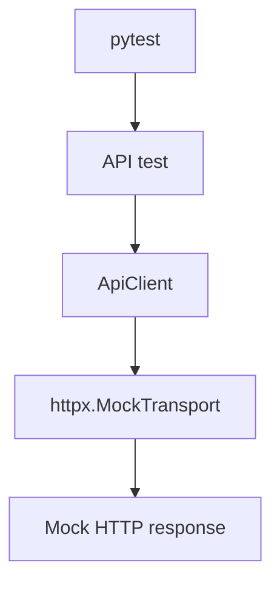
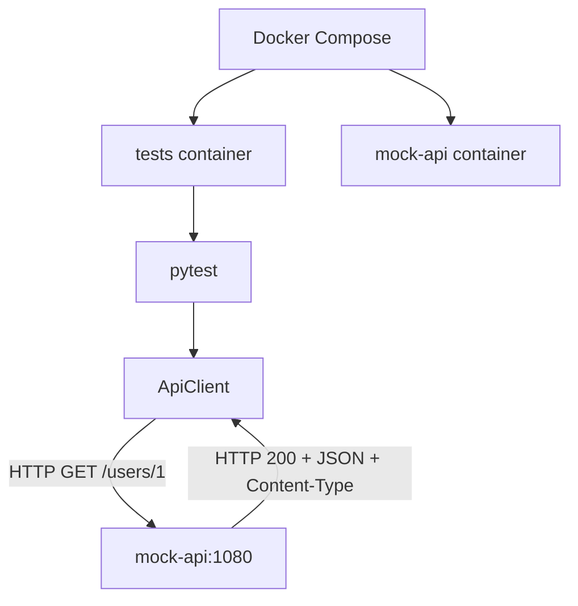

# hp-qa-junior-prep

**RU** · [EN](README.en.md) · [PL](README.pl.md)

<!-- readme-preamble -->

Репозиторий **hp-qa-junior-prep** — это учебно-практический проект автоматизации QA на Python. Здесь собран воспроизводимый стек: пакет **`lab_fw`** (HTTP-клиент, UI, конфигурация, reporting, pytest-плагин), набор **pytest**-тестов, **Docker / Compose**, **GitHub Actions** и отчёты **Allure**. Внешний «боевой» API в типичных прогонах **не вызывается**: контракт имитируют **MockTransport** и **MockServer**, чтобы отрабатывать изоляцию, интеграцию и диагностику без зависимости от сети.

Документ ниже одновременно **инструкция** (команды, env, CI) и **учебник** (теория, связь с кодом, типичные ошибки). Три языка: **RU** (этот файл), [EN](README.en.md), [PL](README.pl.md).

### Для кого

- Инженер QA / SDET, который поднимает фреймворк локально и в CI.
- Разработчик, которому нужно понять, как устроены моки, параллельный pytest и traceability (TestRail / Jira).

### Что вы получите после прохождения материала

- Умение выбирать уровень теста: in-process mock vs контейнерный MockServer vs UI в Grid/Docker.
- Понимание retry, timeout, deadline, idempotency на примере `ApiClient` и `Worker`.
- Навык расследования падений: env → build → logs → metrics → trace.
- Практику Allure + опциональную связь с TestRail и Jira.

### Требования

| Компонент | Версия / примечание |
|-----------|---------------------|
| Python | **≥ 3.11** (`pyproject.toml`) |
| Git | для клонирования и воспроизведения commit в CI |
| Docker Desktop (опционально) | Compose-тесты, Grid, Playwright в CI-образе |
| Allure CLI (опционально) | `allure serve` локально |
| TestRail CLI (опционально) | канал B в разделе N2 |

### Карта разделов документа

| Блок | Тема | Где в коде |
|------|------|------------|
| **I1–I4** | API, моки, негативы, диагностика | `tests/mocks_lab/`, `tests/test_compose_api.py`, `src/lab_fw/api/` |
| **L1–L3** | Распределённые системы, очередь/worker, расследование | `src/distributed_lab/`, `tests/distributed_lab/` |
| **M1–M2** | xdist, изоляция, Selenium Grid, UI в Docker | `tests/parallel_lab/`, `tests/conftest.py`, Compose profiles |
| **N1–N3** | Allure, TestRail, Jira, risk-based наборы | `src/lab_fw/reporting/`, `tests/test_api_client.py`, `pyproject.toml` (markers) |
| **J3** | Mock Device Inventory (cloud, DFU, heartbeat) | `src/device_lab/`, `tests/device_lab/` |

Рекомендуемый порядок чтения: **Быстрый старт → Структура → I1–I4 → L1 → L2 → L3 → M1 → M2 → N1 → N2 → N3 → J3**. Разделы Docker и GitHub Actions удобно держать под рукой при любом прогоне.

### Содержание

1. [Быстрый старт](#быстрый-старт-локально)
2. [Структура репозитория](#структура)
3. [Переменные окружения](#переменные-окружения)
4. [Маркеры pytest](#маркеры-pytest)
5. [Docker](#docker)
6. [GitHub Actions](#github-actions)
7. [I1 — схема API](#схема-взаимодействия-api-i1) (включая I2–I4)
8. [L1 — глоссарий](#распределённые-системы-теория-и-термины-l1)
9. [L2 — очередь и worker](#l2--очередь-retry-timeout-deadline-idempotency)
10. [L3 — расследование сбоев](#l3--расследование-сбоев-чек-лист)
11. [M1 — параллельность](#m1--параллельное-выполнение-и-изоляция-ресурсов)
12. [M2 — Grid и UI](#m2--удалённый-браузер-selenium-grid-и-ui-в-docker)
13. [N1 — Allure](#n1--отчёты-allure)
14. [N2 — TestRail и Jira](#n2--jira--testrail)
15. [N3 — risk-based (smoke / full)](#n3--тестирование-на-основе-рисков-smoke-и-полная-регрессия)
16. [J3 — Device Inventory API (облако и DFU)](#j3--mock-device-inventory-api-облако-и-dfu)
17. [Allure (кратко)](#allure-кратко)
18. [Документация модулей](#документация-модулей)

### Как читать каждый раздел

В начале главы — блок **«О разделе»**: зачем тема, что смотреть в репозитории, как проверить себя. Дальше — справочные таблицы, команды и связь с тестами. Если команда падает, сначала [I4](#диагностика-падения-тестов-i4), затем при сбоях инфраструктуры — [L3](#l3--расследование-сбоев-чек-лист).

## Быстрый старт (локально)

<!-- readme-chapter:quickstart -->
### О разделе

Минимальный путь от пустой машины до «зелёного» прогона unit/API без браузера и без MockServer. Это тот же набор, что workflow **tests** на GitHub (без маркера `compose`).

### Пошагово

1. Клонируй репозиторий, перейди в корень.
2. Создай venv на **Python 3.11+** и активируй его.
3. `pip install -e ".[dev]"` — editable install пакета `lab-fw` и dev-зависимостей (pytest, xdist, allure, playwright, selenium, filelock).
4. Запусти быстрый suite (см. команду ниже). Ожидание: сотни passed, 0 failed; время — минуты на ноутбуке.

### Что означает фильтр маркеров

`-m "not ui and not selenium and not compose"` исключает тесты, которым нужен реальный браузер или контейнер `mock-api`. Так локально не нужны Docker и `playwright install` для первого успеха.

### UI (отдельный шаг)

Playwright и Selenium требуют браузер. Playwright: `playwright install chromium`. Selenium 4 на Windows часто тянет Chrome через Selenium Manager автоматически.

### Самопроверка

| Вопрос | Где ответ |
|--------|-----------|
| Пакет установлен editable? | `python -m pip show lab-fw` → Location внутри твоего `.venv` |
| xdist работает? | В выводе pytest есть `[gw0]` при `-n auto` |
| Почему не бегут compose-тесты? | Нет MockServer — см. раздел Docker |

### Типичные проблемы

- **`python` не 3.11** — переустанови venv с нужной версией.
- **Import errors** — активирован ли venv; выполнен ли `pip install -e ".[dev]"`.
- **Playwright без браузера** — не запускай `-m ui` до `playwright install`.


```bash
python -m venv .venv
source .venv/Scripts/activate   # Windows Git Bash
# .venv\Scripts\activate       # Windows cmd/PowerShell

pip install -e ".[dev]"
pytest -m "not ui and not selenium and not compose" -q -n auto
```

UI-тесты (нужен браузер):

```bash
playwright install chromium
pytest -m ui -q
pytest -m selenium -q
```

## Структура

<!-- readme-chapter:structure -->
### О разделе

Карта репозитория: где лежит переиспользуемый код фреймворка, где сценарии pytest, как связаны Docker и CI.

### Дерево (основное)

| Путь | Содержимое |
|------|------------|
| `src/lab_fw/api/` | `ApiClient`, retry, auth, ошибки |
| `src/lab_fw/ui/` | Playwright / Selenium clients, page objects |
| `src/lab_fw/config/` | `Settings`, env, pydantic |
| `src/lab_fw/reporting/` | Allure decorators, steps, attachments |
| `src/lab_fw/pytest_plugin/` | hooks, markers integration |
| `src/distributed_lab/` | `Job`, `Worker`, `InMemoryQueue` (L2) |
| `tests/` | все pytest-модули |
| `tests/mocks_lab/` | чистые моки и MockTransport (I2) |
| `tests/distributed_lab/` | L2/L3 |
| `tests/parallel_lab/` | M1, xdist и файлы |
| `scripts/` | вспомогательные скрипты (TestRail upload) |
| `categories.json` | правила Allure Categories |
| `.github/workflows/` | **tests** и **CI** |

### Два слоя

- **`lab_fw`** — библиотека, которую импортируют тесты; её можно ставить editable и переиспользовать в других проектах.
- **`tests/`** — демонстрация паттернов; падение теста часто указывает на регрессию фреймворка или контракта.

### Самопроверка

Открой `pyproject.toml`: `[tool.setuptools.packages.find] where = ["src"]`. Убедись, что после install `import lab_fw` работает из корня репо.


| Путь | Назначение |
|------|------------|
| `src/lab_fw/` | фреймворк (api, ui, config, reporting, pytest plugin) |
| `tests/` | pytest suite |
| `Dockerfile` | multi-stage: `local` (Avast CA) / `ci` / `playwright` |
| `docker-compose.yml` | `mock-api` + `tests`; profiles `selenium`, `playwright` |
| `.github/workflows/tests.yml` | unit/API на runner (без UI/compose) |
| `.github/workflows/ci.yml` | Compose: API → Selenium Grid → Playwright в Docker |

## Переменные окружения

<!-- readme-chapter:env -->
### О разделе

Конфигурация через переменные окружения и `Settings`. Большинство API-тестов с MockTransport **не требуют** реального токена.

### Приоритет

1. Явный аргумент / fixture в тесте.
2. Env (`LAB_FW_*`).
3. Значения по умолчанию в коде (`example.com`, timeout 5s).

### Практика

- Локально можно не задавать `LAB_FW_API_TOKEN` — многие тесты пройдут.
- В CI workflow **tests** токен **обязателен** (Secret) — пример расхождения env.
- Для Compose API используй `http://mock-api:1080` в `Settings`, а не глобальный `LAB_FW_BASE_URL`.

### Самопроверка

```bash
python -c "from lab_fw.config import get_settings; s=get_settings(); print(s.base_url, s.timeout_s)"
```


| Env | Назначение |
|-----|------------|
| `LAB_FW_BASE_URL` | API base URL (default `https://example.com`) |
| `LAB_FW_UI_BASE_URL` | UI base URL (default the-internet.herokuapp.com) |
| `LAB_FW_API_TOKEN` | optional Bearer token |
| `LAB_FW_TIMEOUT_S` / `LAB_FW_UI_TIMEOUT_S` | timeouts |
| `LAB_FW_LOG_LEVEL` | уровень логов |
| `SELENIUM_REMOTE_URL` | URL Selenium Grid (`webdriver.Remote`); если не задан — локальный Chrome |
| `DOCKER_TARGET` | target сборки Compose: `ci` (default) или `local` (Avast CA) |

Секрет CI: GitHub → Settings → Secrets → `LAB_FW_API_TOKEN`.

## Маркеры pytest

<!-- readme-chapter:markers -->
### О разделе

Маркеры — «рубильники» для выбора подмножества тестов и для CI. Они **не** поднимают инфраструктуру сами.

### Как CI использует маркеры

| Workflow | Фильтр | Эффект |
|----------|--------|--------|
| **tests** | `not ui`, `not selenium`, `not compose` | быстрый runner без Docker |
| **CI** / Docker CMD | часто без `not compose` | compose-тесты при живом `mock-api` |
| Compose services | см. M2 | `serial` vs параллельный UI |

### Учебный смысл

- `distributed_lab` — L2/L3, без Docker.
- `parallel_lab` — M1, xdist и файлы.
- `reporting` — декораторы Allure.

### Самопроверка

`pytest --markers | findstr /i compose` (Windows) или `pytest --markers | rg compose` — описание из `pyproject.toml`.


| Маркер | Смысл |
|--------|--------|
| `smoke` / `api` / … | обычные быстрые тесты |
| `ui` | реальный Playwright |
| `selenium` | реальный Selenium |
| `compose` | нужен сервис `mock-api` из Compose |
| `parallel_lab` | M1: xdist, файлы, lock |
| `distributed_lab` | L2/L3: queue, investigation |
| `serial` | общее состояние (module-scoped UI/Selenium); не параллелить (`-n`) |
| `reporting` | тесты слоя Allure / `lab_fw.reporting` |

## Docker

<!-- readme-chapter:docker -->
### О разделе

Docker воспроизводит CI локально: один образ `tests`, сервис MockServer, опционально Grid и Playwright.

### Mental model

1. **Образ `ci`** — pytest в Linux-контейнере.
2. **Compose network** — `tests` резолвит `mock-api` по DNS.
3. **Profiles** — UI не стартует по умолчанию (экономия ресурсов).

### Когда нужен `DOCKER_TARGET=local`

Корпоративный MITM (Avast и т.п.): target **local** кладёт CA в образ. Файл `avast-root.crt` только на твоей машине.

### Самопроверка

```bash
docker compose up --build --abort-on-container-exit tests
```

Exit code 0 и лог pytest с passed compose-тестами.

### Типичные ошибки

- Запуск compose-тестов на голом `pytest` без `mock-api`.
- Путаница CMD образа (включает compose) vs workflow **tests** (исключает).


### Образы (`Dockerfile`)

- **`ci`** — для GitHub / Linux без корпоративного MITM  
- **`local`** — копирует `avast-root.crt` (файл локальный, в git не коммитится)  
- **`playwright`** — базовый образ Microsoft Playwright с Chromium (profile `playwright` в Compose)

`Dockerfile.local` и `avast-root.crt` в `.gitignore`.

Сборка и прогон без Compose:

```bash
# CI-подобный образ
docker build --target ci -t hp-qa-junior-prep:ci .
docker run --rm -e LAB_FW_API_TOKEN=ci-demo-token hp-qa-junior-prep:ci

# Локально с Avast (нужен avast-root.crt в корне)
docker build --target local -t hp-qa-junior-prep:local .
docker run --rm -e LAB_FW_API_TOKEN=ci-demo-token hp-qa-junior-prep:local
```

CMD образа: `pytest -m "not ui and not selenium"` — **включая** `compose`-тесты, если доступен `mock-api`.

### Docker Compose

**Базовый прогон (API, compose, parallel_lab — без UI):**

```bash
docker compose up --build --abort-on-container-exit tests
docker compose down

# ноутбук с Avast MITM
DOCKER_TARGET=local docker compose up --build --abort-on-container-exit tests
```

**Profile `selenium`** — Selenium Grid + тесты в контейнере `ci`:

```bash
docker compose --profile selenium run --build --rm selenium-tests          # -m "selenium and not serial" -n 2
docker compose --profile selenium run --build --rm selenium-tests-serial   # -m "selenium and serial"
docker compose --profile selenium down
```

- `selenium` — `selenium/standalone-chrome`, порты `4444` (WebDriver), `7900` (noVNC)
- в `selenium-tests*` задаётся `SELENIUM_REMOTE_URL=http://selenium:4444`

**Profile `playwright`** — UI Playwright в образе `playwright`:

```bash
docker compose --profile playwright run --build --rm playwright-tests
docker compose --profile playwright run --build --rm playwright-tests-serial
```

Сервисы по умолчанию (без profile):

- `mock-api` — MockServer `:1080`
- `tests` — target `${DOCKER_TARGET:-ci}`, CMD из Dockerfile

`LAB_FW_BASE_URL` в compose **не** задаём глобально: старые тесты ждут `example.com` / MockTransport. Compose-тесты ходят на `http://mock-api:1080` явно.

## GitHub Actions

<!-- readme-chapter:gha -->
### О разделе

Два pipeline дополняют друг друга: быстрая обратная связь на runner и полный интеграционный прогон в Docker.

### tests.yml

- Установка зависимостей на ubuntu runner.
- pytest с xdist, **без** ui/selenium/compose.
- Artifact `allure-results` — частичный срез.

### ci.yml

- Полный Compose: API → down → Selenium (parallel + serial) → Playwright (parallel + serial).
- Один aggregated `allure-results` после всех стадий.

### Как учиться по Actions

1. Открой упавший job → step log.
2. Скачай artifact Allure.
3. Сравни команду pytest с локальной из README.

### Самопроверка

Fork + push → зелёный **tests** на каждом PR; **CI** длиннее, но даёт полную картину.


| Workflow | Что делает |
|----------|------------|
| **tests** | `pip install` + `pytest -m "not ui and not selenium and not compose"` + Allure artifact |
| **CI** | по шагам: `tests` → `down` → Selenium → Playwright; `DOCKER_TARGET=ci`; artifact **`allure-results`** (полный Docker-прогон) |

Логика маркера `compose`:

| Где | Есть mock-api? | Compose-тесты |
|-----|----------------|---------------|
| workflow **CI** / локальный compose | да | бегут |
| workflow **tests** (голый runner) | нет | исключены (`not compose`) |

## Схема взаимодействия API (I1)

<!-- readme-chapter:i1 -->
### О разделе (I1–I4)

Блок **Integration / API**: как тестировать HTTP-клиент без продакшена и когда выносить мок в отдельный контейнер.

| Подраздел | Тема |
|-----------|------|
| **I1** | Два режима: MockTransport vs MockServer |
| **I2** | Стратегия моков, `tests/mocks_lab/` |
| **I3** | 401, timeout, `ApiError` |
| **I4** | Карта логов и CI |

### Ключевые файлы

- `src/lab_fw/api/client.py` — `ApiClient`, transport DI.
- `tests/test_api_client.py` — MockTransport примеры + Allure (N2).
- `tests/test_compose_api.py` — MockServer контракт.

### Упражнение

1. `pytest tests/mocks_lab -q` — in-process.
2. `docker compose up … tests` — сеть между контейнерами.
3. Сравни время и сложность отладки.

### Контрольные вопросы

- Почему `compose` не поднимает MockServer?
- Чем HTTP 401 отличается от `ReadTimeout` в assertions?


В проекте два режима тестирования API: изолированный с `httpx.MockTransport` и интеграционный с отдельным сервисом MockServer через Docker Compose. Реальный cloud/API в этих прогонах **не** вызывается — мок имитирует его HTTP-контракт (статус, JSON, заголовки).

### Режим 1. Обычные тесты



`httpx.MockTransport` работает внутри Python-процесса: проверяем поведение HTTP-клиента без отдельного сервера и без реального сетевого обращения к API.

Workflow **tests** исключает маркеры `compose` — нужные сервисы этим workflow не поднимаются.

### Режим 2. Docker Compose / CI



Тесты идут в контейнере `tests`, MockServer — в `mock-api`. Связь по внутренней сети Compose: `http://mock-api:1080`.

Workflow **CI** поднимает Compose с `DOCKER_TARGET=ci`, чтобы интеграционные тесты могли ходить в MockServer.

### Зачем оба уровня

- **MockTransport** — быстро и изолированно: ответы, ошибки, контракт клиентского кода; легче локализовать баг в логике `ApiClient`.
- **MockServer** — сетевое взаимодействие между контейнерами и настройки интеграционного окружения.

Оба подхода снижают зависимость от доступности реального внешнего API.

### Стратегия моков (I2)

#### О подразделе I2

Здесь сравниваются **два шва подмены** HTTP: внутри процесса (transport) и в отдельном контейнере (MockServer). Умение выбрать шов — базовый навык API-тестирования: unit-близко vs интеграция с сетью и DNS Compose.

**Изучи в репозитории:** каталог [tests/mocks_lab/](tests/mocks_lab/README.md) (MockTransport и `unittest.mock`) и [tests/test_compose_api.py](tests/test_compose_api.py) (ожидания MockServer).

**Самопроверка:** объясни, почему DI `transport=` предпочтительнее вечного `patch('httpx.Client')` для `ApiClient`.

| | `httpx.MockTransport` | MockServer |
|--|------------------------|------------|
| Где работает | внутри процесса Python | отдельный сервис (`mock-api`) |
| Сеть | не нужна | реальный HTTP в Docker-сети |
| Цель | unit/API-тесты клиента | интеграция контейнеров |
| Примеры | `tests/mocks_lab/` | `tests/test_compose_api.py` |

Compose-контракт в `test_mock_api_users`:

1. fixture `reset_mockserver` — `PUT /mockserver/reset` до и после теста (изоляция состояния);
2. `PUT /mockserver/expectation` → **201** (правило принято);
3. `ApiClient.get` → **200**, JSON-тело, `Content-Type` содержит `application/json`;
4. `PUT /mockserver/verify` → **202** (запрос реально сматчился с expectation).

Маркер `compose` сам инфраструктуру не поднимает — смотри команду запуска:

- workflow **tests**: `pytest -m "not ui and not selenium and not compose"` (без MockServer);
- **Dockerfile CMD**: `not ui and not selenium` (без `not compose`) — в Compose рядом есть `mock-api`, интеграционные тесты бегут;
- точечно: `pytest -m compose` внутри сервиса `tests`.

`LAB_FW_BASE_URL` в Compose глобально не задаём: compose-тесты передают `base_url="http://mock-api:1080"` явно в `Settings`.

### Негативные интеграционные сценарии (I3)

#### О подразделе I3

Негативные тесты проверяют **контракт ошибок**: приложение и клиент должны предсказуемо обрабатывать 401 и transport timeout. Важно различать **HTTP-ответ** (статус, JSON) и **транспортный сбой** (`ApiError` с `__cause__`).

**Практика:** прочитай реализацию `ApiClient.get` / `ensure_success` в `src/lab_fw/api/` и сопоставь с таблицей ниже.

В `tests/test_compose_api.py` (маркер `compose`, тот же `reset_mockserver`):

| Тест | MockServer | Что проверяем |
|------|------------|----------------|
| `test_mock_api_auth_fail` | `GET /protected` → **401** + JSON `error` | клиент получает статус/тело/Content-Type без вызова реального IdP |
| `test_mock_api_timeout` | `GET /slow` с `delay` 1000 ms, `timeout_s=0.2` | `ApiError`; `__cause__` — `ReadTimeout` ⊂ `TimeoutException` ⊂ `HTTPError`; затем `/mockserver/verify` → **202** |

Политика клиента: при 4xx/5xx `get`/`post` **возвращают** `Response` (опционально `ensure_success` → `HttpStatusError`). Транспортные сбои (timeout и т.п.) всегда через `ApiError`.

### Диагностика падения тестов (I4)

#### О подразделе I4

Это **справочник мест**: куда смотреть первым делом, когда pytest красный локально или в Actions. Используй его вместе с [L3](#l3--расследование-сбоев-чек-лист) (порядок env → logs → …).

**Упражнение:** намеренно сломай expectation в compose-тесте и пройди таблицу сверху вниз, пока не найдёшь 202 vs не-202 на `/mockserver/verify`.

| Ситуация | Где смотреть | Что проверить |
|---|---|---|
| Локальный тест упал | Вывод `pytest` в терминале | Имя теста, traceback, assertion и фактический результат |
| Нужны подробные логи фреймворка | Логи `lab_fw`; настройка `LAB_FW_LOG_LEVEL` | Уровень логирования и сообщения API-клиента |
| Нужны детали HTTP-запроса и ответа | Allure report / attachments | Вложения `response` и `status_error`, если они созданы тестом или плагином |
| Ошибка в Compose-тесте | `docker compose logs tests` | Вывод pytest, traceback, конфигурацию и переменные окружения контейнера |
| Ошибка взаимодействия с MockServer | `docker compose logs mock-api` | Получил ли MockServer запрос, зарегистрировано ли ожидание и какой ответ он вернул |
| Ошибка в GitHub Actions | Actions → нужный workflow → job → упавший step | Для `tests` — шаг запуска pytest и артефакт `allure-results`; для `CI` — шаг `Run Docker Compose` |
| Ожидание MockServer не зарегистрировано | Вывод регистрации ожидания и логи `mock-api` | HTTP-статус регистрации — обычно `201`, а также тело ответа |
| Проверка MockServer не прошла | Вывод `/mockserver/verify` и логи `mock-api` | HTTP-статус проверки — ожидается `202`, а также тело ответа |

**Типичные симптомы**

- **HTTP 4xx/5xx:** `get()` / `post()` возвращают `Response`. Проверь статус, тело ответа и авторизацию. `ensure_success()` при ошибочном статусе вызывает `HttpStatusError`.
- **Timeout / `ApiError`:** проверь timeout, доступность адреса и цепочку исключений (`__cause__`). Клиент оборачивает транспортные ошибки в `ApiError`.
- **Ожидание не зарегистрировано:** проверь ответ регистрации MockServer и его логи.
- **`/mockserver/verify` вернул не `202`:** проверь, соответствует ли фактический запрос зарегистрированному ожиданию и отправлялся ли он вообще.

**Переменные окружения и маркеры**

- `LAB_FW_API_TOKEN` — проверь наличие и корректность токена.
- `http://mock-api:1080` — адрес MockServer из контейнера `tests`; внутри Compose используй имя сервиса `mock-api`.
- `LAB_FW_BASE_URL` — не задавай глобально для Compose без необходимости: обычные тесты используют собственную конфигурацию.
- `@pytest.mark.compose` — маркер интеграционных тестов, которым нужен MockServer.
- Локально на ноутбуке с Avast используй `DOCKER_TARGET=local`, если требуется соответствующий сертификат.

**Быстрый алгоритм:** тест упал → прочитай traceback → определи, это HTTP-ответ или транспортная ошибка → если проблема в Compose, проверь `tests`, затем `mock-api` → в CI открой упавший step и скачай доступный артефакт.

## Распределённые системы: теория и термины (L1)

<!-- readme-chapter:l1 -->
### О разделе

**L1** — концептуальный фундамент для L2/L3: термины, которые встречаются в собеседованиях и в продакшен-логах.

### Как учить

1. Прочитай пункт 1–9 последовательно.
2. После каждого найди отсылку в `lab_fw` (retry, timeout, `ApiError`).
3. Перейди к L2 и посмотри, как абстракции стали кодом.

### Связь с QA

Колонка **QA** в таблицах — что проверять в тестах и в расследовании, а не только определения.

### Самопроверка

Объясни своими словами: retry ≠ timeout; idempotency ≠ «тот же JSON»; eventual consistency ≠ «sleep 5 секунд».


### 1. Async communication

<!-- l1-deep:1 -->
#### О пункте 1 — Async communication

**Смысл:** вызывающий код не блокируется на полной обработке; результат обрабатывается позже другим компонентом.

**В репозитории:** очередь `InMemoryQueue` + `Worker.run_once()` — положили `Job`, HTTP выполнится при следующем `run_once`, а не в момент `put`.

```python
# src/distributed_lab/queue_worker.py (идея)
queue.put(job)
worker.run_once()  # один job → HTTP через ApiClient
```

**QA:** тестируй «принято к обработке» и «итоговое состояние» отдельно; не смешивай с «fire-and-forget без проверки».

**Проверка:** `pytest tests/distributed_lab/test_queue_worker.py -q`

### 2. Queue / event / message broker

<!-- l1-deep:2 -->
#### О пункте 2 — Queue / event / broker

**В репозитории:** упрощённая **Queue** — FIFO на `deque`, типизированный `Job` (`parse_job` → `SchemaError` при битой схеме).

```python
# src/distributed_lab/queue_worker.py
class InMemoryQueue:
    def put(self, job: Job) -> None: ...
    def get(self) -> Job | None: ...
```

**Event** в проде — факт домена (`OrderCreated`); здесь аналог — dict job, который валидируется в модель.

**QA:** после `put` job не теряется; повторная обработка смотри в пункте 5 (idempotency).

**Проверка:** `pytest tests/distributed_lab/test_queue_worker.py -k queue -q`

### 3. Retry vs timeout

<!-- l1-deep:3 -->
#### О пункте 3 — Retry vs timeout

**Retry** решает «повторять ли после ошибки»; **timeout** — «сколько ждать одну попытку». После timeout исход на сервере **неизвестен** — повтор POST опасен без idempotency.

**Политика в коде** (`src/lab_fw/api/retry_policy.py`):

```python
def should_retry(exc: ApiError) -> bool:
    # GET + 429/503 или GET + transport error → True
    # POST → False
```

**Оркестрация:** `lab_fw.core.retry.retry_call` вызывает `should_retry` между попытками.

**Проверка:** `pytest tests/test_api_retry_policy.py tests/distributed_lab/test_l3_investigation.py -q`

### 4. Timeout

<!-- l1-deep:4 -->
#### О пункте 4 — Timeout

**Уровни timeout в репо:**

| Уровень | Где |
|---------|-----|
| HTTP client | `Settings.timeout_s` → `ApiClient` |
| Compose негатив | `timeout_s=0.2` vs delay 1000 ms в MockServer (`tests/test_compose_api.py`) |
| Job / worker | `Job.timeout`, `Job.deadline_s`, `Worker.deadline_w` → `JobDeadlineExceeded` |

```python
# Worker.execute — минимум из job timeout и оставшегося deadline
timeout = min(job.timeout, remaining, remaining_worker)
```

**QA:** assert на тип ошибки: `ApiError` + `__cause__` is `ReadTimeout`, не только «упало».

**Проверка:** `pytest tests/test_compose_api.py::test_mock_api_timeout tests/distributed_lab/test_timeout.py -q`

### 5. Idempotency

<!-- l1-deep:5 -->
#### О пункте 5 — Idempotency

**Заголовок на wire** (без мутации модели job):

```python
# src/distributed_lab/queue_worker.py
if job.idempotency_key is not None:
    kwargs["headers"]["Idempotency-Key"] = job.idempotency_key
```

**Тестовый сервер** в `tests/distributed_lab/test_timeout.py`: повторный POST с тем же ключом не увеличивает `received_requests`.

**Политика retry:** POST **не** ретраится в `should_retry` / worker — защита от двойного эффекта.

**Проверка:** `pytest tests/distributed_lab/test_timeout.py -q -k idempotency`

### 6. Eventual consistency

<!-- l1-deep:6 -->
#### О пункте 6 — Eventual consistency

**Идея:** состояние систем может кратко расходиться; тест ждёт согласования с **deadline**, а не фиксированным `sleep`.

**В репо:** worker проверяет оставшееся время через `_remaining_time` перед и после HTTP; UI-слой использует explicit waits (`PlaywrightWait` / `SeleniumWait`) вместо слепой паузы.

**QA-паттерн:**

```python
# анти-паттерн: time.sleep(5)
# лучше: wait с timeout из settings (ui_timeout_s / job deadline)
```

**Проверка:** `pytest tests/test_playwright_wait.py tests/test_selenium_wait.py -q`

### 7. Logs vs metrics vs traces

<!-- l1-deep:7 -->
#### О пункте 7 — Logs / metrics / traces

| Сигнал | Пример в репо |
|--------|----------------|
| **Logs** | `INFO lab_fw.api`, `WARNING lab_fw.core.retry` при retry |
| **Metrics** | ручные counters в L3: `http_requests`, `503_count` |
| **Traces** | нет полного OTel; есть wire ID `X-Request-ID` (п. 8) |

**Практика L3:** `caplog` ловит два WARNING перед успешным retry на 503.

**Проверка:** `pytest tests/distributed_lab/test_l3_investigation.py -q`

### 8. Correlation / Request / Trace ID

<!-- l1-deep:8 -->
#### О пункте 8 — Correlation / Request / Trace ID

**В репо:** job передаёт заголовки как есть — тесты задают `X-Request-ID`:

```python
# tests/distributed_lab/test_timeout.py — job headers на HTTP
headers={"X-Request-ID": "req-123"}
```

**Retry:** каждая попытка GET может повторить тот же `Idempotency-Key`; Request ID политика зависит от API (здесь — то, что положили в job).

**QA:** grep по репо: `grep -Rni "X-Request-ID" src tests`

**Проверка:** `pytest tests/distributed_lab/test_timeout.py -q -k request`

### 9. Env vs build («locally green ≠ CI»)

<!-- l1-deep:9 -->
#### О пункте 9 — Env vs build

**Env (пример L3):** локально `LAB_FW_API_TOKEN` может быть пуст; в CI workflow **tests** secret **обязателен**.

**Build:** `git rev-parse HEAD`, editable `lab-fw`, Docker image target `ci` vs `local` (Avast CA).

```bash
python -c "import os; print(os.getenv('LAB_FW_API_TOKEN', 'MISSING'))"
docker compose config | head
```

**QA:** падение только в CI → сначала diff env и команды pytest в `.github/workflows/`, не «переписывать тест».

**Проверка:** прочитай `tests/distributed_lab/test_l3_investigation.py` (секции env/build).

## L2 — очередь, retry, timeout, deadline, idempotency

<!-- readme-chapter:l2 -->
### О разделе

**L2** — минимальный «микросервисный» контур в одном процессе: очередь → worker → HTTP с политикой retry и лимитами времени.

### Архитектура

```text
Job → InMemoryQueue → Worker.run_once → retry_call → ApiClient → HTTP (mock или test server)
```

### Чему учит код

- Разные правила retry для GET и POST.
- Три уровня времени: request timeout, job deadline, worker deadline.
- Заголовок `Idempotency-Key` без мутации модели job.

### Практика

Прогоняй модули по отдельности (см. команды ниже), читай traceback при искусственных 503.

### Самопроверка

POST с timeout не должен давать 3 попытки. GET 503→200 — три попытки, два WARNING в логах retry.


Реализация и тесты к разделу [L1](#распределённые-системы-теория-и-термины-l1): in-memory очередь → worker → HTTP через `ApiClient` из `lab_fw`, с политикой retry и ограничениями по времени.

**Код:** `src/distributed_lab/queue_worker.py`  
**Тесты:** `tests/distributed_lab/` (маркер `@pytest.mark.distributed_lab`)

### Компоненты

| Компонент | Назначение |
|-----------|------------|
| `Job` | Задача: `method`, `path`, опционально `timeout`, `deadline_s`, `payload`, `headers`, `idempotency_key` |
| `parse_job` | Валидация dict → `Job`; ошибки схемы → `SchemaError` |
| `InMemoryQueue` | FIFO на `deque`; `put` принимает только `Job` |
| `Worker` | `run_once()` — один job из очереди; `execute()` — один HTTP-вызов |

Worker строит kwargs для клиента: `json` из `payload`, копия `headers`, при наличии `idempotency_key` добавляется заголовок `Idempotency-Key` (поле job не мутируется).

### Retry и метод HTTP

В `run_once` используется `retry_call` (до 3 попыток) и политика `lab_fw.api.retry_policy.should_retry`:

- **GET:** retry на `429` / `503` и на транспортные ошибки (`ConnectError`, `ReadTimeout`, …);
- **POST:** retry **не** выполняется (даже при `429`/`503` или timeout) — снижаем риск двойного эффекта без явной идемпотентности на сервере.

После исчерпания попыток или при не-retryable статусе — `ApiError` / `HttpStatusError` (через `ensure_success`).

### Timeout vs deadline

| Механизм | Где задаётся | Смысл |
|----------|--------------|--------|
| **Timeout** | `Settings.timeout_s`, `Job.timeout` | Сколько ждать один HTTP-запрос (connect/read) |
| **Job deadline** | `Job.deadline_s` | Общий бюджет времени на обработку job (включая retry); истечение → `JobDeadlineExceeded` |
| **Worker deadline** | аргумент `Worker(..., deadline_w=...)` | Бюджет на «сессию» worker; истечение → `WorkerDeadlineExceeded` |

При расчёте timeout для запроса worker берёт **минимум** из job timeout, оставшегося job deadline и оставшегося worker deadline. После `ApiError` worker снова проверяет deadline — финальная ошибка может быть deadline, а не последний HTTP-сбой.

### Idempotency (локальный HTTP-сервер в тестах)

В `tests/distributed_lab/test_timeout.py` — `WorkerTestHandler`: при повторном POST с тем же `Idempotency-Key` сервер **не создаёт вторую запись** в `received_requests`, но отвечает данными первого запроса. Тесты проверяют:

- передачу JSON и заголовков (в т.ч. `X-Request-ID`) на реальный HTTP;
- отсутствие `Idempotency-Key`, если ключ не задан;
- POST при timeout — одна попытка, ключ на wire;
- два job с одним ключом — `server.calls == 2`, `len(received_requests) == 1`;
- GET retry (503→200) — один и тот же `Idempotency-Key` на каждой попытке.

### Запуск

```bash
# distributed_lab (L2)
pytest -m distributed_lab -q

# только модуль очереди/worker (без slow HTTP server)
pytest tests/distributed_lab/test_queue_worker.py -q

# timeout, deadline, idempotency на локальном HTTP server
pytest tests/distributed_lab/test_timeout.py -q
```

Docker / MockServer для L2 **не нужны** — достаточно venv и `pip install -e .`.

### Что смотреть при падении

1. Traceback: `JobDeadlineExceeded` / `WorkerDeadlineExceeded` vs `ApiError` и `__cause__` (`ReadTimeout`, `ConnectError`, …).
2. Счётчики попыток в MockTransport или `server.request_counts` / `received_requests` в slow-server тестах.
3. Метод job: POST не должен давать 3 попытки при типичной политике retry.

## L3 — расследование сбоев (чек-лист)

<!-- readme-chapter:l3 -->
### О разделе

**L3** — методика расследования: не гадать, а проходить фиксированный чек-лист **Env → Build → Logs → Metrics → Trace**.

### Отличие от I4

- **I4** — *где* лежат артеfacts (pytest, compose logs, Actions).
- **L3** — *в каком порядке* смотреть сигналы и как фиксировать выводы (counters, caplog).

### Практика в репо

`tests/distributed_lab/test_l3_investigation.py` — retry с MockTransport, перехват WARNING через `caplog`.

### Самопроверка

Воспроизведи сценарий «503 три раза» и выпиши три счётчика из теста. Найди в коде grep по `X-Request-ID`.


Систематическая диагностика по пяти направлениям: **Env → Build → Logs → Metrics → Trace**. Практика: исследование **retry**, логов (`caplog`) и **ручных счётчиков расследования** (*investigation counters*).

**Тесты:** `tests/distributed_lab/test_l3_investigation.py` (маркер `@pytest.mark.distributed_lab`)

**См. также:** [I4 — диагностика падений pytest](#диагностика-падения-тестов-i4); [L2](#l2--очередь-retry-timeout-deadline-idempotency) (queue, worker, retry, deadline). В L3 — порядок Env → Build → Logs и сценарии retry с `caplog`.

### 1. Env — переменные окружения

Проверка локально (пример):

```bash
python -c "import os; print('LAB_FW_API_TOKEN:', 'SET' if os.getenv('LAB_FW_API_TOKEN') else 'MISSING'); print('LAB_FW_BASE_URL:', os.getenv('LAB_FW_BASE_URL', '<unset>')); print('LAB_FW_LOG_LEVEL:', os.getenv('LAB_FW_LOG_LEVEL', '<unset>'))"
```

Если переменные не заданы, `get_settings()` подставляет значения по умолчанию: `base_url=https://example.com`, `timeout_s=5.0`, `log_level=INFO`, `api_token=None`.

**Локально vs CI:** workflow **tests** в GitHub Actions задаёт `LAB_FW_API_TOKEN` из Secrets и проверяет, что он не пустой. Отсутствие токена локально при L3 — нормально для MockTransport; в CI конфигурация другая — типичный пример **env ≠ local**.

### 2. Build — состояние проекта

| Проверка | Зачем |
|----------|--------|
| `git rev-parse --short HEAD` | воспроизводимость: тот же commit, что в CI |
| `python -m pip show lab-fw` | версия пакета, editable install |
| `git status` | незакоммиченные изменения vs «чистый» build |

### 3. Logs — retry-lab

`httpx.MockTransport` + `Worker` + `ApiClient`. Два сценария в тестах:

| Сценарий | Поведение | Проверки |
|----------|-----------|----------|
| Успешный retry | 503, 503, 200 | 3 попытки; 2× `WARNING` от `lab_fw.core.retry`; ответ `{"ok": true}` |
| Исчерпание (`exhausted`) | 503 × 3 | 3 попытки; 2× `WARNING`; `HttpStatusError`; status/method/path |

В логах: `INFO` — `lab_fw.api` (запрос); `WARNING` — `lab_fw.core.retry` (перед следующей попыткой). Третья неудача **не** обязана давать WARNING — retry уже не планируется.

### 4. Metrics — investigation counters

В проекте нет встроенного Prometheus/метрик. Для сценария «все 503» фиксируют **ручные счётчики по тесту**:

- `http_requests = 3`
- `503_count = 3`
- `retries_after_first = 2`

Это не prod-метрики (не error rate / p95 в runtime). Поиск в коде: `grep -RniE "prometheus|metrics|histogram|counter|p95" src tests pyproject.toml`.

### 5. Trace — корреляция

Поиск идентификаторов: `grep -RniE "X-Request-ID|Correlation-ID|request_id" src tests`. В L2-тестах проверяется передача `X-Request-ID: req-123`. Это **wire-level** идентификатор, не полноценная распределённая трассировка (нет auto Trace ID / span между сервисами).

### Как связаны I4, L3 и L2

| Этап | Вопрос |
|------|--------|
| **I4** | Где искать? (pytest, Compose, mock-api, CI) |
| **L3** | В каком порядке? (Env → Build → Logs → Metrics → Trace) |
| **L2** | Queue, worker, deadline, idempotency |
| **L3 (retry)** | retry + `caplog` + investigation counters |


### Запуск

```bash
pytest tests/distributed_lab/test_l3_investigation.py -v
```

### Ограничения L3

`MockTransport` — без реальной сети и без Docker/MockServer. Автоматические метрики и сквозная tracing-платформа в рамках L3 не реализуются.

## M1 — параллельное выполнение и изоляция ресурсов

<!-- readme-chapter:m1 -->
### О разделе

**M1** — параллельный pytest (`pytest-xdist`): ускорение и **риски** общих ресурсов.

### Главная идея

Параллелизм безопасен только для **независимых** тестов. Общий MockServer, файл или браузер требуют стратегии: `xdist_group` + `--dist loadgroup`, отдельные файлы, `FileLock`, или `@serial`.

### Где смотреть код

- `tests/conftest.py` — `pytest_collection_modifyitems`, `tryfirst=True`.
- `tests/test_compose_api.py` — `reset_mockserver` (не замена группировке!).
- `tests/parallel_lab/test_parallel_resources.py` — файлы и lock.

### Самопроверка

В логе compose + loadgroup видишь `@mockserver` и один worker для всех compose-тестов.


Раздел про `pytest-xdist`: общие ресурсы (MockServer, файлы, браузер), группировка `xdist_group`, `loadgroup` и изоляция артеfactов между worker-процессами.

### Стратегии изоляции

| Общий ресурс | Стратегия | Настройка |
|---|---|---|
| MockServer в Docker Compose | Группировка конфликтующих тестов на одном worker | Маркер `@pytest.mark.xdist_group(name="mockserver")` назначается в `tests/conftest.py` тестам с `@pytest.mark.compose`; запуск с `--dist loadgroup` |
| Один локальный браузер без Grid | Последовательное выполнение конфликтующих тестов | Общая группа + `--dist loadgroup` |
| Общий файл отчёта | Отдельный файл для каждого worker | `worker_id` в имени файла или `tmp_path` |
| Ресурс, создаваемый для каждого теста | Отдельное создание и очистка ресурса | Фикстура pytest и корректный teardown |

Для синхронизации общего файла между процессами недостаточно обычного `threading.Lock`: worker-процессы xdist работают независимо. Если общий файл действительно необходим, потребуется межпроцессная блокировка. Однако для тестовых артефактов обычно проще использовать отдельные файлы.

### Compose и MockServer

Compose-тесты используют общий экземпляр MockServer. Если несколько тестов одновременно изменяют его ожидания или сбрасывают состояние, они могут влиять друг на друга.

В `tests/conftest.py` hook `pytest_collection_modifyitems` назначает всем тестам с маркером `compose` маркер `@pytest.mark.xdist_group(name="mockserver")`.

#### Почему важен `tryfirst=True`

При использовании `--dist loadgroup` xdist группирует тесты по маркеру `xdist_group`.

Во время сбора тестов hook `pytest_collection_modifyitems` в `tests/conftest.py` добавляет маркер `xdist_group(name="mockserver")` тестам, отмеченным `compose`. Для корректной группировки этот маркер должен быть установлен до того, как соответствующая логика xdist обработает тесты и сформирует группировку для планировщика.

На worker-стороне xdist использует маркер `xdist_group` для формирования суффикса в `nodeid`, например `@mockserver`. Если маркер не установлен вовремя, master может получить идентификатор без этого суффикса. Тогда `LoadGroupScheduling` не объединит конфликтующие тесты в одну группу, и они могут выполняться на разных worker одновременно.

В проекте для этого используется `@pytest.hookimpl(tryfirst=True)` — см. фрагмент в `tests/conftest.py`. Он задаёт приоритет реализации hook относительно других реализаций того же hook и помогает назначить групповой маркер до обработки группировки xdist.

Сам по себе `tryfirst=True` не блокирует доступ к общему ресурсу: изоляция обеспечивается правильной группировкой и настройкой запуска.

#### `loadgroup` и `loadscope`

- `--dist load` распределяет отдельные тесты между worker и подходит для независимых тестов.
- `--dist loadscope` сохраняет тесты одного модуля или класса на одном worker. Если все конфликтующие Compose-тесты находятся в одном модуле, этого может быть достаточно.
- `--dist loadgroup` объединяет тесты с одинаковым `xdist_group`, в том числе расположенные в разных модулях. Это более гибкий вариант для общей группы ресурсов.

В проекте в `Dockerfile` уже используются `-n auto` и `--dist loadgroup`.

#### Роль `reset_mockserver`

Фикстура `reset_mockserver` в `tests/test_compose_api.py` сбрасывает состояние MockServer до и после каждого теста.

Это помогает обеспечить чистое состояние сервера между последовательными тестами. Однако сброс не заменяет группировку: если два теста параллельно работают с одним MockServer, сброс одного теста может нарушить работу другого.

### Проверка

#### 1. Запуск Compose

```bash
docker compose up --build --abort-on-container-exit tests
```

Эта команда поднимает `mock-api` и контейнер `tests` (API / compose / parallel_lab, без UI).

#### 2. Проверка группировки Compose-тестов

Внутри контейнера `tests` можно выполнить:

```bash
docker compose run --rm tests pytest tests/test_compose_api.py -vv -n auto --dist loadgroup
```

Команда запускает тесты из `tests/test_compose_api.py` с подробным выводом и включает распределение через `loadgroup`.

При проверке обрати внимание на три признака:

- В начале сессии присутствует сообщение `scheduling tests via LoadGroupScheduling`.
- В строках тестов виден суффикс группы, например `tests/test_compose_api.py::test_mock_api_users@mockserver`.
- Все четыре Compose-теста выполняются на одном worker, например `[gw0]`. Номер worker может быть другим; важно, чтобы все тесты группы выполнялись на одном и том же.

Если команда запускается через Compose, сервис `mock-api` должен быть доступен тестовому контейнеру по адресу `http://mock-api:1080`.

#### 3. Разделение запусков в CI

В проекте обычные тесты и Compose-тесты запускаются отдельно:

- `.github/workflows/tests.yml` запускает тесты с `-n auto`, исключая маркеры `ui`, `selenium` и `compose`.
- `.github/workflows/ci.yml` сначала поднимает только сервис `tests`, затем отдельно profiles `selenium` и `playwright` (см. [M2](#m2--удалённый-браузер-selenium-grid-и-ui-в-docker)).
- `Dockerfile` задаёт `-n auto --dist loadgroup` для запуска pytest в контейнере.

Таким образом, конфигурация CI разделяет обычные тесты и тесты, использующие общий сервис MockServer.

### Практика: `parallel_lab`

Код: `tests/parallel_lab/test_parallel_resources.py`, маркер `@pytest.mark.parallel_lab` (см. `pyproject.toml`). Зависимость для lock-тестов: `filelock` в `[project.optional-dependencies]` (`dev` / `dev_slim`).

| Что проверяем | Тесты (идея) |
|---|---|
| Отдельный файл на worker (`PYTEST_XDIST_WORKER`) | `test_shared_file_write_read`, `test_worker_specific_files_are_isolated` |
| Изоляция через `tmp_path` | `test_tmp_path_creates_isolated_temp_file`, `test_tmp_path_is_unique_for_each_test` |
| Общий файл + `FileLock` под xdist | `test_shared_file_access_with_file_lock`, `test_shared_file_access_is_serialized` |
| Гонка без lock (multiprocessing, воспроизводимо) | `test_shared_file_race_condition_is_reproducible` |
| Lock между процессами | `test_file_lock_prevents_shared_file_race` |

Запуск:

```bash
pytest tests/parallel_lab -m parallel_lab -v
pytest tests/parallel_lab -m parallel_lab -n 2 -v
```

Файлы `shared_report*.txt` в каталоге лабы — локальные артеfactы прогона; в git не коммитятся (см. `.gitignore`). Полный suite в Docker (`Dockerfile` CMD) включает `parallel_lab` вместе с остальными тестами без `ui` / `selenium`.

Параллельный прогон ускоряет независимые тесты; для общих ресурсов нужны группировка (`loadgroup`), отдельные файлы или `FileLock`, плюс корректный teardown. См. [I4](#диагностика-падения-тестов-i4), [L2](#l2--очередь-retry-timeout-deadline-idempotency), [L3](#l3--расследование-сбоев-чек-лист).

## M2 — удалённый браузер (Selenium Grid) и UI в Docker

<!-- readme-chapter:m2 -->
### О разделе

**M2** — UI-тесты как инфраструктура: браузер в Grid, runner pytest отдельно, два режима — parallel и **serial** (module state).

### Playwright vs Selenium

- **Playwright** в CI — образ `playwright` target (браузеры внутри).
- **Selenium** — контейнер Grid, `SELENIUM_REMOTE_URL`.

### noVNC

Порт **7900** — визуальная отладка Grid локально.

### Самопроверка

Module-scoped login chains только с `-m serial` без `-n`. Параллельный UI — `-n 2` и достаточно сессий Grid.


Браузер в контейнере Grid; параллельные UI/Selenium-тесты используют несколько сессий. Сценарии с module-scoped fixtures и общим состоянием помечены `@pytest.mark.serial` и запускаются без `-n`.

### Изменения в коде

| Компонент | Назначение |
|-----------|------------|
| `Settings.selenium_remote_url` | читается из `SELENIUM_REMOTE_URL`; пробелы → «не задано» → локальный Chrome |
| `SeleniumClient.start()` | `webdriver.Chrome()` или `webdriver.Remote(...)`; при ошибке старта — `quit()` и проброс исходного исключения |
| `@pytest.mark.serial` | цепочки с `ui_client_module` / `selenium_client_module` в `test_login_page.py`, `test_secure_page.py`, `test_login_page_selenium.py`, `test_secure_page_selenium.py`; отдельный прогон без `-n` |
| `tests/test_selenium_client.py` | моки Remote/Chrome + опционально живой Grid |
| `docker-compose.yml` | Grid, `selenium-tests` / `selenium-tests-serial`, `playwright-tests` / `playwright-tests-serial` |
| `Dockerfile` target `playwright` | официальный образ Playwright Python — браузеры уже внутри |

Grid: `SE_NODE_MAX_SESSIONS=2` согласован с `-n 2` в `selenium-tests`.

### Маркеры и селекторы в Compose

| Сервис | pytest `-m` |
|--------|-------------|
| `selenium-tests` | `selenium and not serial` |
| `selenium-tests-serial` | `selenium and serial` |
| `playwright-tests` | `ui and not selenium and not serial` |
| `playwright-tests-serial` | `ui and not selenium and serial` |

### Локальный запуск (без полного CI)

```bash
# Grid + параллельные Selenium (из корня репо)
docker compose --profile selenium up -d selenium
export SELENIUM_REMOTE_URL=http://localhost:4444   # Git Bash / WSL
pytest -m "selenium and not serial" -n 2 -vv
pytest -m "selenium and serial" -vv
docker compose --profile selenium down

# Playwright на хосте (нужен playwright install chromium)
pytest -m "ui and not selenium and not serial" -n 2 -vv
pytest -m "ui and not selenium and serial" -vv
```

noVNC при поднятом `selenium`: [http://localhost:7900](http://localhost:7900).

### CI (`.github/workflows/ci.yml`)

1. `docker compose up … tests` — API, `compose`, `parallel_lab`, …  
2. `docker compose down`  
3. `selenium-tests` → `selenium-tests-serial` → `docker compose --profile selenium down`  
4. `playwright-tests` → `playwright-tests-serial`  

Отдельного `playwright down` в workflow нет: на ephemeral runner это обычно не критично; при необходимости добавь step `docker compose --profile playwright down`.

### Связь M1 ↔ M2

| Проблема | M1 | M2 |
|----------|----|----|
| Общий MockServer | `xdist_group` + `loadgroup` | без изменений |
| Общий локальный один браузер | `loadgroup` / последовательно | Grid: несколько сессий; `serial` для module fixtures |
| Playwright в CI без установки на runner | — | отдельный Docker target `playwright` |

### Проверка локально

- Мок-тесты: `pytest tests/test_selenium_client.py -k "not connects_to_real" -q`
- Живой Grid (нужен запущенный `selenium` на `:4444`): `test_selenium_client_connects_to_real_grid` при отсутствии env сам подставляет `http://localhost:4444`; `test_selenium_client_connects_to_real_grid_2` — только через `SELENIUM_REMOTE_URL` (фикстура `selenium_client`). В Compose/CI URL задаётся как `http://selenium:4444`.
- Playwright в Docker: версия пакета `playwright` (1.63.x) должна совпадать с образом `mcr.microsoft.com/playwright/python:v1.63.0-noble`; параллельный прогон UI — с `-p no:anyio` (sync Playwright + xdist).
- Module-pair тесты (`*fixture_module`) — только в прогоне `serial`, не в `-n 2`.

Runner pytest и браузер разделены: UI-параллелизм — через несколько сессий Grid или workers Playwright, не через один общий driver без `@serial`.

## N1 — отчёты Allure

<!-- readme-chapter:n1 -->
### О разделе

**N1** — Allure как аналитический отчёт: метаданные, категории падений, окружение прогона, шаги через `lab_fw.reporting`.

### Поток данных

```text
pytest --alluredir → conftest (categories + environment) → allure-results/ → CI artifact → allure serve
```

### Важно

- xdist workers не пишут environment — только master process.
- `categories.json` статический; env динамический.

### Самопроверка

Открой Behaviors, Categories, Environment после локального `allure serve`.


Allure подключён через `lab_fw.reporting`: метки (epic/feature/severity), steps/attachments, `categories.json`, динамический `environment.properties` в `tests/conftest.py`. Workflow **CI** собирает результаты полного Docker-прогона в artifact `allure-results`; workflow **tests** — более узкий набор без UI/compose.

### Что добавлено

| Компонент | Назначение |
|-----------|------------|
| `lab_fw.reporting` | `step`, `attach_*`, декораторы `epic`, `feature`, `title`, `description`, `severity(SeverityLevel)`; без allure — no-op |
| `tests/test_reporting.py` | маркер `@pytest.mark.reporting` |
| `tests/test_api_client.py` | пример `@feature("API Client")`, `@severity(SeverityLevel.CRITICAL)` |
| `categories.json` | **статический** файл в репо — правила вкладки **Categories** в Allure |
| `tests/conftest.py` | при `--alluredir`: копирует `categories.json` в results; пишет **динамический** `environment.properties` (pytest/allure версии, OS, Python, Local/Docker/GitHub Actions); только master pytest, не xdist worker |
| `docker-compose.yml` | `--alluredir=/app/allure-results`, volume `./allure-results` на всех test-сервисах |
| `.github/workflows/ci.yml` | `Prepare Allure results`, upload artifact; закомментирован `# cp environment.properties` — пример статического env (в репозитории env генерируется в conftest) |
| `Dockerfile` | `COPY categories.json` в образ (нужно для conftest внутри контейнера) |

### Где скачать отчёт на GitHub

| Workflow | Что в artifact `allure-results` |
|----------|----------------------------------|
| **tests** | unit/API без UI, compose, selenium (`not ui and not selenium and not compose`) |
| **CI** | API + compose + parallel_lab + **Selenium + Playwright** (все этапы пишут в одну папку на runner) |

Скачать ZIP → локально `allure serve allure-results` (нужен [Allure CLI](https://allurereport.org/docs/install/)).

### Локальный прогон

```bash
pytest -m reporting -q --alluredir=allure-results
pytest tests/test_api_client.py -q --alluredir=allure-results
allure serve allure-results
```

При `--alluredir` conftest сам кладёт `categories.json` и `environment.properties` в `allure-results/`.

### Что проверить в UI Allure

- **Behaviors** — epic/feature (если повесил декораторы на тесты).
- **Categories** — группы из `categories.json` (таймауты, сеть, 5xx, assert, broken).
- **Environment** — поля из `environment.properties`.
- **Steps / Attachments** — шаги `ApiClient` и `lab_fw.reporting.step`.

### TestRail и Jira

Метки feature/epic дополняются ссылками testcase/issue — см. [N2](#n2--jira--testrail).

## N2 — Jira и TestRail

<!-- readme-chapter:n2 -->
### О разделе

**N2** — traceability: pytest ↔ TestRail ↔ Jira ↔ Allure. Два **независимых** канала (ссылки vs upload run).

### Настройка trial

1. Создай case C1/C2, поле References с node id pytest.
2. Добавь `@testcase` / `@issue` на тесты.
3. JUnit + trcli для run (канал B).

### Безопасность

`.env` с API key TestRail — только локально, в `.gitignore`.

### Самопроверка

Links в Allure; в TestRail run — `test_id` = `C1`, не `1`; фильтр Assigned To снят.


Один прогон pytest можно связать с каталогом кейсов (TestRail) и задачами (Jira): ссылки в Allure (`@testcase`, `@issue`), поле References в TestRail, опциональная загрузка результатов через trcli. Группировка по `feature` и `severity` описана в [N1](#n1--отчёты-allure).

### Зачем четыре системы

| Система | Роль |
|---------|------|
| **pytest** | Запускает код, даёт pass/fail. |
| **Allure** | Человекочитаемый отчёт: шаги, вложения, **Links** на внешние системы. |
| **TestRail** | Хранит **test case** (шаги, приоритет, suite, milestone, run). |
| **Jira** | Хранит **работу команды** (story, task, bug) и историю обсуждений. |

Один autotest не «живёт» только в Git: в TestRail есть формулировка «что проверяем», в Jira — «зачем это делали», в Allure — «что реально выполнилось в последнем прогоне».

### Два независимых канала связи

Их часто путают — это **разные** механизмы:

```text
  (A) Allure links          pytest --alluredir  →  @testcase / @issue  →  Links в отчёте
  (B) TestRail run          pytest --junitxml   →  trcli parse_junit   →  Run + Passed/Failed в TR
```

- **(A)** не пишет результаты в TestRail; только ссылки TMS / Issue в Allure.
- **(B)** не добавляет ссылки в Allure; заливает статусы в **Test Run** (например «N2 pytest API client results»).
- **References** в карточке кейса TestRail — обратная ручная связь «этот кейс = вот node id pytest».

Оба канала можно использовать вместе; достаточно и одного, если понимаешь ограничения.

### Код: декораторы в `lab_fw.reporting`

Помимо `@feature` / `@severity` (N1) в слое reporting доступны:

| Декоратор | Allure | Типичный URL |
|-----------|--------|----------------|
| `@testcase(url, name=…)` | Link → TestRail | `https://<instance>.testrail.io/index.php?/cases/view/<id>` |
| `@issue(url, name=…)` | Link → Jira | `https://<site>.atlassian.net/browse/<KEY>-<n>` |

Без установленного `allure-pytest` декораторы — **no-op** (прогон не падает). Пример из `tests/test_api_client.py`:

```python
from lab_fw.reporting import feature, severity, SeverityLevel, testcase, issue

@issue("https://andrzejszamborski08.atlassian.net/browse/KAN-4")
@testcase("https://andrzejszamborski.testrail.io/index.php?/cases/view/1", name="C1")
@feature("API Client")
def test_get_ok_with_mock_transport(record_property):
    record_property("test_id", "C1")
    ...
```

Для Jira в `@issue` удобнее канонический **`/browse/KAN-4`**, а не URL доски с query-параметрами.

Unit-тесты декораторов: `pytest -m reporting -q` (`tests/test_reporting.py`).

### Пример карты (проект HP QA Junior Prep)

| TestRail case | pytest node id | Декораторы Allure |
|---------------|----------------|-------------------|
| **C1** — GET /users returns 200 | `tests.test_api_client#test_get_ok_with_mock_transport` | `@testcase(…/view/1)`, `@feature("API Client")` |
| **C2** — Connection error → ApiError | `tests.test_api_client#test_request_http_error_becomes_api_error` | `@testcase(…/view/2)`, `@severity(CRITICAL)` |
| Jira **KAN-4** (meta: связать pytest и TestRail) | оба теста | `@issue(…/browse/KAN-4)` |

### TestRail: что заполнить в кейсе

В suite (секция **API Client**), для каждого case:

- **Type:** Automated · **Is Automated:** Yes  
- **References:** node id pytest и при необходимости ключ Jira, например  
  `tests.test_api_client#test_get_ok_with_mock_transport, Jira KAN-4`  
- **Steps / Expected:** сценарий mock API (как в ваших C1/C2)

ID в URL (`view/1`) — **глобальный id кейса**, не номер строки в дереве suite.

### Allure: как смотреть связь

```bash
pytest tests/test_api_client.py -q --alluredir=allure-results
allure serve allure-results
```

- **Behaviors → API Client** — группировка по `@feature`.  
- Карточка теста → **Links** — клик в TestRail и Jira.

Подробнее про API слоя: [Reporting / Allure](src/lab_fw/reporting/README.md).

### TestRail CLI (канал B)

1. Сгенерировать JUnit (в XML property `test_id` со значениями **`C1`**, **`C2`** — с буквой **C**, как в UI TestRail):

```bash
pytest tests/test_api_client.py --junitxml=testrail-results.xml
```

2. Секреты в `.env` в корне репо (файл в `.gitignore`):  
   `TESTRAIL_URL`, `TESTRAIL_EMAIL`, `TESTRAIL_API_KEY`.

3. Установить [TestRail CLI](https://github.com/gurock/trcli), затем:

```bash
bash scripts/upload_testrail.sh
```

Скрипт вызывает `trcli parse_junit` с `--case-matcher property` и `--suite-id 1` (подставь свой suite при другом проекте).

### TestRail UI: типичные «глюки»

| Симптом | Частая причина |
|---------|----------------|
| Сводка **2 Passed**, список **No tests found** | Активен фильтр **Assigned To** — снимите жёлтую плашку или выберите **All**. |
| trcli не матчит кейсы | В JUnit `test_id` должно быть `C1`, не `1`. |
| Кнопка Jira «Select organization» молчит | Popup-blocker; обход: установка [GitHub App Jira](https://github.com/apps/jira/installations/new) и выбор репо `hp-qa-junior-prep`. |

### Jira + GitHub (отдельно от pytest)

Приложение **GitHub for Atlassian** связывает **коммиты и PR** с ключом issue (`KAN-4` в message/title/branch) — панель **Development** на задаче. Это **не** заменяет `@issue` в Allure: декоратор только добавляет ссылку в отчёт.

### Файлы в репозитории (N2)

| Путь | Смысл |
|------|--------|
| `src/lab_fw/reporting/allure_tools.py` | `testcase`, `issue`, общий `decor_allure` |
| `tests/test_api_client.py` | живой пример API Client + links |
| `tests/test_reporting.py` | тесты декораторов |
| `scripts/upload_testrail.sh` | обёртка над trcli |
| `pyproject.toml` | `python_functions = ["test_*"]` — чтобы pytest не собирал импорт `testcase` как тест |

`testrail-results.xml` и локальные папки allure — в `.gitignore`, в git не коммитятся.

## N3 — тестирование на основе рисков (smoke и полная регрессия)

<!-- readme-chapter:n3 -->
### О разделе

**N3** описывает, как **разделить коллекцию pytest на осмысленные наборы** и выбирать объём прогона по **риску**, **области изменений** и **стоимости** (время, инфраструктура, flakiness). Маркеры в `pyproject.toml` — основной механизм; workflow GitHub Actions и Docker CMD задают **политику по умолчанию** для CI.

Связанные главы: [Маркеры pytest](#маркеры-pytest), [GitHub Actions](#github-actions), [M1](#m1--параллельное-выполнение-и-изоляция-ресурсов), [M2](#m2--удалённый-браузер-selenium-grid-и-ui-в-docker), [N1](#n1--отчёты-allure), [N2](#n2--jira--testrail).

### Зачем risk-based testing

**Risk-based testing** — не «меньше тестов ради экономии», а **явный выбор**: что должно упасть первым, если сломалась сборка, конфиг, API-контракт, UI или интegrация с MockServer. В этом репозитории:

- **Smoke** — минимальный сигнал «каркас жив» (настройки, базовые абстракции, часть UI smoke).
- **Targeted regression** — маркеры `api`, `mocks`, `distributed_lab`, `config`, … по затронутому коду.
- **CI default** — быстрый прогон без браузера и без Compose на runner без `mock-api`.
- **Full collection** — вся обнаруженная коллекция (локально, nightly, pre-release, Docker CMD).

Один тест может иметь **несколько маркеров**; `--collect-only` считает вхождения по маркеру, суммы по таблице **не** равны числу уникальных тестов.

### Инвентаризация: `--collect-only`

Команды ниже **собирают** node id тестов и **не выполняют** их. Числа в таблице получены для текущего дерева репозитория (`400` тестов в корне `tests/`). После добавления тестов пересчитайте:

```bash
python -m pytest --collect-only -q
python -m pytest --collect-only -q -m smoke
```

### Наборы по маркерам

| Набор | Собрано | Что проверяет | Команда сбора |
|-------|---------|---------------|---------------|
| **Smoke** | 17 | Базовые проверки компонентов: settings, пользователи, абстракции, таймауты, отдельные UI smoke | `python -m pytest --collect-only -q -m smoke` |
| **Regression** | 4 | Роли пользователей и общий тест с маркером `regression` | `python -m pytest --collect-only -q -m regression` |
| **User** | 5 | Создание пользователя по умолчанию, переопределения, комбинации ролей | `python -m pytest --collect-only -q -m user` |
| **Config** | 11 | Defaults settings, env, таймауты, URL Selenium Grid | `python -m pytest --collect-only -q -m config` |
| **Mocks** | 50 | unittest.mock, patch, spy, HTTP mock, retry, reporting в mocks_lab | `python -m pytest --collect-only -q -m mocks` |
| **Pure mocks** | 10 | Patch/mock/retry без httpx transport suite | `python -m pytest --collect-only -q -m mocks_pure` |
| **HTTPX mocks** | 36 | MockTransport: GET/POST, JSON, transport errors, retry, attachments | `python -m pytest --collect-only -q -m mocks_httpx` |
| **API** | 97 | Auth, tokens, ApiError, retry policy, schemas, ApiClient | `python -m pytest --collect-only -q -m api` |
| **UI** | 34 | Playwright: login, поля, waits, URL, timeouts | `python -m pytest --collect-only -q -m ui` |
| **Selenium** | 47 | Selenium: login, waits, flash, local/remote Grid | `python -m pytest --collect-only -q -m selenium` |
| **Compose** | 4 | Mock API в Docker: health, users, 401, timeout | `python -m pytest --collect-only -q -m compose` |
| **Distributed lab** | 85 | Queue/worker, retry, timeout, deadline, idempotency, L3 | `python -m pytest --collect-only -q -m distributed_lab` |
| **Parallel lab** | 10 | xdist, shared files, FileLock, race (M1) | `python -m pytest --collect-only -q -m parallel_lab` |
| **Serial** | 12 | Последовательные сценарии, scope фикстур, браузер | `python -m pytest --collect-only -q -m serial` |
| **Reporting** | 51 | Allure steps, severity, testcase/issue links | `python -m pytest --collect-only -q -m reporting` |

### Браузерные поднаборы (UI × serial)

| Поднабор | Собрано | Смысл | Команда сбора |
|----------|---------|--------|---------------|
| Playwright non-serial | 26 | UI без `serial`, параллельно при `-n` | `python -m pytest --collect-only -q -m "ui and not selenium and not serial"` |
| Playwright serial | 8 | UI с общим module/session state | `python -m pytest --collect-only -q -m "ui and not selenium and serial"` |
| Selenium non-serial | 43 | Selenium без `serial` | `python -m pytest --collect-only -q -m "selenium and not serial"` |
| Selenium serial | 4 | Selenium `@serial` | `python -m pytest --collect-only -q -m "selenium and serial"` |

Маркер **`serial`** — сигнал планировщику: не смешивать с `-n auto` без `--dist loadgroup` и осознанной группы (см. M1/M2).

### CI-набор (GitHub Actions **tests**)

| Показатель | Значение |
|------------|----------|
| Собрано | **315** |
| Выражение | `-m "not ui and not selenium and not compose"` |
| Исключено | Браузер, живой MockServer Compose |
| Остаётся | API, mocks, config, reporting, distributed_lab, parallel_lab, … |

```bash
python -m pytest --collect-only -q -m "not ui and not selenium and not compose"
```

Workflow **tests** запускает этот фильтр с `-n auto` и `--alluredir`. Workflow **CI** / образ `tests` в Compose добавляет **compose** и профили **selenium** / **playwright** (см. [Docker](#docker), [M2](#m2--удалённый-браузер-selenium-grid-и-ui-в-docker)).

### Полная коллекция

| Показатель | Значение |
|------------|----------|
| Всего собрано | **400** |
| Команда | `python -m pytest --collect-only -q` |

Полный прогон — **максимальная** проверка репозитория; для ежедого push обычно избыточен по времени и инфраструктуре.

### Smoke vs regression vs full-suite

| Подход | Роль | В проекте |
|--------|------|-----------|
| **Smoke** | Быстрый сигнал после изменения | `-m smoke` (17 тестов) |
| **Regression (узкая)** | Область, которую затронул diff | `-m api`, `-m mocks_httpx`, `-m distributed_lab`, … |
| **CI regression (широкая)** | Стабильный gate без UI/Docker | 315 тестов, фильтр **tests** |
| **Full suite** | Полное покрытие коллекции | все **400**, + отдельно UI/selenium/compose при необходимости |

**Severity** и **feature** в Allure (N1) и case priority в TestRail (N2) дополняют маркеры: критичный autotest может входить и в smoke, и в `-m api`.

### Рекомендуемая политика запусков

| Событие | Набор | Пример команды | Какой риск закрываем |
|---------|--------|----------------|----------------------|
| Локальная проверка после правки | По области | `pytest tests/mocks_lab -m mocks_httpx -q` | Сломали HTTP mock / ApiClient |
| Быстрый gate | Smoke | `pytest -m smoke -q` | «Фреймворк вообще жив» |
| Push / PR (как CI) | CI-315 | `pytest -m "not ui and not selenium and not compose" -q -n auto` | Регресс API/L2/L3/mocks без Grid |
| После изменений UI | Playwright subset | `pytest -m "ui and not serial" -q` | Браузерные сценарии |
| Перед релизом / nightly | Full + infra | `pytest -q` локально; `docker compose up … tests`; profiles M2 | Compose, Grid, полная коллекция |

Политика в команде может ужесточать (например, обязательный `-m smoke` на каждый commit), но **граница CI** в этом репо уже зафиксирована в `.github/workflows/tests.yml`.

### Запуск (не только сбор)

```bash
# Smoke — минуты, без Docker
pytest -m smoke -q

# CI-подобный прогон локально
pytest -m "not ui and not selenium and not compose" -q -n auto

# Compose (нужен mock-api)
pytest -m compose -q

# Distributed / parallel labs
pytest tests/distributed_lab -m distributed_lab -q
pytest tests/parallel_lab -m parallel_lab -n 2 -q
```

### Самопроверка

1. `--collect-only` для smoke даёт **17**, для CI-выражения — **315**, всего — **400**.
2. Можете объяснить, почему **distributed_lab** входит в CI-315, а **compose** — нет (in-process vs живой MockServer).
3. Знаете, когда нужен **`serial`** для UI и почему его не смешивают с `-n auto` без группы.


## J3 — mock Device Inventory API (облако и DFU)

<!-- readme-chapter:j3 -->
### О разделе

**J3** — учебная реализация **облачного Device Inventory**: список устройств, состояние `online` / `offline` / `dfu_in_progress`, heartbeat, сценарии **DFU** (Device Firmware Update) без Bluetooth и без физического железа. Код в `src/device_lab/`; HTTP-контракт имитируется через **`httpx.MockTransport`** и **`ApiClient`** — тот же приём, что в [mocks_lab](tests/mocks_lab/README.md) и [I1](README.md#схема-взаимодействия-api-i1).

Связанные темы: [N3 — risk-based наборы](#n3--тестирование-на-основе-рисков-smoke-и-полная-регрессия) (класс **C**, cloud API), [L1](#распределённые-системы-теория-и-термины-l1) (timeout, eventual consistency), [Distributed lab](src/distributed_lab/queue_worker.py) (очереди и side effects).

### Архитектура (mock cloud in-process)

```text
  pytest tests/device_lab
        │
        ▼
  InMemoryInventory  ◄───  create_handler(inventory)
        │                        │
        │                        ▼
        │                  httpx.MockTransport
        │                        │
        └────────────────────────┼──► ApiClient (lab_fw)
                                 │
                           JSON /devices/…
```

Compose и реальная сеть не нужны: handler подключается в тестах так же, как в [mocks_lab](tests/mocks_lab/README.md).

### Назначение в архитектуре репозитория

| Компонент | Путь | Роль |
|-----------|------|------|
| Модели | `src/device_lab/models.py` | `Device`, `DeviceState`, `parse_device` → `SchemaError` |
| Inventory | `src/device_lab/inventory.py` | `InMemoryInventory` — источник правды in-process |
| HTTP handler | `src/device_lab/api.py` | `create_handler(inventory)` для MockTransport |
| Ошибки | `src/lab_fw/core/errors.py` | `DeviceNotFoundError`, `InvalidStateTransitionError`, `DfuAlreadyInProgressError` |
| Тесты | `tests/device_lab/` | маркер `@pytest.mark.device_lab` |

Подробная опись API, таблицы переходов и команды — [Device lab README](tests/device_lab/README.md).

### Модель состояний

| Состояние | Значение |
|-----------|----------|
| `offline` | Устройство зарегистрировано; активного heartbeat нет (или давно не было) |
| `online` | Доступно для команд; обновлён `last_seen_at` после heartbeat |
| `dfu_in_progress` | Идёт обновление прошивки; версия FW **не** меняется до `complete_dfu` |

**Регистрация:** `register(device_id, firmware_version="1.0.0")` создаёт устройство в **`offline`**, `last_seen_at = None`.

### Допустимые переходы

| Из | В | Механизм |
|----|---|----------|
| `offline` | `online` | `heartbeat()` или `set_state(online)` |
| `online` | `offline` | `set_state(offline)` |
| `online` | `dfu_in_progress` | `start_dfu(device_id, target_version)` |
| `dfu_in_progress` | `online` | `complete_dfu(new_version)` или `fail_dfu()` |

**Ограничения:**

- `set_state` **не** переводит в/из DFU — только `offline` ↔ `online`.
- Повторный `start_dfu` при активном DFU → `DfuAlreadyInProgressError`.
- `start_dfu` только из `online`.
- **`heartbeat` во время DFU** не сбрасывает состояние в `online`; обновляет только `last_seen_at` (устройство «на связи», но всё ещё в DFU).

**Продуктовый риск «ghost online»:** `set_state(online)` без heartbeat оставляет `last_seen_at is None` — в UI может быть «online», а freshness по heartbeat не подтверждена. Тесты фиксируют это поведение.

### HTTP API (mock cloud)

Базовый path-префикс: `/devices`. Handler: `create_handler(inventory)`.

| Метод | Path | Действие |
|-------|------|----------|
| GET | `/devices` | Список всех устройств (JSON array) |
| GET | `/devices/{id}` | Одно устройство или 404 `device_not_found` |
| POST | `/devices/{id}/heartbeat` | Heartbeat → 200 + device JSON |
| POST | `/devices/{id}/dfu/start` | Body: `{"target_version":"…"}` → DFU (409 при конфликте состояния) |
| POST | `/devices/{id}/dfu/complete` | Body: `{"version":"…"}` → новая FW + online |
| POST | `/devices/{id}/dfu/fail` | Прервать DFU → online, FW без изменений |
| POST | `/devices/{id}/dfu/set_state` | Body: `{"state":"online"|"offline"}` — admin-style `set_state` |

Неверный JSON, пустые строки в body → **400**; неизвестный маршрут → **404**; неподдерживаемый метод под `/devices/…` → **405**.

Пример с `ApiClient`:

```python
from device_lab.api import create_handler
from device_lab.inventory import InMemoryInventory
from lab_fw.api.client import ApiClient
from lab_fw.core.config import Settings
import httpx

inventory = InMemoryInventory()
inventory.register("device-001")
transport = httpx.MockTransport(create_handler(inventory))
settings = Settings(base_url="https://device-cloud.test", timeout_s=5.0, log_level="INFO")

with ApiClient(settings, transport=transport) as client:
    r = client.get("/devices/device-001")
    assert r.status_code == 200
```

### Запуск тестов

```bash
pytest tests/device_lab -m device_lab -q
pytest --collect-only -q -m device_lab
```

Тесты входят в CI-фильтр `not ui and not selenium and not compose` (см. [GitHub Actions](#github-actions)). Маркер описан в `pyproject.toml`.

### Связь с risk-based наборами (N3)

| Уровень | Что из J3 |
|---------|-----------|
| PR / smoke | `tests/device_lab` subset или mock GET `/devices/{id}` |
| Nightly | полный `-m device_lab` + inventory state transitions |
| Pre-release / device-lab | реальный DFU на железе **вне** этого пакета; здесь — контракт и логика состояний |

### Самопроверка

1. Объясни, почему DFU не завершается через `set_state(online)`.
2. Чем отличается `fail_dfu` от `complete_dfu` по версии прошивки.
3. Запусти `pytest tests/device_lab -m device_lab -q` — все тесты должны пройти.

## Allure (кратко)

<!-- readme-chapter:allure_short -->
### О разделе

Краткая шпаргалка команд Allure. Полная глава — [N1](#n1--отчёты-allure).

### Когда использовать

- Локальная отладка упавшего теста с attachments.
- Просмотр artifact из GitHub Actions без полного CI локально.


```bash
pytest -q --alluredir=allure-results
allure serve allure-results
```

Подробнее — [N1](#n1--отчёты-allure), [N2](#n2--jira--testrail) и [Reporting](src/lab_fw/reporting/README.md).

В Actions artifact `allure-results` загружается с `if: always()` (workflow **tests** и **CI**).

## Документация модулей

<!-- readme-chapter:modules -->
### О разделе

Углубление по подсистемам `lab_fw` и pytest. Корневой README — карта; модульные README — API контрактов, UI стеки, reporting decorators.

### Рекомендуемый порядок

1. [API](src/lab_fw/api/README.md) — клиент и ошибки.
2. [Device lab](tests/device_lab/README.md) — облачный inventory, DFU, MockTransport.
3. [Mocks lab](tests/mocks_lab/README.md) — швы подмены.
4. [Reporting](src/lab_fw/reporting/README.md) — Allure слой.
5. [UI](src/lab_fw/ui/README.md) — Playwright/Selenium.
6. [Pytest plugin](src/lab_fw/pytest_plugin/README.md) — hooks.
7. [README_PYTEST](tests/README_PYTEST.md) — изоляция и hygiene тестов.


- [API](src/lab_fw/api/README.md)
- [Device lab](tests/device_lab/README.md)
- [UI](src/lab_fw/ui/README.md)
- [Reporting / Allure](src/lab_fw/reporting/README.md)
- [Pytest plugin](src/lab_fw/pytest_plugin/README.md)
- [Pytest notes](tests/README_PYTEST.md)
- [Mocks lab](tests/mocks_lab/README.md)

## Дополнительно

<!-- readme-chapter:extra -->
### О разделе

Внешний тематический план навыков (отдельный файл), не часть runtime репозитория.

Используй [PLAN_MID_HP.md](PLAN_MID_HP.md) как список тем для расширения практики поверх этого README.


Тематический план развития навыков: [PLAN_MID_HP.md](PLAN_MID_HP.md).
