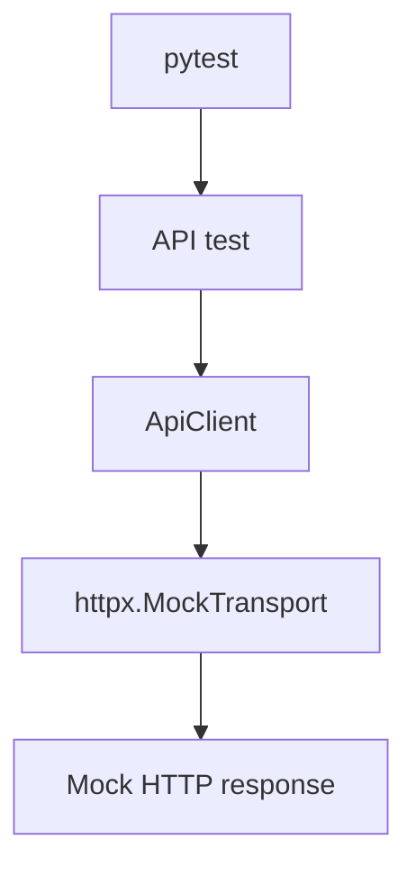
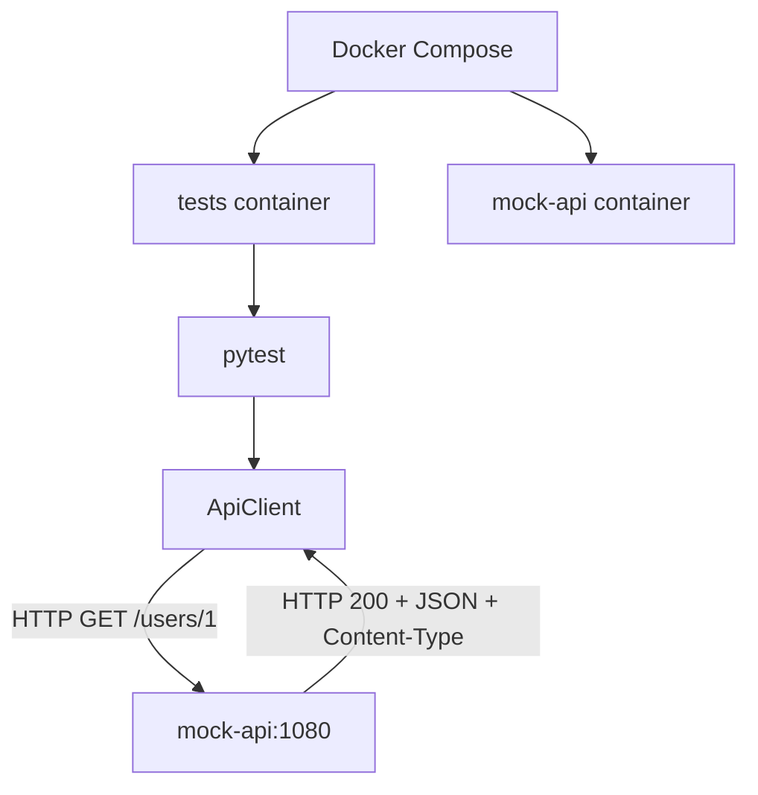

# hp-qa-junior-prep

[RU](README.md) · [EN](README.en.md) · **PL**

Repo szkoleniowe Junior QA Automation (Python): framework pytest `lab_fw`, API (httpx), UI (Playwright / Selenium), mocki, Allure, Docker, Docker Compose, GitHub Actions.

## Szybki start (lokalnie)

```bash
python -m venv .venv
source .venv/Scripts/activate   # Windows Git Bash
# .venv\Scripts\activate       # Windows cmd/PowerShell

pip install -e ".[dev]"
pytest -m "not ui and not selenium and not compose" -q -n auto
```

Testy UI (wymagana przeglądarka):

```bash
playwright install chromium
pytest -m ui -q
pytest -m selenium -q
```

## Struktura

| Ścieżka | Przeznaczenie |
|---------|---------------|
| `src/lab_fw/` | framework (api, ui, config, reporting, plugin pytest) |
| `tests/` | suite pytest |
| `Dockerfile` | multi-stage: `local` (CA Avast) / `ci` |
| `docker-compose.yml` | `mock-api` + `tests` |
| `.github/workflows/tests.yml` | unit/API na runnerze (bez UI/compose) |
| `.github/workflows/ci.yml` | Docker Compose na GitHub Actions |

## Zmienne środowiskowe

| Env | Przeznaczenie |
|-----|---------------|
| `LAB_FW_BASE_URL` | API base URL (domyślnie `https://example.com`) |
| `LAB_FW_UI_BASE_URL` | UI base URL (domyślnie the-internet.herokuapp.com) |
| `LAB_FW_API_TOKEN` | opcjonalny Bearer token |
| `LAB_FW_TIMEOUT_S` / `LAB_FW_UI_TIMEOUT_S` | timeouty |
| `LAB_FW_LOG_LEVEL` | poziom logów |

Sekret CI: GitHub → Settings → Secrets → `LAB_FW_API_TOKEN`.

## Markery pytest

| Marker | Znaczenie |
|--------|-----------|
| `smoke` / `api` / … | zwykłe szybkie testy |
| `ui` | prawdziwy Playwright |
| `selenium` | prawdziwy Selenium |
| `compose` | wymaga usługi `mock-api` z Compose |

## Docker

### Obrazy (`Dockerfile`)

- **`ci`** — na GitHub / Linux bez firmowego MITM
- **`local`** — kopiuje `avast-root.crt` (plik lokalny, nie w git)

`Dockerfile.local` i `avast-root.crt` są w `.gitignore`.

```bash
docker build --target ci -t hp-qa-junior-prep:ci .
docker run --rm -e LAB_FW_API_TOKEN=ci-demo-token hp-qa-junior-prep:ci

docker build --target local -t hp-qa-junior-prep:local .
docker run --rm -e LAB_FW_API_TOKEN=ci-demo-token hp-qa-junior-prep:local
```

CMD obrazu: `pytest -m "not ui and not selenium"` — **obejmuje** testy `compose`, gdy dostępny jest `mock-api`.

### Docker Compose

```bash
docker compose up --build --abort-on-container-exit

DOCKER_TARGET=local docker compose up --build --abort-on-container-exit
```

Usługi: `mock-api` (MockServer `:1080`) + `tests` (build + pytest).

`LAB_FW_BASE_URL` **nie** jest ustawiane globalnie w compose (starsze testy oczekują `example.com` / MockTransport). Testy compose wołają `http://mock-api:1080` wprost.

## GitHub Actions

| Workflow | Co robi |
|----------|---------|
| **tests** | `pip install` + `pytest -m "not ui and not selenium and not compose"` + artefakt Allure |
| **CI** | `docker compose` z `DOCKER_TARGET=ci` — także `@pytest.mark.compose` |

| Gdzie | mock-api? | Testy compose |
|-------|-----------|---------------|
| **CI** / lokalny compose | tak | uruchamiane |
| workflow **tests** | nie | wykluczone (`not compose`) |

## Schemat interakcji API (lab I1)

Projekt ma dwa tryby testów API: izolowany `httpx.MockTransport` oraz integracyjny z osobnym MockServer przez Docker Compose. Prawdziwe cloud/API w tych przebiegach **nie** jest wołane — mock imituje kontrakt HTTP (status, JSON, nagłówki).

### Tryb 1. Zwykłe testy



`httpx.MockTransport` działa w procesie Pythona: sprawdzamy klienta HTTP bez osobnego serwera i bez realnego wywołania sieciowego API.

Workflow **tests** wyklucza marker `compose` — wymagane serwisy nie są tam uruchamiane.

### Tryb 2. Docker Compose / CI



Testy działają w kontenerze `tests`, MockServer w `mock-api`. Komunikacja w sieci Compose: `http://mock-api:1080`.

Workflow **CI** uruchamia Compose z `DOCKER_TARGET=ci`, żeby testy integracyjne mogły trafić do MockServer.

### Po co oba poziomy

- **MockTransport** — szybko i izolowanie: odpowiedzi, błędy, kontrakt kodu klienta; łatwiej złapać błąd w logice `ApiClient`.
- **MockServer** — ruch HTTP między kontenerami i konfiguracja środowiska integracyjnego.

Oba podejścia ograniczają zależność od dostępności prawdziwego zewnętrznego API.

### Strategia mocków (lab I2)

| | `httpx.MockTransport` | MockServer |
|--|------------------------|------------|
| Gdzie działa | w procesie Pythona | osobna usługa (`mock-api`) |
| Sieć | niepotrzebna | prawdziwy HTTP w sieci Dockera |
| Cel | testy unit/API klienta | integracja kontenerów |
| Przykłady | `tests/mocks_lab/` | `tests/test_compose_api.py` |

Kontrakt Compose w `test_mock_api_users`:

1. fixture `reset_mockserver` — `PUT /mockserver/reset` przed i po teście (izolacja stanu);
2. `PUT /mockserver/expectation` → **201** (reguła przyjęta);
3. `ApiClient.get` → **200**, ciało JSON, `Content-Type` zawiera `application/json`;
4. `PUT /mockserver/verify` → **202** (żądanie faktycznie trafiło w expectation).

Marker `compose` sam nie uruchamia infrastruktury — patrz komenda:

- workflow **tests**: `pytest -m "not ui and not selenium and not compose"` (bez MockServer);
- **Dockerfile CMD**: `not ui and not selenium` (bez `not compose`) — w Compose jest `mock-api`, więc testy integracyjne lecą;
- celowane: `pytest -m compose` w serwisie `tests`.

`LAB_FW_BASE_URL` nie ustawiamy globalnie w Compose: testy compose podają `base_url="http://mock-api:1080"` wprost w `Settings`.

### Negatywne scenariusze integracyjne (lab I3)

W `tests/test_compose_api.py` (marker `compose`, ten sam `reset_mockserver`):

| Test | MockServer | Co sprawdzamy |
|------|------------|---------------|
| `test_mock_api_auth_fail` | `GET /protected` → **401** + JSON `error` | klient dostaje status/ciało/Content-Type bez prawdziwego IdP |
| `test_mock_api_timeout` | `GET /slow` z `delay` 1000 ms, `timeout_s=0.2` | `ApiError`; `__cause__` to `ReadTimeout` ⊂ `TimeoutException` ⊂ `HTTPError`; potem `/mockserver/verify` → **202** |

Polityka klienta: przy 4xx/5xx `get`/`post` **zwracają** `Response` (opcjonalnie `ensure_success` → `HttpStatusError`). Błędy transportu (timeout itd.) zawsze jako `ApiError`.

### Diagnostyka padających testów (lab I4)

| Objaw | Gdzie szukać | Co sprawdzić |
|---|---|---|
| Lokalny test nie przeszedł | Wynik `pytest` w terminalu | Nazwę testu, traceback, assertion i rzeczywisty wynik |
| Potrzebne są logi frameworka | Logi `lab_fw`; ustawienie `LAB_FW_LOG_LEVEL` | Poziom logowania i komunikaty klienta API |
| Potrzebne są szczegóły żądania i odpowiedzi HTTP | Raport Allure / załączniki | Załączniki `response` i `status_error`, jeśli zostały utworzone |
| Test Compose nie przeszedł | `docker compose logs tests` | Wynik pytest, traceback, konfigurację i zmienne środowiskowe kontenera |
| Wystąpił problem z MockServer | `docker compose logs mock-api` | Czy żądanie dotarło, czy zarejestrowano oczekiwanie i jaką odpowiedź zwrócono |
| Błąd w GitHub Actions | Actions → workflow → job → nieudany krok | Dla `tests` — krok pytest i artefakt `allure-results`; dla `CI` — krok `Run Docker Compose` |
| Nie zarejestrowano oczekiwania MockServer | Wynik rejestracji i logi `mock-api` | Status HTTP rejestracji (zwykle `201`) oraz treść odpowiedzi |
| Weryfikacja MockServer nie powiodła się | Wynik `/mockserver/verify` i logi `mock-api` | Status HTTP weryfikacji (oczekiwany `202`) oraz treść odpowiedzi |

**Typowe objawy**

- **HTTP 4xx/5xx:** `get()` / `post()` zwracają `Response`. Sprawdź status, treść odpowiedzi i autoryzację. `ensure_success()` zgłasza `HttpStatusError` dla nieprawidłowego statusu.
- **Timeout / `ApiError`:** sprawdź timeout, dostępność adresu i łańcuch wyjątków (`__cause__`). Klient opakowuje błędy transportowe w `ApiError`.
- **Nie zarejestrowano oczekiwania:** sprawdź odpowiedź rejestracji MockServer i jego logi.
- **`/mockserver/verify` nie zwrócił `202`:** sprawdź, czy rzeczywiste żądanie odpowiada zarejestrowanemu oczekiwaniu i czy zostało wysłane.

**Zmienne środowiskowe i markery**

- `LAB_FW_API_TOKEN` — sprawdź, czy token istnieje i jest poprawny.
- `http://mock-api:1080` — adres MockServer z kontenera `tests`; w Compose używaj nazwy usługi `mock-api`.
- `LAB_FW_BASE_URL` — nie ustawiaj globalnie dla Compose bez potrzeby; zwykłe testy korzystają z własnej konfiguracji.
- `@pytest.mark.compose` — marker testów integracyjnych wymagających MockServer.
- Na laptopie z Avast użyj `DOCKER_TARGET=local`, jeśli wymagany jest odpowiedni certyfikat.

**Szybki schemat:** test nie przeszedł → przeczytaj traceback → ustal, czy to odpowiedź HTTP, czy błąd transportowy → w Compose sprawdź `tests`, a następnie `mock-api` → w CI otwórz nieudany krok i pobierz dostępny artefakt.

## Systemy rozproszone: teoria i terminy (lab L1)

Słowniczek na poziomie mid. Gdzie pasuje — powiązanie z `lab_fw` (retry, timeout, `ApiError`, Compose/CI).

### 1. Async communication

Nadawca nie musi czekać na zakończenie całej operacji, zanim pójdzie dalej; wynik może wrócić później. Async **nie równa się** kolejce — kolejka to tylko jeden z mechanizmów.

**QA:** opóźnienia, brak natychmiastowej odpowiedzi, powtórne zdarzenia, błędy tła.

**Przykład:** API zwraca `202 Accepted` (zadanie przyjęte); zamówienie pojawia się później — sprawdzamy i `202`, i późniejszy stan.

### 2. Queue / event / message broker

| Termin | Znaczenie | QA |
|--------|-----------|-----|
| **Queue** | wiadomości czekają na przetwarzanie | brak utraty, poprawna obsługa, brak złych skutków przy retry |
| **Event** | fakt w systemie (np. `OrderCreated`) | pojawia się przy właściwych warunkach z poprawnymi danymi |
| **Message broker** | trasuje wiadomości między serwisami (RabbitMQ, Kafka) | dostawa, routing, błędy, redelivery |

### 3. Retry vs timeout

- **Retry** — czy próbujemy ponownie po przejściowym błędzie (limit prób; nie retryować bez sensu np. typowego `404`).
- **Timeout** — jak długo czekamy (connect / read / overall deadline).

Timeout może prowadzić do retry, ale to różne mechanizmy. Po timeoucie klienta **nie wiesz**, czy serwer dokończył pracę — ślepy retry bez idempotencji jest niebezpieczny.

W `lab_fw`: polityka retry; po wyczerpaniu prób — oczekiwany `ApiError`.

### 4. Timeout

Maks. czas oczekiwania na połączenie, dane lub całą operację (w tym pauzy między retry). Trzy próby po 5 s z pauzami ≠ „tylko 5 s łącznie”.

**QA:** zawieszone wywołania nie blokują w nieskończoność; błędy oczekiwania są przewidywalne (`ApiError` + `__cause__` jak `TimeoutException`).

### 5. Idempotency

Ponowienie operacji nie daje **dodatkowego efektu** względem jednokrotnego wykonania. Nie wymaga identycznego JSON w każdej odpowiedzi (metadane mogą się różnić).

**Idempotency-Key** pomaga serwerowi rozpoznać tę samą operację logiczną. GET/PUT/DELETE zwykle są idempotentne semantyką HTTP; POST zwykle nie (zależy od API).

**Przykład:** ponowne utworzenie płatności z tym samym kluczem nie tworzy drugiej płatności.

### 6. Eventual consistency

Komponenty mogą się chwilowo rozjechać; bez nowych zapisów zbiegają się. **QA:** nie oznaczać defektem każdej krótkiej zwłoki; łapać brak zbieżności w dopuszczalnym czasie. W testach — **polling z deadline**, nie ślepy `sleep`.

### 7. Logs vs metrics vs traces

| | Pytanie | Przykład |
|--|---------|----------|
| **Logs** | co się stało? | `ApiError: HTTP 500` + metoda/URL/czas |
| **Metrics** | jak często / jak dobrze? | error rate, latency p95, retry count |
| **Traces** | gdzie w łańcuchu serwisów? | gateway 20 ms → orders 50 ms → payments 2 s |

### 8. Correlation / Request / Trace ID

Identyfikatory łączące zapisy jednego żądania lub procesu biznesowego. Request ID często = jedno HTTP; Correlation ID obejmuje powiązane kroki; Trace ID — tracing rozproszony. Przy retry polityka może dać nowy Request ID, zachowując Correlation/Trace ID.

### 9. Env vs build („locally green ≠ CI”)

- **Env** — URL, tokeny, timeouty, tryb uruchomienia.
- **Build** — kod, zależności, obraz Dockera.

Sukces lokalnie nie dowodzi sukcesu w CI. Kontroluj: wersje Pythona/zależności, sekrety/env, zawartość obrazu, mocki/serwisy zewnętrzne, komendę pytest w workflow. W tym repo Compose spina usługi; CI sprawdza powtarzalność.

## Lab L2: kolejka, retry, timeout, deadline, idempotency

Ćwiczenie do [L1](#systemy-rozproszone-teoria-i-terminy-lab-l1): kolejka in-memory → worker → HTTP przez `ApiClient` z `lab_fw`, z polityką retry i limitami czasu.

**Kod:** `src/distributed_lab/queue_worker.py`  
**Testy:** `tests/distributed_lab/` (marker `@pytest.mark.distributed_lab`)

### Komponenty

| Komponent | Rola |
|-----------|------|
| `Job` | Zadanie: `method`, `path`, opcjonalnie `timeout`, `deadline_s`, `payload`, `headers`, `idempotency_key` |
| `parse_job` | Walidacja dict → `Job`; błędy schematu → `SchemaError` |
| `InMemoryQueue` | FIFO na `deque`; `put` przyjmuje tylko `Job` |
| `Worker` | `run_once()` — jedno zadanie; `execute()` — jedno wywołanie HTTP |

Worker buduje kwargs klienta: `json` z `payload`, kopia `headers`, a gdy jest `idempotency_key` — nagłówek `Idempotency-Key` (bez mutacji modelu job).

### Retry i metoda HTTP

W `run_once` jest `retry_call` (do 3 prób) i `lab_fw.api.retry_policy.should_retry`:

- **GET:** retry przy `429` / `503` i błędach transportowych (`ConnectError`, `ReadTimeout`, …);
- **POST:** **brak** retry (nawet przy `429`/`503` lub timeout) — mniejsze ryzyko podwójnego efektu bez idempotencji po stronie serwera.

Po wyczerpaniu prób lub przy statusie bez retry — `ApiError` / `HttpStatusError` (przez `ensure_success`).

### Timeout vs deadline

| Mechanizm | Gdzie | Znaczenie |
|-----------|--------|-----------|
| **Timeout** | `Settings.timeout_s`, `Job.timeout` | Ile czekać na jedno wywołanie HTTP (connect/read) |
| **Job deadline** | `Job.deadline_s` | Budżet czasu na job (w tym retry); koniec → `JobDeadlineExceeded` |
| **Worker deadline** | `Worker(..., deadline_w=...)` | Budżet sesji workera; koniec → `WorkerDeadlineExceeded` |

Timeout żądania to **minimum** z job timeout, pozostałego job deadline i pozostałego worker deadline. Po `ApiError` worker ponownie sprawdza deadline — końcowy błąd może być deadline, a nie ostatni błąd HTTP.

### Idempotency (serwer HTTP do nauki)

W `tests/distributed_lab/test_timeout.py` — `WorkerTestHandler`: powtórny POST z tym samym `Idempotency-Key` **nie dodaje** drugiego wpisu do `received_requests`, ale zwraca dane pierwszego żądania. Testy obejmują:

- JSON i nagłówki (w tym `X-Request-ID`) na prawdziwym HTTP;
- brak `Idempotency-Key`, gdy pole nie jest ustawione;
- POST przy timeout — jedna próba, klucz na wire;
- dwa joby, ten sam klucz — `server.calls == 2`, `len(received_requests) == 1`;
- GET retry (503→200) — ten sam `Idempotency-Key` przy każdej próbie.

### Uruchomienie

```bash
# wszystkie testy lab L2
pytest -m distributed_lab -q

# tylko kolejka/worker (bez wolnego serwera HTTP)
pytest tests/distributed_lab/test_queue_worker.py -q

# timeout, deadline, idempotency na lokalnym serwerze HTTP
pytest tests/distributed_lab/test_timeout.py -q
```

Docker / MockServer do L2 **nie są potrzebne** — wystarczy venv i `pip install -e .`.

### Gdy test pada

1. Traceback: `JobDeadlineExceeded` / `WorkerDeadlineExceeded` vs `ApiError` i `__cause__` (`ReadTimeout`, `ConnectError`, …).
2. Liczniki prób w MockTransport lub `server.request_counts` / `received_requests` w testach slow-server.
3. Metoda job: POST nie powinien dawać trzech prób przy domyślnej polityce retry.

## Lab L3: checklista badania awarii

Systematyczna diagnostyka w pięciu obszarach: **Env → Build → Logs → Metrics → Trace**. Praktyka: zachowanie **retry**, logi przez `caplog` oraz ręczne **liczniki badania** (*investigation counters*).

**Testy:** `tests/distributed_lab/test_l3_investigation.py` (marker `@pytest.mark.distributed_lab`)

**Powiązane laby:** [I4 — gdzie szukać przy padnięciu pytest](#diagnostyka-padających-testów-lab-i4) (mapa miejsc); [L2](#lab-l2-kolejka-retry-timeout-deadline-idempotency) (kolejka, worker, retry, deadline); L3 to **trasa badania** plus praktyka retry/logów.

### 1. Env — zmienne środowiskowe

Sprawdzenie lokalne (przykład):

```bash
python -c "import os; print('LAB_FW_API_TOKEN:', 'SET' if os.getenv('LAB_FW_API_TOKEN') else 'MISSING'); print('LAB_FW_BASE_URL:', os.getenv('LAB_FW_BASE_URL', '<unset>')); print('LAB_FW_LOG_LEVEL:', os.getenv('LAB_FW_LOG_LEVEL', '<unset>'))"
```

Gdy zmienne nie są ustawione, `get_settings()` stosuje domyślne: `base_url=https://example.com`, `timeout_s=5.0`, `log_level=INFO`, `api_token=None`.

**Lokalnie vs CI:** workflow **tests** w GitHub Actions ustawia `LAB_FW_API_TOKEN` ze Secrets i weryfikuje, że nie jest pusty. Brak tokenu lokalnie przy L3 jest OK z MockTransport; w CI env jest inny — typowy przypadek **local ≠ CI**.

### 2. Build — stan projektu

| Sprawdzenie | Po co |
|-------------|--------|
| `git rev-parse --short HEAD` | ten sam commit co w CI |
| `python -m pip show lab-fw` | wersja pakietu, editable install |
| `git status` | niezacommitowane zmiany vs czysty build |

### 3. Logs — lab retry

`httpx.MockTransport` + `Worker` + `ApiClient`. Dwa scenariusze:

| Scenariusz | Zachowanie | Asercje |
|------------|------------|---------|
| Udane retry | 503, 503, 200 | 3 próby; 2× `WARNING` z `lab_fw.core.retry`; odpowiedź `{"ok": true}` |
| Wyczerpanie (`exhausted`) | 503 × 3 | 3 próby; 2× `WARNING`; `HttpStatusError`; status/method/path |

Logi: `INFO` — `lab_fw.api`; `WARNING` — `lab_fw.core.retry` przed kolejną próbą. Trzecia porażka nie musi dawać trzeciego WARNING.

### 4. Metrics — liczniki badania

W repozytorium nie ma wbudowanego Prometheusa/metryk. Dla scenariusza „same 503” zapisuj **ręczne liczniki z testu**:

- `http_requests = 3`
- `503_count = 3`
- `retries_after_first = 2`

To nie są metryki produkcyjne (brak error rate / p95 w runtime). Szukanie w kodzie: `grep -RniE "prometheus|metrics|histogram|counter|p95" src tests pyproject.toml`.

### 5. Trace — korelacja

Szukanie ID: `grep -RniE "X-Request-ID|Correlation-ID|request_id" src tests`. Testy L2 sprawdzają `X-Request-ID: req-123`. To **identyfikator na wire**, nie pełny tracing rozproszony (brak auto Trace ID / spanów między serwisami).

### I4 vs L3 vs L2 (kotwica ustna)

| Etap | Pytanie |
|------|---------|
| **I4** | Gdzie szukać? (pytest, Compose, mock-api, CI) |
| **L3** | W jakiej kolejności? (Env → Build → Logs → Metrics → Trace) |
| **L2** | Kolejka, worker, deadline, idempotency (osobny lab) |
| **Retry-lab w L3** | Praktyka: retry + `caplog` + liczniki badania |

*I4 — mapa miejsc; L3 — trasa badania; testy L2/L3 — retry i logi w praktyce.*

### Uruchomienie

```bash
pytest tests/distributed_lab/test_l3_investigation.py -v
```

### Ograniczenia L3

`MockTransport` — bez prawdziwej sieci i bez Docker/MockServer. Automatyczne metryki i platforma tracing end-to-end nie wchodzą w zakres L3.

## Lab M1 — Równoległe uruchamianie i izolacja zasobów

### Cel

Zrozumieć wpływ równoległego uruchamiania pytest przez `pytest-xdist` na współdzielone zasoby i nauczyć się zapobiegać konfliktom między testami.

### Strategie izolacji

| Współdzielony zasób | Strategia | Konfiguracja |
|---|---|---|
| MockServer w Docker Compose | Grupowanie konfliktujących testów na jednym workerze | Marker `@pytest.mark.xdist_group(name="mockserver")` w `tests/conftest.py` dla testów `@pytest.mark.compose`; uruchomienie z `--dist loadgroup` |
| Jeden lokalny browser bez Grid | Sekwencyjne wykonanie konfliktujących testów | Wspólna grupa + `--dist loadgroup` |
| Wspólny plik raportu | Osobny plik na worker | `worker_id` w nazwie pliku lub `tmp_path` |
| Zasób tworzony na test | Utworzenie i cleanup na test | Fixture pytest z poprawnym teardown |

Zwykły `threading.Lock` nie synchronizuje wspólnego pliku między procesami: workery xdist to osobne procesy. Gdy wspólny plik jest konieczny, potrzebna jest blokada międzyprocesowa. Dla artefaktów testowych prostsze są osobne pliki.

### Compose i MockServer

Testy Compose używają jednej instancji MockServer. Gdy kilka testów jednocześnie zmienia oczekiwania lub resetuje stan, mogą na siebie wpływać.

W `tests/conftest.py` hook `pytest_collection_modifyitems` przypisuje testom z markerem `compose` marker `@pytest.mark.xdist_group(name="mockserver")`.

#### Dlaczego ważne jest `tryfirst=True`

Przy `--dist loadgroup` xdist grupuje testy według markera `xdist_group`.

Podczas kolekcji hook `pytest_collection_modifyitems` w `tests/conftest.py` dodaje `xdist_group(name="mockserver")` testom oznaczonym `compose`. Aby grupowanie działało, marker musi być ustawiony zanim logika xdist zbuduje plan dla schedulera.

Po stronie workera xdist używa `xdist_group` do sufiksu w `nodeid`, np. `@mockserver`. Gdy marker pojawi się za późno, controller może dostać identyfikatory bez tego sufiksu. Wtedy `LoadGroupScheduling` nie połączy konfliktujących testów w jedną grupę i mogą iść równolegle na różnych workerach.

W projekcie używane jest `@pytest.hookimpl(tryfirst=True)` — patrz `tests/conftest.py`. Podnosi priorytet hooka, aby marker grupy był ustawiony przed przetwarzaniem grupowania przez xdist.

Sam `tryfirst=True` nie blokuje dostępu do zasobu: izolację daje poprawne grupowanie i konfiguracja uruchomienia.

#### `loadgroup` a `loadscope`

- `--dist load` — rozdziela pojedyncze testy między workery; dla testów niezależnych.
- `--dist loadscope` — trzyma testy jednego modułu lub klasy na jednym workerze. Gdy wszystkie konfliktujące testy Compose są w jednym module, to może wystarczyć.
- `--dist loadgroup` — łączy testy z tym samym `xdist_group`, także z różnych modułów. Elastyczniejsze dla wspólnej grupy zasobów.

W `Dockerfile` projektu jest już `-n auto` i `--dist loadgroup`.

#### Rola `reset_mockserver`

Fixture `reset_mockserver` w `tests/test_compose_api.py` resetuje MockServer przed i po każdym teście.

To utrzymuje czysty stan między testami wykonywanymi sekwencyjnie. Nie zastępuje grupowania: przy równoległej pracy dwóch testów na jednym MockServer reset jednego może zepsuć drugi.

### Weryfikacja

#### 1. Uruchomienie Compose

```bash
docker compose up --build --abort-on-container-exit
```

Uruchamia serwisy Compose i kontener testów zgodnie z konfiguracją projektu.

#### 2. Sprawdzenie grupowania testów Compose

W kontenerze `tests`:

```bash
docker compose run --rm tests pytest tests/test_compose_api.py -vv -n auto --dist loadgroup
```

Uruchamia testy z `tests/test_compose_api.py` z verbose i scheduleringiem `loadgroup`.

Szukaj trzech sygnałów:

- Na początku sesji: `scheduling tests via LoadGroupScheduling`.
- W liniach testów: sufiks grupy, np. `tests/test_compose_api.py::test_mock_api_users@mockserver`.
- Wszystkie cztery testy Compose na tym samym workerze, np. `[gw0]`. Numer może być inny; ważne, że cała grupa na jednym workerze.

Przy uruchomieniu przez Compose serwis `mock-api` musi być dostępny z kontenera testów pod `http://mock-api:1080`.

#### 3. Podział uruchomień w CI

Testy zwykłe i Compose są rozdzielone:

- `.github/workflows/tests.yml` — `-n auto`, bez markerów `ui`, `selenium`, `compose`.
- `.github/workflows/ci.yml` — `docker compose up --build --abort-on-container-exit`.
- `Dockerfile` — `-n auto --dist loadgroup` dla pytest w kontenerze.

CI oddziela główny suite od testów wymagających współdzielonego MockServer.

### Powiązane laby

- **C6** — izolacja testów i współdzielone zasoby.
- **G3** — równoległość w CI: `pytest-xdist`, Docker, ustawienia uruchomienia.
- **I4** — gdzie szukać konfiguracji i wyników: pytest, Compose, MockServer, CI.
- **L2** — kolejka, worker, timeout, retry, idempotency.
- **L3** — badanie awarii po logach i innych sygnałach.

**Idea M1:** równoległość przyspiesza niezależne testy, ale współdzielone zasoby wymagają jawnej strategii izolacji. Grupowanie, osobne zasoby na worker i cleanup rozwiązują różne problemy i się nie zastępują.

## Allure

```bash
pytest -q --alluredir=allure-results
allure serve allure-results
```

Upload artefaktu używa `if: always()`.

## Dokumentacja modułów

- [API](src/lab_fw/api/README.pl.md)
- [UI](src/lab_fw/ui/README.pl.md)
- [Reporting / Allure](src/lab_fw/reporting/README.pl.md)
- [Pytest plugin](src/lab_fw/pytest_plugin/README.pl.md)
- [Pytest notes](tests/README_PYTEST.pl.md)
- [Mocks lab](tests/mocks_lab/README.pl.md)

## Plan nauki

Zob. [PLAN_MID_HP.md](PLAN_MID_HP.md).
