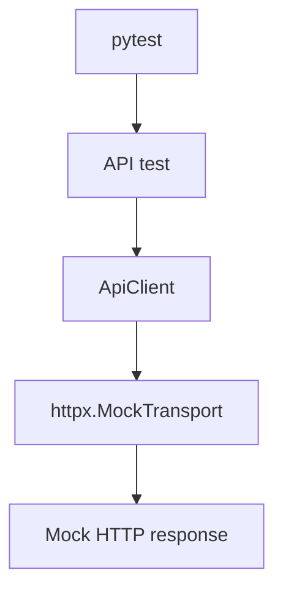
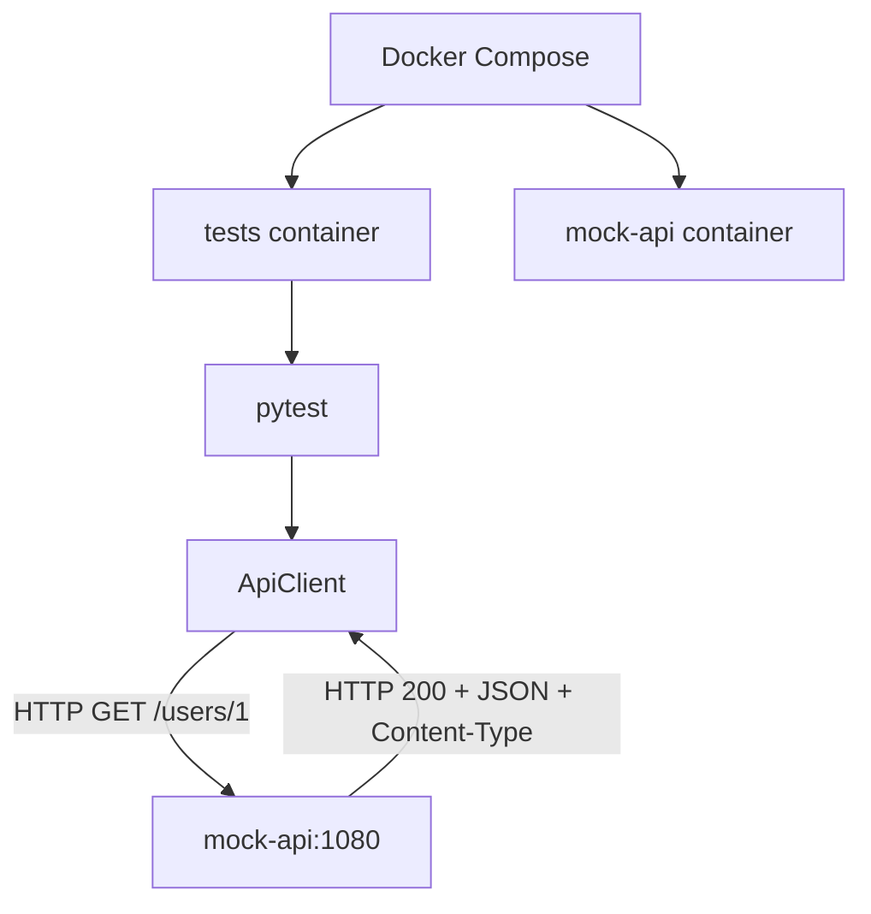

# hp-qa-junior-prep

[RU](README.md) · [EN](README.en.md) · **PL**

Repo szkoleniowe Junior QA Automation (Python): framework pytest `lab_fw`, API (httpx), UI (Playwright / Selenium), mocki, Allure, Docker, Docker Compose, GitHub Actions.

## Szybki start (lokalnie)

```bash
python -m venv .venv
source .venv/Scripts/activate   # Windows Git Bash
# .venv\Scripts\activate       # Windows cmd/PowerShell

pip install -e ".[dev]"
pytest -m "not ui and not selenium and not compose" -q -n auto
```

Testy UI (wymagana przeglądarka):

```bash
playwright install chromium
pytest -m ui -q
pytest -m selenium -q
```

## Struktura

| Ścieżka | Przeznaczenie |
|---------|---------------|
| `src/lab_fw/` | framework (api, ui, config, reporting, plugin pytest) |
| `tests/` | suite pytest |
| `Dockerfile` | multi-stage: `local` (CA Avast) / `ci` |
| `docker-compose.yml` | `mock-api` + `tests` |
| `.github/workflows/tests.yml` | unit/API na runnerze (bez UI/compose) |
| `.github/workflows/ci.yml` | Docker Compose na GitHub Actions |

## Zmienne środowiskowe

| Env | Przeznaczenie |
|-----|---------------|
| `LAB_FW_BASE_URL` | API base URL (domyślnie `https://example.com`) |
| `LAB_FW_UI_BASE_URL` | UI base URL (domyślnie the-internet.herokuapp.com) |
| `LAB_FW_API_TOKEN` | opcjonalny Bearer token |
| `LAB_FW_TIMEOUT_S` / `LAB_FW_UI_TIMEOUT_S` | timeouty |
| `LAB_FW_LOG_LEVEL` | poziom logów |

Sekret CI: GitHub → Settings → Secrets → `LAB_FW_API_TOKEN`.

## Markery pytest

| Marker | Znaczenie |
|--------|-----------|
| `smoke` / `api` / … | zwykłe szybkie testy |
| `ui` | prawdziwy Playwright |
| `selenium` | prawdziwy Selenium |
| `compose` | wymaga usługi `mock-api` z Compose |

## Docker

### Obrazy (`Dockerfile`)

- **`ci`** — na GitHub / Linux bez firmowego MITM
- **`local`** — kopiuje `avast-root.crt` (plik lokalny, nie w git)

`Dockerfile.local` i `avast-root.crt` są w `.gitignore`.

```bash
docker build --target ci -t hp-qa-junior-prep:ci .
docker run --rm -e LAB_FW_API_TOKEN=ci-demo-token hp-qa-junior-prep:ci

docker build --target local -t hp-qa-junior-prep:local .
docker run --rm -e LAB_FW_API_TOKEN=ci-demo-token hp-qa-junior-prep:local
```

CMD obrazu: `pytest -m "not ui and not selenium"` — **obejmuje** testy `compose`, gdy dostępny jest `mock-api`.

### Docker Compose

```bash
docker compose up --build --abort-on-container-exit

DOCKER_TARGET=local docker compose up --build --abort-on-container-exit
```

Usługi: `mock-api` (MockServer `:1080`) + `tests` (build + pytest).

`LAB_FW_BASE_URL` **nie** jest ustawiane globalnie w compose (starsze testy oczekują `example.com` / MockTransport). Testy compose wołają `http://mock-api:1080` wprost.

## GitHub Actions

| Workflow | Co robi |
|----------|---------|
| **tests** | `pip install` + `pytest -m "not ui and not selenium and not compose"` + artefakt Allure |
| **CI** | `docker compose` z `DOCKER_TARGET=ci` — także `@pytest.mark.compose` |

| Gdzie | mock-api? | Testy compose |
|-------|-----------|---------------|
| **CI** / lokalny compose | tak | uruchamiane |
| workflow **tests** | nie | wykluczone (`not compose`) |

## Schemat interakcji API (lab I1)

Projekt ma dwa tryby testów API: izolowany `httpx.MockTransport` oraz integracyjny z osobnym MockServer przez Docker Compose. Prawdziwe cloud/API w tych przebiegach **nie** jest wołane — mock imituje kontrakt HTTP (status, JSON, nagłówki).

### Tryb 1. Zwykłe testy



`httpx.MockTransport` działa w procesie Pythona: sprawdzamy klienta HTTP bez osobnego serwera i bez realnego wywołania sieciowego API.

Workflow **tests** wyklucza marker `compose` — wymagane serwisy nie są tam uruchamiane.

### Tryb 2. Docker Compose / CI



Testy działają w kontenerze `tests`, MockServer w `mock-api`. Komunikacja w sieci Compose: `http://mock-api:1080`.

Workflow **CI** uruchamia Compose z `DOCKER_TARGET=ci`, żeby testy integracyjne mogły trafić do MockServer.

### Po co oba poziomy

- **MockTransport** — szybko i izolowanie: odpowiedzi, błędy, kontrakt kodu klienta; łatwiej złapać błąd w logice `ApiClient`.
- **MockServer** — ruch HTTP między kontenerami i konfiguracja środowiska integracyjnego.

Oba podejścia ograniczają zależność od dostępności prawdziwego zewnętrznego API.

### Strategia mocków (lab I2)

| | `httpx.MockTransport` | MockServer |
|--|------------------------|------------|
| Gdzie działa | w procesie Pythona | osobna usługa (`mock-api`) |
| Sieć | niepotrzebna | prawdziwy HTTP w sieci Dockera |
| Cel | testy unit/API klienta | integracja kontenerów |
| Przykłady | `tests/mocks_lab/` | `tests/test_compose_api.py` |

Kontrakt Compose w `test_mock_api_users`:

1. fixture `reset_mockserver` — `PUT /mockserver/reset` przed i po teście (izolacja stanu);
2. `PUT /mockserver/expectation` → **201** (reguła przyjęta);
3. `ApiClient.get` → **200**, ciało JSON, `Content-Type` zawiera `application/json`;
4. `PUT /mockserver/verify` → **202** (żądanie faktycznie trafiło w expectation).

Marker `compose` sam nie uruchamia infrastruktury — patrz komenda:

- workflow **tests**: `pytest -m "not ui and not selenium and not compose"` (bez MockServer);
- **Dockerfile CMD**: `not ui and not selenium` (bez `not compose`) — w Compose jest `mock-api`, więc testy integracyjne lecą;
- celowane: `pytest -m compose` w serwisie `tests`.

`LAB_FW_BASE_URL` nie ustawiamy globalnie w Compose: testy compose podają `base_url="http://mock-api:1080"` wprost w `Settings`.

### Negatywne scenariusze integracyjne (lab I3)

W `tests/test_compose_api.py` (marker `compose`, ten sam `reset_mockserver`):

| Test | MockServer | Co sprawdzamy |
|------|------------|---------------|
| `test_mock_api_auth_fail` | `GET /protected` → **401** + JSON `error` | klient dostaje status/ciało/Content-Type bez prawdziwego IdP |
| `test_mock_api_timeout` | `GET /slow` z `delay` 1000 ms, `timeout_s=0.2` | `ApiClient` rzuca `ApiError`, `__cause__` to `httpx.TimeoutException` |

Polityka klienta: przy 4xx/5xx `get`/`post` **zwracają** `Response` (opcjonalnie `ensure_success` → `HttpStatusError`). Błędy transportu (timeout itd.) zawsze jako `ApiError`.

## Allure

```bash
pytest -q --alluredir=allure-results
allure serve allure-results
```

Upload artefaktu używa `if: always()`.

## Dokumentacja modułów

- [API](src/lab_fw/api/README.pl.md)
- [UI](src/lab_fw/ui/README.pl.md)
- [Reporting / Allure](src/lab_fw/reporting/README.pl.md)
- [Pytest plugin](src/lab_fw/pytest_plugin/README.pl.md)
- [Pytest notes](tests/README_PYTEST.pl.md)
- [Mocks lab](tests/mocks_lab/README.pl.md)

## Plan nauki

Zob. [PLAN_MID_HP.md](PLAN_MID_HP.md).
